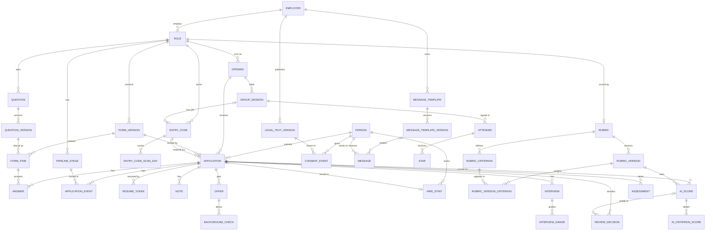

# Kahuna ATS: Data model

Companion to [PLAN.md](PLAN.md). Postgres, managed with Drizzle and drizzle-kit migrations. Written Tue Oct 13, 2026 and revised the same day after review.

## Principles

- **UUID keys.** Every table's primary key is `id uuid`, a UUIDv7 generated by the app (time-ordered, so indexes stay compact). Ids appear in staff URLs; they are never used as an applicant secret.
- **UTC storage, Central reporting.** Every timestamp is `timestamptz` stored in UTC. Reports bucket by day and count days in `America/Chicago`. Things that are calendar dates (start date, offer date) are `date`. Every conversion goes through one app helper, or `(ts at time zone 'America/Chicago')` in SQL, and the service and database run with `TZ=UTC` so nothing depends on host settings. Daylight saving time ends Sun Nov 1, 2026, two days after launch; tests cover 1am to 3am Central that day, a reminder falling due at 8:30pm Oct 31, backdated times entered across the change, the scan-count day and the business-day count.
- **Append-only logs.** `application_event`, `application_submission`, `note_revision`, `consent_event`, `review_decision` and `audit_log` are never updated or deleted by the app. One generic trigger function rejects UPDATE and DELETE on all of them. Corrections are new rows. The one exception is the Phase 3 retention job, which runs as its own database role that the triggers exempt; it nulls PII columns, stamps `redacted_at` and deletes rows past their retention period.
- **Soft delete.** Mutable business rows carry `deleted_at`. Configuration rows carry `archived_at`. Applicant data is only ever removed by the retention job.
- **Published config is immutable.** Question versions, form versions and their items, legal text versions, message template versions and rubric versions can't change once published (trigger). An edit creates a new version.
- **Report keys never change once used.** A stage's `key`, `role_id` and `milestone` are locked once any event references the stage, a picklist option's `list_key`, scope, `key` and `fcra_adverse` once any row references the option, and a question's `key` and `role_id` always (triggers). A remap means archiving and adding a replacement, so past reports never shift. Names and labels stay editable, with edits audited.
- **PII classes.** Every text and jsonb column is tagged in the Drizzle schema, through one helper, with a class: `contact` (names, phone, email, IP, user agent), `free_text` (anything a person typed) or `none`. That registry drives the Viewer projections, the retention strip list, the CSV `includes_contact` flag and Sentry scrubbing, and a CI test fails when a text or jsonb column has no class. Contact details live on `person`. Copies legitimately live in the message and consent logs (kept 4 years as proof of consent), in `suppression` and `landing_conflict`, and from P2 in `attendee`. Retention nulls `contact` and `free_text` columns and stamps `redacted_at`; choice answers, numbers, events, scores and outcomes stay, so multi-season analysis survives. Columns marked "Contact" or "PII text" below are the classed ones.
- **Language-keyed text.** Applicant-facing text is `ltext`: a `jsonb` column shaped like `{"en": "..."}` that must contain `en`. Adding Spanish later is content work, not a migration. Staff-facing labels are plain `text`.
- **Additive phases.** Phase tags: **P1** (in the Oct 30 migration), **P2**, **P3**. After Oct 30 a migration may add tables, nullable columns, enum values, indexes and constraints that existing rows already satisfy. It may never rename, drop or retype a column, or require backfilling P1 data. Each table ships with its first writer, with one named exception: `group_session` is in the P1 migration because `entry_code` and `application` reference it, even though its first writer may be Phase 2. Facts that can't be reconstructed later are captured from Oct 30, which is why some P1 tables have no screen until November or Phase 3.
- **Database roles.** The app connects as `ats_app`, a login without superuser rights that holds data grants only. Railway's default `postgres` user is a superuser, which could switch off the triggers above or run shell commands through `COPY ... PROGRAM`, so it is used only by the migration step. Default privileges grant each new table to `ats_app`, and a CI check fails if the app's role is a superuser. The retention role arrives with the P3 purge.
- **Deletes never cascade.** Every foreign key is `ON DELETE RESTRICT`, and a schema test fails on any `CASCADE`. The one exception is `suppression.message_id` (`ON DELETE SET NULL`), because a suppression outlives the message that caused it and is never purged. The P3 purge deletes child rows before their parents.

### Conventions used in the tables

- **Standard columns** are listed by name only: `id uuid not null` (PK), `created_at timestamptz not null default now()`, `updated_at timestamptz not null` (mutable tables), `deleted_at` / `archived_at` / `redacted_at timestamptz null` where listed.
- **Column checks, not domains:** `ltext` (jsonb that must contain `en`) and `phone_us` (text, check `~ '^\+1[2-9][0-9]{2}[2-9][0-9]{6}$'`, so only valid US E.164 numbers can be stored) are column CHECK constraints declared with Drizzle's `check()`, so drizzle-kit tracks them. Triggers are hand-written SQL in custom drizzle-kit migrations.
- **Composite FKs** like `(opening_id, role_id) -> opening(id, role_id)` enforce that denormalized columns agree. The target table carries a matching `unique (id, role_id)`.
- **"Null" column:** `no` means NOT NULL.
- **Enums** are Postgres enum types, listed in [Enumerations](#enumerations). Adding a value later is additive; renaming or removing one is not allowed.

## Entity diagram

Core entities and relationships. Logs and settings (`audit_log`, `application_submission`, `note_revision`, `suppression`, `rate_limit_bucket`, `landing_conflict`, `picklist_option`, `app_user`, and the P2 and P3 support tables) are omitted for readability.

## Tables

### Configuration

#### employer (P1)

The legal employer and the brand applicants see. Carries sender identity. Seeded with Kahuna only; Midwest Access becomes a second row later.

| Column | Type | Null | Notes |
|---|---|---|---|
| key | text | no | Stable slug, e.g. `kahuna` |
| legal_name | text | no | Exactly as on the IRS EIN letter (the carrier registration must match) |
| display_name | text | no | Shown on pages and in message signatures |
| website_url | text | yes | |
| hiring_host | text | yes | e.g. `jobs.<domain>`; null until DNS exists |
| logo_url | text | yes | |
| email_from_name | text | no | e.g. "Kahuna Window Cleaning Hiring" |
| email_from_address | text | yes | On the sending subdomain |
| reply_to_address | text | yes | The hiring@ Google Group |
| sms_quo_phone_number_id | text | yes | Quo phone number id (`PN...`) of the hiring number, used as `from` on every text |
| sms_enabled | boolean | no | Default false. The launch switch |
| sms_from_e164 | phone_us | yes | Display only |
| help_contact | text | yes | Phone and email used on pages, in templates and in the HELP reply |
| timezone | text | no | Default `America/Chicago` |

Standard: id, created_at, updated_at, archived_at. Unique: `key`.

#### role (P1)

Permanent job definition: pipeline, questions, rubric.

| Column | Type | Null | Notes |
|---|---|---|---|
| employer_id | uuid | no | FK employer |
| key | text | no | e.g. `snow_removal_tech` |
| internal_name | text | no | Staff-facing |
| title | ltext | no | Applicant-facing |
| summary | ltext | yes | Landing page copy |
| uses_group_interview | boolean | no | Informational; snow false |
| sort_order | integer | no | |

Standard: id, created_at, updated_at, archived_at. Unique: `(employer_id, key)`. New applications pin the role's one published `form_version` (no pointer column, so role and form don't reference each other). Roles are created through the seed file until the P2 settings screen.

#### opening (P1)

One role in one season. The cohort for funnels and retention, and the parent of applications, codes, sessions and hires.

| Column | Type | Null | Notes |
|---|---|---|---|
| role_id | uuid | no | FK role |
| key | text | no | e.g. `snow-2026-27` |
| name | text | no | "Snow Removal 2026-27" |
| status | opening_status | no | draft, open, closed |
| opens_on / closes_on | date | yes | |
| season_start_on / season_end_on | date | yes | Required before retention is reported for this opening (service) |
| target_headcount | integer | yes | |
| pay_text | ltext | yes | Pay rate or range shown on the landing page |
| benefits_text | ltext | yes | |

Standard: id, created_at, updated_at. Unique: `(role_id, key)`, `(id, role_id)`. Partial unique: `(role_id) where status = 'open'` (one open opening per role, so a role QR always resolves). Openings are created and edited through the seed file until the P2 settings screen.

#### pipeline_stage (P1)

Configurable stages per role, each mapped to a fixed milestone.

| Column | Type | Null | Notes |
|---|---|---|---|
| role_id | uuid | no | FK role |
| key | text | no | Stable slug |
| name | text | no | Staff-facing; renaming is safe |
| milestone | milestone | yes | Null for custom stages like "Phone screen" |
| sort_order | integer | no | |
| is_system | boolean | no | Started and Submitted: the app moves applications into them; can't be archived |
| show_on_board | boolean | no | Started is false (shown as a drop-off count) |

Standard: id, created_at, updated_at, archived_at. Unique: `(role_id, key)`, `(id, role_id)`. Index: `(role_id, sort_order)`. Stages are archived, never deleted. Trigger: `key`, `role_id` and `milestone` can't change once any `application_event` references the stage (as `to_stage_id` or `from_stage_id`); to remap, archive the stage and add a replacement, so past funnels and stage times never change. Milestones must not decrease as sort order increases (seed loader validation now, the P2 stage editor later). Several stages may share a milestone.

#### question (P1)

Question lineage: the stable identity of a question across rewordings. Reports group answers by lineage.

| Column | Type | Null | Notes |
|---|---|---|---|
| role_id | uuid | no | FK role |
| key | text | no | e.g. `job1_months` |
| ai_never_send | boolean | no | Default false. Never sent to the AI scorer, whatever a rubric asks for (P2). Admin-editable, audited. Seeded true for questions that invite protected-trait disclosures |

Standard: id, created_at, updated_at, archived_at. Unique: `(role_id, key)`. Trigger: `key` and `role_id` never change. Which answers the scorer reads is chosen by the rubric's criteria (P2), so a new rubric version can re-score older applications; this flag is the deny list on top.

#### question_version (P1)

Exact wording, type and options of one version of a question.

| Column | Type | Null | Notes |
|---|---|---|---|
| question_id | uuid | no | FK question |
| version | integer | no | 1, 2, 3 |
| type | question_type | no | |
| prompt | ltext | no | |
| help | ltext | yes | |
| options | jsonb | yes | `[{"key": "...", "label": {"en": "..."}}]`. Keys are stable and never reused for a different meaning in a lineage |
| validation | jsonb | yes | e.g. `{"min": 0, "max": 600, "integer": true}`, `{"maxLength": 2000}` |
| meaning_changed | boolean | no | True when this version asks something materially different from the previous one; reports stop pooling across it |
| change_note | text | yes | |
| published_at | timestamptz | yes | Set by the form publish trigger when first included in a published form |
| created_by | uuid | yes | FK app_user (null for seed) |

Standard: id, created_at. Unique: `(question_id, version)`, `(id, question_id)`. Check: options present if and only if type is single_choice or multi_choice. Trigger: no UPDATE or DELETE once `published_at` is set.

#### form_version (P1)

An immutable snapshot of a role's application form.

| Column | Type | Null | Notes |
|---|---|---|---|
| role_id | uuid | no | FK role |
| version | integer | no | |
| status | config_status | no | draft, published, retired |
| sections | jsonb | no | `[{"key": "basics", "title": {"en": "..."}, "intro": {"en": "..."}}]` |
| change_reason | text | yes | Required to publish: a written, job-related reason |
| published_at | timestamptz | yes | |
| published_by | uuid | yes | FK app_user |
| created_by | uuid | yes | FK app_user |

Standard: id, created_at. Unique: `(role_id, version)`, `(id, role_id)`. Partial unique: `(role_id) where status = 'published'`, the one live form per role that new applications pin; publishing v2 retires v1 in the same transaction. Publish trigger: sets `published_at` on every question version in its items that lacks one, and rejects the publish if any item's question belongs to another role. Trigger: once published, only `status` may change (published to retired).

**Seed loader.** Until the question editor ships, question changes go through a reviewed seed file. The loader is a manual command, never run on deploy, and insert-only: it keys each question version and form version by a content hash, so unchanged content is a no-op; changed content inserts new versions and publishes a new form in one transaction. It never updates a published row.

**`config:apply`.** Edits to live settings before the Phase 2 settings screens exist go through a second manual command that applies a reviewed change file to mutable configuration only: opening status, pay, benefits, dates and headcount; stage and picklist option labels and archiving; entry code close. It calls the same service-layer functions the future screens will, so the lock-once-used triggers, the one-open-opening rule and the "can't open without pay and dates" check all run, and it writes one `audit_log` row per change with the change file's name. It is how the Oct 29 dry-run close, the dry-run soft delete and the snow opening are done. Ad hoc SQL against production is not allowed.

#### form_item (P1)

Which question versions a form version contains, where, and whether required. Kept as rows (not a JSON blob) so answers can reference it with a foreign key.

| Column | Type | Null | Notes |
|---|---|---|---|
| form_version_id | uuid | no | FK form_version |
| question_version_id | uuid | no | |
| question_id | uuid | no | Lineage, denormalized. Composite FK `(question_version_id, question_id) -> question_version(id, question_id)` |
| section_key | text | no | Matches a key in `form_version.sections` |
| sort_order | integer | no | |
| required | boolean | no | Checked on submit only |
| attention_values | text[] | yes | Answer values that show a warning chip on the profile and list (e.g. `{"false"}` on "18 or older?"). Never acted on automatically |

PK: `(form_version_id, question_version_id)`. Unique: `(form_version_id, question_id)`, `(form_version_id, question_version_id, question_id)` (target of the answer FK). Immutable with its form version (same trigger).

#### legal_text_version (P1)

Versioned consent text, privacy policy, SMS terms and later the AI disclosure. A consent record points at the exact version the applicant saw.

| Column | Type | Null | Notes |
|---|---|---|---|
| employer_id | uuid | no | FK employer |
| kind | legal_text_kind | no | |
| version | integer | no | |
| body | ltext | no | Markdown per language |
| change_note | text | yes | |
| published_at | timestamptz | yes | Current = latest published per `(employer_id, kind)` |
| published_by | uuid | yes | |

Standard: id, created_at. Unique: `(employer_id, kind, version)`. Trigger: immutable once published.

#### message_template (P1)

A named message with its purpose and channel.

| Column | Type | Null | Notes |
|---|---|---|---|
| employer_id | uuid | no | FK employer |
| role_id | uuid | yes | Null = all roles of the employer |
| purpose | message_purpose | no | |
| channel | channel | no | sms, email |
| name | text | no | Staff-facing |

Standard: id, created_at, updated_at, archived_at. Unique (nulls not distinct): `(employer_id, role_id, purpose, channel) where archived_at is null`. The current version is the latest published one, the same rule legal text uses.

#### message_template_version (P1)

| Column | Type | Null | Notes |
|---|---|---|---|
| template_id | uuid | no | FK message_template |
| version | integer | no | |
| subject | ltext | yes | Email only |
| body | ltext | no | Allowed variables: `{first_name}`, `{link}`, `{role_title}`, `{employer_name}`, `{help_contact}`; P2 adds `{session_date}`, `{booking_link}`. `{link}` is rendered only in the message delivered; the stored `message.body` keeps a placeholder (see `resume_token`) |
| change_note | text | yes | |
| published_at | timestamptz | yes | |
| published_by | uuid | yes | |

Standard: id, created_at. Unique: `(template_id, version)`. Trigger: immutable once published.

#### picklist_option (P1)

All small staff-facing picklists in one table: disqualify, withdraw, not-selected and leave reasons, star reasons, crews, assessment types. They share one shape, and none needs extra columns, so separate tables would not earn their keep.

| Column | Type | Null | Notes |
|---|---|---|---|
| list_key | picklist_key | no | |
| employer_id | uuid | yes | Null = all employers |
| role_id | uuid | yes | Null = all roles of the employer |
| key | text | no | Stable slug; reports group by it |
| label | text | no | |
| requires_note | boolean | no | e.g. "Other" |
| fcra_adverse | boolean | no | Default false. True for background-based disqualify reasons; triggers the FCRA guard |
| default_separation | separation_type | yes | Leave reasons only; pre-fills voluntary or involuntary |
| sort_order | integer | no | |

Standard: id, created_at, updated_at, archived_at. Unique (nulls not distinct): `(list_key, employer_id, role_id, key)`. Options for a role = rows matching the role, or the employer with null role, or null employer, not archived. Trigger: `list_key`, `employer_id`, `role_id`, `key` and `fcra_adverse` can't change once any row references the option; archive it and add a new one instead. Labels stay editable (audited). The picklist editor is P2; until then options change through the seed file.

### People and applications

#### person (P1)

The human, independent of any opening, with their contact details. Viewers and the AI scorer never read the contact columns (projections driven by the PII registry, with tests).

| Column | Type | Null | Notes |
|---|---|---|---|
| first_name / last_name | text | yes | Contact. Required unless `redacted_at` is set (check) |
| mobile_e164 | phone_us | yes | Contact. Required by the landing form, not the table, so imports and staff-created people fit |
| email | text | yes | Contact. As typed (after confirmation) |
| email_normalized | text | yes | Lowercased and trimmed |
| shared_mobile | boolean | no | Default false. Staff set it when two people really share one phone; such a number matches by email only |
| merged_into_person_id | uuid | yes | FK person. Set by a merge, always pointing at a root |
| do_not_contact | boolean | no | Default false. Blocks every send |
| preferred_language | text | no | Default `en` |

Standard: id, created_at, updated_at, deleted_at, redacted_at. Partial unique: `(mobile_e164) where mobile_e164 is not null and not shared_mobile`. Indexes: `email_normalized`, `(merged_into_person_id)`. Checks: `redacted_at is not null or (first_name is not null and last_name is not null)`; `merged_into_person_id <> id`. The public landing form never updates these columns. Staff edits are audited with values recorded as `"[changed]"`.

**Landing matching.** The landing service follows `merged_into_person_id` to the root, then:
- Mobile and email both match the same person, or neither matches anyone: proceed. If that person already has an application on this opening, the link is resent to the details on file and the applicant sees a neutral "check your messages" screen; otherwise a new application (and, if needed, a new person) is created.
- The mobile is flagged shared: match by email only; no email match creates a new person with `shared_mobile` set.
- Any other mismatch (the mobile matches one person but the email differs or matches another, or only the email matches): no application is created for the typist. If the mobile's person has an application on this opening, its link goes to the details on file. The applicant sees the same neutral screen with the office number, and a `landing_conflict` row goes to staff, who update the details on file or mark the phone shared and ask the person to start again.
- Person creation uses `insert ... on conflict do nothing` and re-selects, so two simultaneous first requests never return an error. Every branch has a Vitest case.

**Merging people (P2 tool).** One Admin-only service function in one transaction: lock both people; move their `application`, `note`, `message`, `hire_stint` and `attendee` rows to the survivor; if both have an application on one opening, keep the one at the later milestone, soft-delete the other and write `person_merged` on both; the survivor gets `do_not_contact` if either had it; staff choose which contact details the survivor keeps and the merged row's are nulled; chains are collapsed so `merged_into_person_id` always points at a root. `consent_event` and `suppression` stay keyed by address, so the send check is unaffected, and reports read people through a view `person_canonical(person_id, canonical_id)`. Until the tool ships there is no merge button.

#### application (P1)

One person applying to one opening.

| Column | Type | Null | Notes |
|---|---|---|---|
| person_id | uuid | no | FK person |
| opening_id | uuid | no | Composite FK `(opening_id, role_id) -> opening(id, role_id)` |
| role_id | uuid | no | Denormalized for constraints and reports |
| form_version_id | uuid | no | Pinned at creation. Composite FK `(form_version_id, role_id) -> form_version(id, role_id)` |
| origin | application_origin | no | landing, staff_created, imported |
| status | application_status | no | open, hired, closed |
| closed_outcome | closed_outcome | yes | Set if and only if status = closed |
| closed_reason_option_id | uuid | yes | FK picklist_option; required when closed |
| current_stage_id | uuid | no | Cache of the latest event. Composite FK `(current_stage_id, role_id) -> pipeline_stage(id, role_id)` |
| stage_entered_at | timestamptz | no | occurred_at of the event that moved it there |
| on_hold | boolean | no | Default false |
| event_seq | integer | no | Default 0. `seq` of the latest event. The UI sends it back with a move; a mismatch means someone else changed the application first |
| answers_locked | boolean | no | True after submit; staff can reopen (logged) |
| started_at | timestamptz | no | Cache: `occurred_at` of the `created` event |
| submitted_at | timestamptz | yes | Cache: `occurred_at` of the first `submitted` event. Only the transition function writes it |
| last_activity_at | timestamptz | no | Last applicant save or staff action |
| language | text | no | Default `en` |
| landing_request_key | text | yes | Random key placed in the landing form when it renders. A repeat POST with the same key and mobile within an hour returns this application and sets the same cookie, so a retry on weak signal doesn't land on "we sent your link" |
| entry_code_id | uuid | yes | FK entry_code; null for staff-created |
| entry_channel | entry_channel | no | Copied from the code, or `staff_entered` |
| scanned_session_id | uuid | yes | From the code scanned. Composite FK `(scanned_session_id, opening_id) -> group_session(id, opening_id)` |
| attributed_session_id | uuid | yes | The scanned session, or one matched later from the sign-in sheet. Composite FK `(attributed_session_id, opening_id) -> group_session(id, opening_id)` |
| attribution_method | attribution_method | no | Default `none` |
| source | source | yes | Asked on the landing form (optional). The end-of-form prompt appears only if it is blank. Staff can edit (audited) |
| source_detail | text | yes | Referrer name or "other" text. PII text |
| source_set_by | actor_type | yes | |
| indeed_applied_on | date | yes | Staff-entered when known |
| exclude_from_analysis | boolean | no | Default false; set true at the moment source becomes `current_employee` (landing form or later), editable |

Standard: id, created_at, updated_at, deleted_at, redacted_at.
Keys and indexes:
- Partial unique `(person_id, opening_id) where deleted_at is null`.
- Unique `(id, role_id)`, `(id, form_version_id)`, `(id, opening_id)` for composite FKs; unique `landing_request_key`.
- Index `(opening_id, status, current_stage_id)` for the list and board; `(submitted_at)`; `(attributed_session_id)`; `(last_activity_at) where submitted_at is null` for reminders and drop-off.
- Checks: `(status = 'closed') = (closed_outcome is not null)`; `closed_outcome is null or closed_reason_option_id is not null`.
- Trigger: insert is rejected unless the pinned form version is published.

#### answer (P1)

One answer to one question version. Values are typed; choices store option keys, not labels.

| Column | Type | Null | Notes |
|---|---|---|---|
| application_id | uuid | no | |
| form_version_id | uuid | no | Composite FKs `(application_id, form_version_id) -> application(id, form_version_id)` and `(form_version_id, question_version_id, question_id) -> form_item` |
| question_version_id | uuid | no | |
| question_id | uuid | no | Lineage, denormalized for reports (and checked by the FK above) |
| value_text | text | yes | short_text, long_text. PII text |
| value_number | numeric | yes | number |
| value_date | date | yes | date |
| value_bool | boolean | yes | yes_no |
| value_options | text[] | yes | single_choice (one key), multi_choice |
| revision | integer | no | Default 0. Each save sends the revision it last saw; the server updates only when it matches |
| updated_at | timestamptz | no | Server time of the last save |

Standard: id, created_at, redacted_at. Unique: `(application_id, question_version_id)`. Index: `(question_id)`. Check: `num_nonnulls(value_text, value_number, value_date, value_bool, value_options) <= 1`. Trigger: reject INSERT, UPDATE or DELETE when the application's `answers_locked` is true; it reads the application row `FOR SHARE` (the P3 retention role is exempt). Which column a type uses is validated in the service layer by zod.

**Autosave and submit.** A save whose base revision doesn't match gets the current value back, and the client drops its queued value for that field unless the field is focused on that device. So a phone that queued saves offline never overwrites newer answers entered on another device. Submit carries any unsaved values; the server applies them, validates, writes the `submitted` event, snapshots the answers and locks them in one transaction that starts with `select ... from application where id = $1 for update`, so a late autosave can't slip in after validation. A 409 "already submitted" clears the client's queue. Playwright covers it: queue saves offline on device A, edit on device B, reconnect A, and B's values survive.

#### application_submission (P1)

A snapshot of the answers at every submit and resubmit, so what the applicant had sent at the time of a decision can be shown even after staff reopen the answers.

| Column | Type | Null | Notes |
|---|---|---|---|
| application_id | uuid | no | |
| seq | integer | no | 1 for the first submit, then 2, 3 |
| form_version_id | uuid | no | |
| submitted_at | timestamptz | no | |
| answers | jsonb | no | `{question_key: value}` as stored. PII text |

Standard: id, redacted_at. Unique: `(application_id, seq)`. Trigger: append-only.

#### application_event (P1)

Append-only log of everything that moves an application: stage changes, status changes, holds, submissions. The single source for time and funnel reports. Stage and status history are one table, because every status change happens at a stage and reports need both in order.

| Column | Type | Null | Notes |
|---|---|---|---|
| application_id | uuid | no | FK application |
| role_id | uuid | no | Denormalized so stage FKs can be checked. Composite FK `(application_id, role_id) -> application(id, role_id)` |
| seq | integer | no | 1, 2, 3 per application; defines order |
| kind | application_event_kind | no | |
| from_stage_id / to_stage_id | uuid | yes | Composite FKs `(from_stage_id, role_id)` and `(to_stage_id, role_id) -> pipeline_stage(id, role_id)`, so an event can never point at another role's stage. `to_stage_id` set on created, the first submitted, stage_changed and reopened. Resubmissions after reopened answers carry none, so they never move the stage |
| from_status / to_status | application_status | yes | Also set by `hire_rescinded` |
| closed_outcome | closed_outcome | yes | On `closed` |
| reason_option_id | uuid | yes | FK picklist_option |
| note | text | yes | PII text |
| voids_event_id | uuid | yes | FK application_event; on `event_voided`, marks an earlier event as a mistake |
| actor_type | actor_type | no | staff, applicant, system |
| actor_user_id | uuid | yes | FK app_user; required when actor_type = staff |
| occurred_at | timestamptz | no | When it happened. Staff may backdate |
| recorded_at | timestamptz | no | When it was entered. Set to now() by the insert trigger; the app can't supply it |
| batch_id | uuid | yes | Groups a bulk move |
| metadata | jsonb | yes | e.g. `{"resubmission": true}`, `{"background_check_ids": [...]}`, `{"not_report_based": true}` (the FCRA statement), merge source. PII text |

Standard: id, redacted_at. Unique: `(application_id, seq)`. Indexes: `(application_id, occurred_at)`, `(to_stage_id, occurred_at)`, `(kind, occurred_at)`.
Checks: `occurred_at <= recorded_at + interval '5 minutes'`; `actor_type <> 'staff' or actor_user_id is not null`; `kind <> 'closed' or (closed_outcome is not null and reason_option_id is not null)`; `kind <> 'event_voided' or voids_event_id is not null`. Trigger: append-only.

**Transitions, replay and voiding.** One pure function replays an application's non-voided events into its cached state (`current_stage_id`, `stage_entered_at`, `status`, `closed_outcome`, `closed_reason_option_id`, `on_hold`, `started_at`, `submitted_at`, `event_seq`). The transition function, the nightly consistency check and the report tests all use it, so they can't disagree.
- The transition function is the only writer of events and of the cached columns. It starts with `select ... from application where id = $1 for update`, compares the `event_seq` the UI sent, computes the next `seq` under that lock, writes the event and re-derives the cache in one transaction. A mismatch returns "changed by <user> at <time>, reload". Bulk moves check each row and list the rows they skipped.
- A stage change on a closed application is rejected unless it is an explicit reopen. Applicant submit goes through the same function: rejected on a closed application, and it changes the stage only while the current milestone is before `submitted`.
- Only the latest non-voided state-changing event can be voided. `created`, `submitted`, `event_voided` and `person_merged` can never be voided. Voiding re-derives the cache in the same transaction.
- Moving into an `offered` stage creates the `offer` row, and moving into a `background_check` stage creates the `background_check` row, in the same transaction. Voiding that move soft-deletes the offer or cancels the check.
- Voiding a move into a `hired` stage, or a normal move out of one, voids the stint it created with `void_kind = entered_in_error`. `hire_rescinded` is for real rescissions: it sets `to_status` (open, or closed with outcome and reason) and voids the stint with `void_kind = rescinded`.

#### note (P1)

| Column | Type | Null | Notes |
|---|---|---|---|
| person_id | uuid | no | |
| application_id | uuid | yes | |
| body | text | yes | PII text (null only after redaction) |
| is_restricted | boolean | no | Accommodation or health information. Admin and Hiring Manager only; never exported; never sent to AI |
| author_user_id | uuid | no | |
| edited_at | timestamptz | yes | The text before each edit is kept in `note_revision` |

Standard: id, created_at, deleted_at, redacted_at. Index: `(application_id, created_at)`, `(person_id)`.

#### note_revision (P1)

| Column | Type | Null | Notes |
|---|---|---|---|
| note_id | uuid | no | |
| body | text | yes | The text before the edit. PII text |
| edited_by | uuid | no | |
| edited_at | timestamptz | no | |

Standard: id, redacted_at. Index: `(note_id, edited_at)`. Trigger: append-only. Revisions of a restricted note are restricted too.

#### resume_token (P1)

Reusable link tokens, stored only as hashes. A token is minted inside the single send function at the moment of the provider call; its plaintext exists only in memory and in the message delivered. The stored `message.body` carries `{link:<resume_token_id>}`, shown as "[application link]" in the UI and CSV, so staff can't open an application as the applicant. A retry reuses nothing from the earlier attempt's body: it mints a fresh token, and the earlier attempt's token is revoked **only** after a definite provider rejection (a 4xx meaning nothing was sent). After a timeout, a 5xx or any other unclear result, the earlier token stays live, because that message may have been delivered; the retry then sends with idempotency key `message.id:attempt` and accepts a possible duplicate email with two working links over a dead one. A Vitest simulates a provider timeout after acceptance and checks that the delivered link still opens. Older tokens stay valid until they expire.

Links look like `https://<hiring_host>/r#<token>`. Browsers never send the part after `#`, so the token stays out of server logs, Railway's HTTP logs and Sentry. The page posts it once, receives an HttpOnly, Secure, SameSite=Lax cookie and replaces the URL. The landing page moves into the application with a full page load, so the bot-check script doesn't follow the applicant, and a per-route CSP allows `challenges.cloudflare.com` only on the landing and lost-link pages.

| Column | Type | Null | Notes |
|---|---|---|---|
| application_id | uuid | no | |
| token_hash | bytea | no | SHA-256 of a random token of at least 128 bits |
| issued_via | token_issue | no | landing_cookie, message, staff_reissue |
| message_id | uuid | yes | FK message that carried it |
| expires_at | timestamptz | no | Sliding: last use plus 30 days |
| last_used_at | timestamptz | yes | |
| revoked_at | timestamptz | yes | |
| revoked_by | uuid | yes | |

Standard: id, created_at. Unique: `token_hash`. Index: `(application_id)`. At most 10 live tokens per application; the oldest is revoked first (service).

### Entry codes and sessions

#### entry_code (P1)

Every printed or shared link. The QR encodes `https://<hiring_host>/q/<code>`.

| Column | Type | Null | Notes |
|---|---|---|---|
| code | text | no | 6 to 8 characters, Crockford base32, uppercase. Unique |
| role_id | uuid | no | |
| opening_id | uuid | yes | Null = whichever opening of the role is open at scan time. Composite FK `(opening_id, role_id) -> opening(id, role_id)` |
| group_session_id | uuid | yes | Composite FK `(group_session_id, opening_id) -> group_session(id, opening_id)` |
| channel | entry_channel | no | |
| label | text | no | e.g. "Snow flyer, Golden Valley shop" |
| closed_at | timestamptz | yes | Closed codes fall back to the role page |
| created_by | uuid | yes | |

Standard: id, created_at, updated_at. Unique: `code`. Index: `(group_session_id)`. Check: `group_session_id is null or opening_id is not null`. The launch codes are created by script; the entry code screen ships by Nov 10.

#### entry_code_scan_day (P1)

Anonymous daily scan counter. No IP, device or cookie is stored.

| Column | Type | Null | Notes |
|---|---|---|---|
| entry_code_id | uuid | no | |
| day | date | no | Central date |
| scans | integer | no | Incremented by upsert |

PK: `(entry_code_id, day)`.

#### group_session (P1; screen by Nov 10 only if snow runs sessions, otherwise P2)

A group interview session. Created in P1 because entry codes and applications reference it.

| Column | Type | Null | Notes |
|---|---|---|---|
| opening_id | uuid | no | |
| starts_at | timestamptz | no | |
| location_name | text | no | |
| location_address | text | yes | |
| invited_count | integer | yes | Entered from Indeed |
| attended_count | integer | yes | Headcount from the sheet until P2 attendee rows exist |
| status | group_session_status | no | |
| notes | text | yes | PII text |
| created_by | uuid | no | |

Standard: id, created_at, updated_at, deleted_at, redacted_at. Unique: `(id, opening_id)`. Index: `(opening_id, starts_at)`.

### Consent and messaging

#### consent_event (P1)

Append-only history of text consent: opt-ins, unchecked boxes, opt-outs, START replies.

| Column | Type | Null | Notes |
|---|---|---|---|
| person_id | uuid | no | |
| application_id | uuid | yes | |
| employer_id | uuid | yes | FK employer. From the role (web form) or from the number that was texted (keyword events), so consent stays per employer when Midwest Access is added |
| channel | channel | no | `sms` in practice |
| address | text | no | E.164. Contact |
| action | consent_action | no | |
| method | consent_method | no | |
| legal_text_version_id | uuid | yes | The version actually shown, carried in a hidden form field and validated as a published `sms_consent` version, not whatever is current when the form posts. Required when method = web_form |
| checkbox_value | boolean | yes | web_form only |
| language | text | yes | Language of the text shown |
| ip | inet | yes | Contact. From the one client-IP helper (see `rate_limit_bucket`) |
| user_agent | text | yes | Contact |
| entry_code_id | uuid | yes | |
| message_id | uuid | yes | The inbound message for keyword or free-text events |
| recorded_by | uuid | yes | Staff, for staff_recorded |
| occurred_at | timestamptz | no | |

Standard: id, created_at. Index: `(address, employer_id, occurred_at)`, `(person_id)`. Check: `method <> 'web_form' or legal_text_version_id is not null`. Trigger: append-only. Rows are deleted whole when their retention period ends (P3, before the messages they reference), not stripped, so the table needs no redaction column.

#### suppression (P1)

The source of truth for "do not send to this address", checked at send time. Belongs to the address, not an application.

| Column | Type | Null | Notes |
|---|---|---|---|
| channel | channel | no | |
| address | text | no | E.164 or normalized email. Contact |
| reason | suppression_reason | no | |
| message_id | uuid | yes | The inbound text or bounce that caused it. `ON DELETE SET NULL` |
| created_by | uuid | yes | |
| lifted_at | timestamptz | yes | |
| lift_reason | text | yes | A START from that number, or a staff action with a recorded reason. Never a web opt-in |
| lifted_by | uuid | yes | |

Standard: id, created_at. Partial unique: `(channel, address) where lifted_at is null`. Suppression is global across employers on purpose, as the conservative choice, and its rows are never purged. The landing form is public and unverified, so a web opt-in after a STOP records a `consent_event` but leaves the suppression in place, and the page tells the applicant to text START (Quo keeps blocking that number until START anyway).

#### message (P1)

Every text and email, in and out. Doubles as the outbound queue that the cron script works through.

| Column | Type | Null | Notes |
|---|---|---|---|
| direction | message_direction | no | |
| channel | channel | no | |
| person_id | uuid | yes | Null for unmatched inbound |
| application_id | uuid | yes | |
| template_version_id | uuid | yes | Null for inbound |
| purpose | message_purpose | yes | |
| to_address / from_address | text | yes | Contact. Both present unless `redacted_at` is set (check), so the P3 purge can strip them and keep the row for time-to-contact reports |
| subject | text | yes | |
| body | text | yes | As sent or received, except that application links are stored as `{link:<resume_token_id>}`. PII text |
| status | message_status | no | |
| provider | message_provider | no | quo, resend, sink |
| provider_message_id | text | yes | Unique |
| error_code | text | yes | Contact (provider errors can echo addresses) |
| segments | smallint | yes | SMS |
| dedupe_key | text | yes | Unique, e.g. `reminder_24h:<application_id>` |
| send_after | timestamptz | yes | Also holds texts waiting for 9am |
| attempts | smallint | no | Default 0 |
| locked_at | timestamptz | yes | |
| sent_at / delivered_at / failed_at | timestamptz | yes | |
| triggered_by_type | actor_type | no | |
| triggered_by_user_id | uuid | yes | |
| handled_at / handled_by | timestamptz / uuid | yes | Inbound triage. Every inbound text is emailed to hiring@ and shown on the profile; one still unhandled after 2 business days re-alerts |

Standard: id, created_at, updated_at, redacted_at. Unique: `provider_message_id`, `dedupe_key`. Indexes: `(send_after) where status = 'queued'`; `(application_id, created_at)`; `(person_id, created_at)`; `(created_at) where direction = 'inbound' and handled_at is null`. There is no per-callback table (low value, and raw payloads carry PII). A delivery callback applies only when its status ranks higher than the stored one, because callbacks arrive out of order. Inbound texts insert with `on conflict (provider_message_id) do nothing`, and opt-out handling runs only when a row was actually inserted. Resend webhooks are deduplicated on their `svix-id`.

**The cron script** (every 5 minutes) claims due `queued` rows with `FOR UPDATE SKIP LOCKED` and sends or retries them. It also runs the reminder query: `submitted_at` is null, status open, `started_at` at least 24 hours ago, now between 9:00 and 20:00 Central, person not do-not-contact; for each match it inserts one message (text if the send rules allow, otherwise email) with `dedupe_key = reminder_24h:<application_id>` and `on conflict do nothing`. It also prunes `rate_limit_bucket` and, once a night, replays every open application's events and emails hiring@ on any drift from the cached columns.

**Send rules.** Every outbound text and email goes through one send function, which checks at send time, not queue time:
1. The person isn't `do_not_contact` and the address has no live suppression.
2. For a text: `sms_enabled` is on for the employer, and the latest `consent_event` for that address and employer is `opt_in` or `opt_in_keyword`. Otherwise the message falls back to email when there is one, or is marked `suppressed`. Consent belongs to the number, so it doesn't carry over to a number staff edit in or a merge brings; the profile then shows "texts off: no opt-in for this number".
3. Quiet hours: a text the applicant didn't just ask for (anything except the landing and lost-link sends) waits in `send_after` until 9am Central if it falls outside 9am to 8pm. Staff see "will send at 9:00am".
4. The first text to an address since its latest opt-in uses the full-disclosure wording (brand, frequency, rates, HELP and STOP), whatever the template.
5. Links are minted at send (see `resume_token`).
6. Status `sending` and `attempts + 1` are committed before the provider call. Email passes `message.id:attempt` as Resend's idempotency key (check the current header name in Resend's docs). A text stuck in `sending` with no `provider_message_id` becomes `unknown` and is shown to staff, never resent automatically.
7. Texts go through Quo's API (`POST /v1/messages`, one recipient per call, `from` = the employer's `sms_quo_phone_number_id`) behind one provider module. Quo webhooks are created through its newer webhook API (`message.received`, `message.delivered`, `message.failed`, `message.undelivered`), never its legacy or in-app webhooks, which use a different signature and don't report failures. Each delivery's signature is verified against the raw body, a timestamp more than 5 minutes off is rejected, and the `webhook-id` header is stored so redeliveries are ignored. Quo can retry a `failed` text once through its retry endpoint; `undelivered` is never retried.
8. Quo exposes no opt-out list, so the ATS's `suppression` table is the record. Quo's single-word keywords (STOP, STOPALL, UNSUBSCRIBE, CANCEL, END, QUIT), plus REVOKE and OPT OUT, arriving as `message.received` create a suppression and a `consent_event` at once; START and UNSTOP record `opt_in_keyword` and lift it. Everything else inbound waits for a person (see the Collapsed table on classifiers). A send that comes back failed or undelivered with a carrier block is flagged for staff as possibly opted out. A Quo opt-out covers every Kahuna Quo number, including the customer line, and only the person can lift it by texting START.

Tests cover declined, opted out, re-opted in, number edited by staff and merged cases, quiet hours and the first-text wording.

#### rate_limit_bucket (P1)

Counters for the public forms, kept in Postgres so they survive deploys and are shared by every replica.

| Column | Type | Null | Notes |
|---|---|---|---|
| key | text | no | e.g. `start:ip:<ip>`, `start:mobile:<hash>`, `start:code:<id>`. Phones and emails are hashed |
| window_start | timestamptz | no | |
| count | integer | no | |

PK: `(key, window_start)`. Incremented and checked in one upsert statement; the cron prunes old rows. The real limits are per mobile, per email address (which also stops mail-bombing through the lost-link page), per entry code per day, and the global daily send cap. The per-IP limit is loose (for example 60 starts per 10 minutes), because a room shares one Wi-Fi address. The client IP comes from one helper that reads the header Railway's edge sets and overwrites (confirmed on staging), never the leftmost `X-Forwarded-For` entry, which anyone can fake.

#### landing_conflict (P1)

A landing attempt whose mobile and email point at different people (see Landing matching under `person`). Shown as an attention flag in the list view until staff resolve it.

| Column | Type | Null | Notes |
|---|---|---|---|
| opening_id | uuid | no | |
| entry_code_id | uuid | yes | |
| typed_first_name / typed_last_name | text | yes | Contact |
| typed_mobile_e164 | phone_us | yes | Contact |
| typed_email | text | yes | Contact |
| matched_person_ids | uuid[] | no | |
| resolved_at / resolved_by | timestamptz / uuid | yes | |
| resolution | text | yes | e.g. "updated email on file", "marked phone shared" |

Standard: id, created_at, redacted_at. Index: `(opening_id) where resolved_at is null`.

### Offers, checks and hires

#### offer (P1, created from the stage dialog; panel by Nov 10)

| Column | Type | Null | Notes |
|---|---|---|---|
| application_id | uuid | no | |
| offered_on | date | no | The Central date of the stage move's `occurred_at`, set when the move into an `offered` stage creates this row. Read-only afterward; a correction voids the move and re-enters it, so time to offer and the profile always agree |
| offered_by | uuid | no | |
| is_conditional | boolean | no | Default true |
| pay_amount | numeric(8,2) | yes | |
| pay_unit | pay_unit | yes | |
| planned_start_on | date | yes | Asked in the stage dialog; optional |
| response | offer_response | no | Default pending |
| responded_on | date | yes | |
| note | text | yes | PII text |

Standard: id, created_at, updated_at, deleted_at. Unique: `(id, application_id)`. Index: `(application_id, offered_on)`. Several offers per application are allowed; the latest is current. A live offer is one with `deleted_at` null and response pending or accepted. Setting response to rescinded while a check is open falls under the FCRA guard (see invariants).

#### background_check (P1, created from the stage dialog; panel by Nov 10)

Status and dates only. Never report contents, SSN or date of birth. Admin and Hiring Manager only. Created when an application moves into a `background_check` stage (type and requested date asked in the dialog); from Oct 30 the profile can also set its status and pre-adverse notice date.

| Column | Type | Null | Notes |
|---|---|---|---|
| application_id | uuid | no | |
| offer_id | uuid | no | Composite FK `(offer_id, application_id) -> offer(id, application_id)`: no check without an offer |
| check_type | background_check_type | no | One row per check |
| vendor | text | yes | |
| vendor_reference | text | yes | PII text |
| status | background_check_status | no | |
| requested_on / completed_on | date | yes | |
| pre_adverse_notice_on | date | yes | Write-once except for Admins; any change is audited |
| final_adverse_on | date | yes | |
| note | text | yes | Status notes only. PII text |

Standard: id, created_at, updated_at. Unique: `(id, application_id)`. Index: `(application_id)`. Check: `final_adverse_on is null or pre_adverse_notice_on is not null`. A check is open while its status is requested, in_progress, needs_review or pre_adverse_sent.

#### hire_stint (P1; hire form by Nov 10, Hires page P3)

One row per person per role per season. Created automatically when an application reaches Hired; external and historical hires have no application.

| Column | Type | Null | Notes |
|---|---|---|---|
| person_id | uuid | no | |
| application_id | uuid | yes | Composite FK `(application_id, opening_id) -> application(id, opening_id)` |
| origin | hire_origin | no | ats, external, historical_import |
| employer_id | uuid | no | Defaults from the role; can be overridden |
| role_id | uuid | no | |
| opening_id | uuid | yes | Composite FK `(opening_id, role_id) -> opening(id, role_id)`. Required for ATS stints |
| crew_option_id | uuid | yes | picklist `crew`; changes audited, value at exit kept |
| offer_accepted_on | date | yes | |
| planned_start_on | date | yes | |
| start_on | date | yes | First day actually worked. Null for an on-call tech who hasn't worked yet |
| last_worked_on | date | yes | Last day actually worked |
| end_on | date | yes | Date the stint ended: the separation date, or the season end for completed_season. Never a made-up "last day worked" |
| outcome | hire_outcome | no | Default active |
| separation_type | separation_type | yes | |
| leave_reason_option_id | uuid | yes | picklist `leave_reason` |
| leave_note | text | yes | PII text |
| rehire_eligible | boolean | yes | |
| rating_30 / rating_90 | smallint | yes | 1 to 5. On the November hire form, so they're entered when due |
| rating_30_by / rating_90_by | uuid | yes | |
| season_end_rating | season_end_rating | yes | Mainly snow |
| storms_worked | smallint | yes | Snow |
| voided_at | timestamptz | yes | Set with `void_kind` by the transition function |
| void_kind | hire_void_kind | yes | entered_in_error (a mistaken move to Hired was undone) or rescinded (a `hire_rescinded` event) |
| void_reason | text | yes | |

Standard: id, created_at, updated_at, redacted_at. Partial uniques: `(application_id) where voided_at is null`; `(person_id, opening_id) where voided_at is null and opening_id is not null` (one hire row per person per season). Indexes: `(role_id, start_on)`, `(person_id)`, `(opening_id)`.
Checks: outcome in (separated, never_started) requires separation_type, leave_reason_option_id and end_on; outcome = completed_season requires end_on; `end_on >= start_on` and `last_worked_on` between `start_on` and `end_on` when those are set; ratings between 1 and 5; `origin <> 'ats' or (application_id is not null and opening_id is not null)`; `(voided_at is null) = (void_kind is null)`.

### Access and audit

#### app_user (P1)

Better Auth's user model, configured to use this table, with extra columns. Better Auth also owns `auth_session`, `auth_account` and `auth_verification` (P1), generated by its CLI and not described here.

| Column | Type | Null | Notes |
|---|---|---|---|
| email | text | no | Lowercase. Unique. Contact |
| name | text | yes | |
| status | user_status | no | invited (allowlisted, not yet signed in), pending (signed in, no role), active, disabled |
| role | user_role | yes | admin, hiring_manager, viewer. Null until an Admin assigns one. Added through Better Auth's additional fields; grants and revokes go to `audit_log` |
| google_sub | text | yes | Google account id, bound on first sign-in. Unique |
| invited_by | uuid | yes | |
| last_sign_in_at | timestamptz | yes | |

Standard: id, created_at, updated_at, plus the columns Better Auth requires. Check: `status <> 'active' or role is not null`. The allowlist is simply `app_user` rows an Admin created; there is no separate table.

Access rules:
- Sign-in is refused, without creating a row, unless the email is allowlisted or the verified `hd` claim is one of the configured Workspace domains (then the row starts as pending). Personal Gmail gets in only through an allowlist row for a named exception you approved.
- A later sign-in with the same email but a different `google_sub` is refused, so a reassigned Workspace address doesn't inherit the old person's access.
- Every service function takes the actor, reloads `status` and `role` from the database and asserts the permission. Server actions and route handlers are thin wrappers, and middleware only redirects; Next.js server actions are directly reachable POST endpoints, and middleware has been bypassed before. A test lists every server action and route handler and checks that anonymous, pending, disabled and Viewer callers are rejected where they should be.
- Sessions have a fixed lifetime (for example 7 days) that doesn't roll forward, Better Auth's cookie cache stays off, and disabling a user or changing their role deletes their `auth_session` rows.
- If Midwest Access later needs per-company access, a new `user_employer` table is added where no rows means all employers.

#### audit_log (P1)

Edits, exports, permission changes, config publishes, merges, legal holds and retention strips. Stage changes are not copied here: `application_event` is already append-only with actor and entry time, and the audit viewer shows both. Each export is one row: action `export.run`, `entity_type = export`, a new uuid as `entity_id`, and `changes = {filters, files: [{name, rows, sha256}], includes_contact}`; the files themselves are not stored.

| Column | Type | Null | Notes |
|---|---|---|---|
| occurred_at | timestamptz | no | |
| actor_type | actor_type | no | |
| actor_user_id | uuid | yes | |
| action | text | no | e.g. `person.update`, `application.source_change`, `user.role_grant`, `config.publish`, `legal_hold.place`, `retention.strip` |
| entity_type | text | no | |
| entity_id | uuid | no | |
| person_id / application_id | uuid | yes | For profile views |
| changes | jsonb | yes | `{field: {from, to}}`. PII fields are recorded as `"[changed]"`, never values |
| request_id | text | yes | |
| ip | inet | yes | Contact |

Standard: id. Indexes: `(entity_type, entity_id, occurred_at)`, `(application_id, occurred_at)`, `(actor_user_id, occurred_at)`. Trigger: append-only. Page views are not logged.

### Phase 2 tables

#### attendee (P2)

A name from a group interview sign-in sheet or door check-in.

| Column | Type | Null | Notes |
|---|---|---|---|
| group_session_id | uuid | no | |
| name_as_written | text | yes | Contact (null only after redaction) |
| mobile_e164 | phone_us | yes | Contact |
| source | attendee_source | no | paper_sheet, door_checkin, staff_added |
| person_id / application_id | uuid | yes | Set when matched |
| match_method | attribution_method | no | Default none |
| matched_by / matched_at | uuid / timestamptz | yes | |

Standard: id, created_at, updated_at, deleted_at, redacted_at. Index: `(group_session_id)`, `(mobile_e164)`. Partial unique: `(group_session_id, application_id) where application_id is not null`. Matching links automatically only on an exact mobile match; name matches are suggestions a person confirms.

#### star (P2)

| Column | Type | Null | Notes |
|---|---|---|---|
| attendee_id | uuid | no | |
| user_id | uuid | no | |
| mark | star_mark | no | star, concern |
| reason_option_id | uuid | yes | picklist `star_reason` |
| note | text | yes | Max 140 characters. PII text |

Standard: id, created_at, deleted_at. Partial unique: `(attendee_id, user_id, mark) where deleted_at is null`.

#### rubric (P2)

| Column | Type | Null | Notes |
|---|---|---|---|
| role_id | uuid | no | Unique |
| scoring_mode | scoring_mode | no | off, hidden, visible. Default off. Snow stays off: snow applicants never saw an AI disclosure |

Standard: id, created_at, updated_at. The live version is the one published `rubric_version` (partial unique there), so there is no pointer column. Rubrics are written in the P2 rubric editor (Admin only).

#### rubric_criterion (P2)

Stable criterion identity across rubric versions, so criterion scores can be compared over seasons.

| Column | Type | Null | Notes |
|---|---|---|---|
| rubric_id | uuid | no | |
| key | text | no | |

Standard: id, created_at, archived_at. Unique: `(rubric_id, key)`.

#### rubric_version (P2)

| Column | Type | Null | Notes |
|---|---|---|---|
| rubric_id | uuid | no | |
| version | integer | no | |
| status | config_status | no | |
| instructions | text | no | Includes "ignore spelling, grammar, length and language" and the ban on protected traits and criminal history |
| allowed_flags | jsonb | no | `[{key, label}]`: the fixed, job-related flag list |
| change_reason | text | yes | Required to publish |
| validation | jsonb | yes | Results of the test-set run plus a copy of the test cases used (test cases stay editable). Publishing is blocked unless it passed |
| published_at / published_by | timestamptz / uuid | yes | |

Standard: id, created_at. Unique: `(rubric_id, version)`. Partial unique: `(rubric_id) where status = 'published'`; publishing a new version retires the old one in the same transaction. Trigger: immutable once published.

#### rubric_version_criterion (P2)

| Column | Type | Null | Notes |
|---|---|---|---|
| rubric_version_id | uuid | no | |
| criterion_id | uuid | no | |
| name | text | no | |
| guidance_strong / guidance_acceptable / guidance_weak | text | no | |
| weight | numeric(5,2) | no | Check > 0 |
| question_ids | uuid[] | no | Question lineages this criterion reads. The service rejects any lineage with `ai_never_send` |
| meaning_changed | boolean | no | Default false. True when this criterion's guidance asks for something materially different from the previous version; reports stop pooling across it |
| sort_order | integer | no | |

PK: `(rubric_version_id, criterion_id)`. Immutable with its version.

#### rubric_test_case (P2)

Fixed test answers. Cases in one group say the same thing in different forms (standard, broken English, very short) and must score within a tolerance before a version can publish. Results are stored on `rubric_version.validation` rather than in a results table, since they are only read as a publish gate.

| Column | Type | Null | Notes |
|---|---|---|---|
| rubric_id | uuid | no | |
| group_key | text | no | |
| variant | text | no | e.g. standard, broken_english, short |
| answers | jsonb | no | `{question_key: value}` |

Standard: id, created_at, archived_at.

#### ai_score (P2)

| Column | Type | Null | Notes |
|---|---|---|---|
| application_id | uuid | no | |
| rubric_version_id | uuid | no | |
| model_id | text | no | |
| prompt_version | text | no | |
| status | ai_score_status | no | |
| input_snapshot | jsonb | no | Exactly what was sent: an anonymous id plus answers to the lineages the rubric's criteria read, never an `ai_never_send` one. PII text |
| raw_output | jsonb | yes | PII text |
| overall_score | smallint | yes | Check 0 to 100 |
| label | ai_label | yes | strong, mixed, weak |
| rationale | text | yes | PII text |
| flags | text[] | yes | Keys from `allowed_flags` only (service rejects others) |
| keyword_hits | text[] | yes | Protected-trait keyword scan of the rationale; any hit alerts an Admin |
| is_current | boolean | no | |
| hidden_from_reviewers | boolean | no | |
| scored_after_decision | boolean | no | e.g. a re-score after the human decided |
| requested_by_type / requested_by_user_id | actor_type / uuid | no / yes | |
| batch_id | text | yes | |
| input_tokens / output_tokens | integer | yes | |
| error | text | yes | |
| completed_at | timestamptz | yes | |

Standard: id, created_at. Unique: `(id, rubric_version_id)`. Partial unique: `(application_id) where is_current`. Index: `(rubric_version_id)`. Only `is_current` ever changes after completion.

#### ai_criterion_score (P2)

| Column | Type | Null | Notes |
|---|---|---|---|
| ai_score_id | uuid | no | |
| rubric_version_id | uuid | no | Composite FKs `(ai_score_id, rubric_version_id) -> ai_score(id, rubric_version_id)` and `(rubric_version_id, criterion_id) -> rubric_version_criterion`, so a criterion score always belongs to its score's rubric version |
| criterion_id | uuid | no | |
| score | smallint | no | 1 to 5 |
| rationale | text | yes | PII text |

PK: `(ai_score_id, criterion_id)`. A table rather than JSON because the predictiveness report groups by criterion across seasons.

#### review_decision (P2)

The human decision, separate from stage moves, so AI-vs-human agreement never has to be inferred.

| Column | Type | Null | Notes |
|---|---|---|---|
| application_id | uuid | no | |
| decision | review_decision_value | no | advance, hold, decline |
| reason_option_id | uuid | yes | Required for decline; must come from the `disqualify_reason` list (service) |
| note | text | yes | PII text |
| ai_score_id | uuid | yes | The current score at decision time, if any |
| ai_score_visible | boolean | no | Whether the reviewer could see it |
| application_event_id | uuid | yes | The event this decision was recorded with |
| decided_by | uuid | no | |
| decided_at | timestamptz | no | |

Standard: id, created_at. Index: `(application_id, decided_at)`. Check: `decision <> 'decline' or reason_option_id is not null`. Trigger: append-only; the latest row is current.

Rule: the decision compared with the AI is the **screening** decision. For any application with a current `ai_score` that has not yet reached `interview_invited`, each of these writes a decision in the same transaction: a staff disqualification (decline, with the same reason), a move to a stage at or after `interview_invited` (advance), or a Hold (hold). A later screening action supersedes a Hold. Once the application has reached `interview_invited`, nothing more is written, so a later ladder-test failure is not recorded as the reviewer overruling the score. Moving into the Reviewed stage alone writes nothing. `not_selected` and `withdrew` closures write no decision. `ai_score_id` and `ai_score_visible` come from the current score. Without this rule, quick declines from the Submitted column would drop out of the agreement report, and whether the score was visible could not be reconstructed later.

#### interview (P2)

| Column | Type | Null | Notes |
|---|---|---|---|
| application_id | uuid | no | |
| kind | interview_kind | no | |
| status | interview_status | no | |
| scheduled_at | timestamptz | yes | |
| booked_via | text | yes | booking_link, phone, in_person |
| interviewer_user_id | uuid | yes | |
| held_at | timestamptz | yes | |
| overall_grade | interview_grade | yes | |
| recommendation | interview_recommendation | yes | |
| notes | text | yes | PII text. No medical observations |
| notion_url | text | yes | |

Standard: id, created_at, updated_at, deleted_at, redacted_at. Index: `(application_id)`, `(scheduled_at)`.

#### interview_grade (P2)

| Column | Type | Null | Notes |
|---|---|---|---|
| interview_id | uuid | no | |
| category_key | text | no | One of the scorecard categories the interview skill uses; keys are config, not an enum |
| grade | interview_grade | no | |

PK: `(interview_id, category_key)`.

#### assessment (P2)

The ladder test and any future per-role test. Types come from the `assessment_type` picklist, so new tests need no schema change.

| Column | Type | Null | Notes |
|---|---|---|---|
| application_id | uuid | no | |
| assessment_type_option_id | uuid | no | picklist `assessment_type` |
| result | assessment_result | no | pass, fail, did_not_attempt |
| administered_by | uuid | no | |
| administered_on | date | no | |
| note | text | yes | Restricted. Never medical observations. PII text |
| voided_at | timestamptz | yes | |

Standard: id, created_at, redacted_at. Partial unique: `(application_id, assessment_type_option_id) where voided_at is null`.

#### job (P2)

Scheduled work beyond sending, starting with P2 scoring and later the P3 purge. In P1 the cron script sends due `message` rows and inserts reminders directly, so no job table is needed yet.

| Column | Type | Null | Notes |
|---|---|---|---|
| kind | text | no | Validated in code, so new kinds need no migration |
| payload | jsonb | no | Ids only, never PII |
| run_at | timestamptz | no | |
| status | job_status | no | |
| attempts | smallint | no | |
| max_attempts | smallint | no | Default 5 |
| locked_at / locked_by | timestamptz / text | yes | |
| last_error | text | yes | Contact (provider errors can echo addresses) |
| dedupe_key | text | yes | Unique |
| finished_at | timestamptz | yes | |

Standard: id, created_at. Index: `(run_at) where status in ('queued', 'retry')`.

### Phase 3 tables

#### retention_policy (P3)

Ships with the purge job and its settings screen (Admin only, audited). Until then nothing is purged, and any change is made by the builder through an audited script.

| Column | Type | Null | Notes |
|---|---|---|---|
| record_type | retention_record_type | no | Unique |
| retain_days | integer | no | Check `retain_days >= 365` |
| anchor | text | no | What the clock starts from (documented per record type) |
| updated_by | uuid | yes | Changes go to the audit log |

Standard: id, updated_at.

#### legal_hold (P3)

Ships with the purge job, which skips held records. Until then a hold is a note plus an `audit_log` entry, which is safe because nothing purges before Phase 3.

| Column | Type | Null | Notes |
|---|---|---|---|
| person_id / application_id / opening_id | uuid | yes | Exactly one is set |
| reason | text | no | |
| placed_by | uuid | no | |
| placed_at | timestamptz | no | |
| released_by / released_at | uuid / timestamptz | yes | |

Standard: id. Check: `num_nonnulls(person_id, application_id, opening_id) = 1`. Partial indexes on each target `where released_at is null`.

#### data_request (P3)

Deletion requests and Minnesota personnel-record requests (7 working days). Until P3 these are logged as notes plus audit entries.

| Column | Type | Null | Notes |
|---|---|---|---|
| person_id | uuid | yes | |
| kind | data_request_kind | no | |
| received_on | date | no | |
| due_on | date | yes | |
| completed_on | date | yes | |
| handled_by | uuid | yes | |
| note | text | yes | |

Standard: id, created_at, updated_at.

### Collapsed or not built, and why

| Considered | Decision |
|---|---|
| Separate stage-history and status-history tables | One `application_event`; reports need both in one order |
| Separate table per reason list, and a crew table | One `picklist_option`; same shape, no extra columns |
| Form section table | `form_version.sections` JSON; sections are labels only and never referenced |
| Translation tables | `ltext` JSON keyed by language |
| Allowlist table | `app_user` rows with status `invited` |
| Role assignment history table | `app_user.role`; grants and revokes are already in `audit_log` |
| Separate `person_contact` table | Folded into `person`; Viewer and AI limits come from projections driven by the PII registry either way |
| Separate `export_log` | `audit_log` rows with action `export.run` |
| Job table in P1 | The cron script sends due `message` rows and inserts reminders directly; `job` arrives with P2 scoring |
| Active-version pointers on role, template and rubric | "One published version" partial uniques; no circular foreign keys, no duplicate of `status` |
| Database grant split for append-only logs | One generic trigger; the app role simply isn't a superuser |
| Milestone snapshot on each event | Not needed while a used stage can't be remapped (trigger) |
| Keyword classifier for opt-out texts | Not built. A person reads every inbound text, with a re-alert after 2 business days; a classifier that misses "pls dont text me" gives false comfort |
| Per-callback message status table | Latest status on `message` |
| Rubric test results table | `rubric_version.validation` JSON |
| Current-score pointer on application | `ai_score.is_current` with a partial unique index |
| Rubric pointer on opening | The role's one published rubric version |
| Storm call-out log | Not built. Season-end rating plus storms worked, rebuildable from payroll |
| Self-identification table | Not built unless you decide to collect it; if so, a separate P2 table hidden from reviewers and the AI |
| Staff notification table | Not needed; alerts go by email to the hiring@ group |
| CRM API keys | Later, when the CRM exists |

## Enumerations

| Enum | Values | Notes |
|---|---|---|
| milestone | started, submitted, reviewed, interview_invited, interviewed, offered, background_check, hired | Fixed and ordered; reports compare by this order. "Retained" is computed, not a milestone |
| application_status | open, hired, closed | |
| closed_outcome | disqualified, withdrew, not_selected | |
| application_origin | landing, staff_created, imported | |
| application_event_kind | created, submitted, answers_reopened, stage_changed, closed, reopened, hold_set, hold_cleared, contacted, hire_rescinded, event_voided, person_merged | |
| actor_type | staff, applicant, system | Deliberately has no AI value |
| channel | sms, email | |
| message_direction | outbound, inbound | |
| message_status | queued, sending, sent, delivered, failed, undelivered, suppressed, canceled, received, unknown | unknown = a text whose provider call may or may not have gone out; shown to staff, never resent automatically |
| message_provider | quo, resend, sink | sink = staging, never sends |
| message_purpose | resume_link, link_recovery, reminder_24h, submit_confirmation, group_invite, one_on_one_invite, one_on_one_reminder, status_update, decline | P2 values created in P1 |
| token_issue | landing_cookie, message, staff_reissue | |
| consent_action | opt_in, declined, opt_out, opt_in_keyword | declined = box left unchecked |
| consent_method | web_form, keyword, free_text_reply, staff_recorded | |
| suppression_reason | stop_keyword, free_text_request, staff_marked, carrier_blocked, email_hard_bounce, email_complaint | |
| entry_channel | role_qr, session_qr, indeed_message, job_posting, flyer, website, staff_entered, other | |
| source | indeed, referral, current_employee, former_employee, social_media, sign_or_walk_in, other | |
| attribution_method | none, scanned_session, phone_match, staff_confirmed | |
| question_type | short_text, long_text, single_choice, multi_choice, yes_no, date, number | number added to the brief's six |
| config_status | draft, published, retired | |
| opening_status | draft, open, closed | |
| group_session_status | scheduled, held, canceled | |
| legal_text_kind | sms_consent, privacy_policy, sms_terms, landing_notice, ai_disclosure | ai_disclosure used from P2 |
| picklist_key | disqualify_reason, withdraw_reason, not_selected_reason, leave_reason, star_reason, crew, assessment_type | |
| user_status | invited, pending, active, disabled | |
| user_role | admin, hiring_manager, viewer | |
| offer_response | pending, accepted, declined, rescinded, expired | |
| pay_unit | hourly, daily, salary | |
| background_check_type | criminal, driving_record, drug_screen, other | |
| background_check_status | requested, in_progress, clear, needs_review, pre_adverse_sent, final_adverse_sent, canceled | |
| hire_origin | ats, external, historical_import | external and historical are excluded from funnel and predictiveness |
| hire_outcome | active, completed_season, separated, never_started | |
| hire_void_kind | entered_in_error, rescinded | |
| separation_type | voluntary, involuntary | |
| season_end_rating | reliable, mixed, unreliable, never_worked | |
| job_status (P2) | queued, running, retry, succeeded, dead | |
| retention_record_type (P3) | applicant_contact_not_hired, hire_contact, consent_and_messages, background_check_status, audit_log | |
| attendee_source (P2) | paper_sheet, door_checkin, staff_added | |
| star_mark (P2) | star, concern | |
| scoring_mode (P2) | off, hidden, visible | |
| ai_label (P2) | strong, mixed, weak | Replaces the brief's Advance / Review / Decline |
| ai_score_status (P2) | queued, succeeded, failed, invalid_output | |
| review_decision_value (P2) | advance, hold, decline | |
| interview_kind (P2) | one_on_one, phone_screen | |
| interview_status (P2) | scheduled, held, no_show, canceled | |
| interview_grade (P2) | a_plus, a, a_minus, b_plus, b, b_minus, c_plus, c, c_minus, d, f | |
| interview_recommendation (P2) | hire, maybe, no_hire | |
| assessment_result (P2) | pass, fail, did_not_attempt | |
| data_request_kind (P3) | deletion, personnel_record_copy, other | |

## How each report is computed

Common rules: applications with `exclude_from_analysis`, `origin = imported` or `deleted_at` set are left out unless a filter adds them. Events referenced by an `event_voided` event are ignored, and so are hire stints with `voided_at` set (the Hires page lists rescinded ones separately). "Reached milestone M" means some non-voided event moved the application to a stage whose milestone is at or after M in the fixed order, so a skipped milestone counts as reached when a later one was. Person-level questions ("returned next season") read people through `person_canonical`. Days are Central calendar dates subtracted. Every figure shows its n. In the funnel, retention, predictiveness and AI reports, rates are hidden when a group has fewer than 5 people, and a warning shows under 10.

**Drop-off (Started vs Submitted).** `application` grouped by opening, entry code or day: started = rows created, submitted = `submitted_at` set. Applications not submitted but active in the last 7 days show as "in progress", not dropped. The same counts head the Phase 1 list view. By source uses the landing-form answer, with blanks shown as "not given"; entry channel is captured for everyone and is the complete drop-off dimension. Scans to starts uses `entry_code_scan_day`; scans count repeat scans by the same person, so that ratio is labeled approximate. Duplicate attempts resend a link and create no row.

**Time to hire.** Start = `submitted_at` (the first submitted event). Time to offer ends at the `occurred_at` of the first non-voided event reaching `offered`; `offer.offered_on` is that event's Central date by construction, so the report and the profile agree. An application that skips Offered uses its first later-milestone event. Time to disqualify covers only applications whose current outcome is disqualified, using the last non-voided `closed` event, so someone disqualified, reopened and later hired isn't counted in both. Average and median (`percentile_cont(0.5)`), filtered by role or opening, submitted date range, source and entry channel. Open applications aren't averaged in; the report shows "N still open, oldest X days" so slow cases aren't hidden. Median is the headline when n is under 10.

**Time in each stage.** From `application_event`, ordered by `seq`, each stage-or-status-changing event opens an interval for its stage that ends at the next event's `occurred_at` (a `closed` event ends it; `reopened` starts a new one). Resubmission events carry no stage, so they don't restart the clock. Intervals are summed per application and stage across repeat visits. An interval still open runs to now, is flagged, and is shown separately from the median by default. Group by stage within a role, or by milestone across roles and renames. Hold time is included unless the "exclude hold" toggle subtracts `hold_set` to `hold_cleared` periods. The Started stage measures time to finish the application. The report also shows the share of moves entered more than 2 days after they happened (`recorded_at - occurred_at`), to expose batch entry.

**Funnel conversion.** Per application, the highest milestone reached; steps are started, submitted, reviewed, interviewed, offered, hired, retained 90 days (interview_invited and background_check are optional steps). Each step's rate uses the previous step as denominator. A milestone with no active stage in that role's pipeline shows N/A and is bridged. Three steps have their own rules:
- Reviewed means a staff decision was made after submit: a milestone at or after `reviewed`, or a staff `closed` event (any outcome except withdrew, and not the `opening_closed` reason) while the application sat at a submitted-milestone stage, or (P2) a `review_decision`. "Closed at Submitted" shows as its own count beside the step, so the rate doesn't depend on whether staff moved a card before disqualifying it.
- Hired counts applications with a non-voided ATS hire stint, not the stage event, so a rescinded or mistaken hire drops out of both hired and retained.
- Retained 90 comes from the retention calculation, excludes pending hires from numerator and denominator, and shows never-worked hires as a separate count.

Group by role, opening, source, entry channel and `attributed_session_id` (null shows as "no session").

**Group interview attendance vs applications.** Per `group_session`: invited (`invited_count`), attended (`attended_count`, or count of `attendee` rows from P2), started and submitted (applications with that `attributed_session_id`, which the composite FK keeps within the session's opening), and from P2 "attended, never applied" (attendees with no match) and "applied, not on sheet" (applications with no attendee row). Applicants who scanned a generic role QR at a session only count once matched by phone or by staff. Conversion is submitted divided by attended.

**Retention by role, source and hire cohort.** From non-voided `hire_stint` rows joined to `opening` and, where present, `application.source`. An opening's `season_end_on` is required before its retention is reported, so a window end is never computed over a null. Each stint is classified in this order:
1. `never_started`: lost at day 0.
2. Never worked: `season_end_rating = never_worked`, or `start_on` still null after `season_end_on`. Its own bucket, shown with its count and left out of both retained and lost. With deliberate snow over-hiring, this count is one of the test run's main lessons.
3. `start_on` null before season end: pending.
4. For N in 30, 60, 90: window end = the earlier of `start_on + N` and `season_end_on`. Pending if the window end is after today and the stint hasn't ended; retained if outcome is active or completed_season, or `end_on` is on or after the window end; lost otherwise.

Season-end retention = `completed_season`; an active stint past `season_end_on` is flagged as missing data. "Returned next season" = the same canonical person has a later stint in the same role. Cohort is the opening by default, or start month. External and historical hires appear with source "no application". Leave reasons are tallied by voluntary and involuntary. For snow the headline is the `season_end_rating` distribution, storms worked and the never-worked count; N-day figures stay available.

**Question predictiveness.** Per role, never pooled across roles. Population: non-voided ATS hire stints with a decided outcome. The outcome is a per-role report setting: window cleaning defaults to retained to the earlier of 90 days or season end (switchable to season end); snow defaults to `season_end_rating`, comparing reliable with mixed or unreliable, with never worked shown separately and excluded. For each choice, yes/no and number question lineage, the population is the hires whose pinned form contains that lineage (through `form_item`), and hires who skipped it form a "no answer" group (for the job-history items, skipping is itself a signal). Versions pool only within a run with no `meaning_changed = true` between them. Choice answers group by option key; numbers use fixed buckets (months: 0 to 5, 6 to 11, 12 to 23, 24 plus). Output is a count table of stayed and left per answer, with rates only when every group has at least 5, a warning under 10, and "no variation" when every hire gave the same answer (typical for knockouts). From P2, each AI criterion shows median score for stayed vs left under the same thresholds, pooled only within a run of rubric versions with no criterion `meaning_changed`. A per-leaver page lists each leaver's choice answers, current score, star or concern, interview grades, ladder result and leave reason. A fixed banner says outcomes exist only for people who were hired and that nothing here changes weights. No p-values or rankings.

**AI recommendation vs human decision vs retention (P2 data).** `review_decision` (the latest one recorded before the application first reached `interview_invited`) joined to the `ai_score` it references, then to non-voided `hire_stint`. A matrix of label (strong, mixed, weak) by decision (advance, hold, decline), split by `ai_score_visible` and filtered by rubric version and model. Because a screening decision is written automatically for every scored application that is closed, held or advanced before `interview_invited`, the only scored applications without one are `not_selected` and `withdrew` closures, shown as a separate count. Scores flagged `scored_after_decision` are excluded. Agreement = strong with advance, weak with decline. A warning shows when decline agreement is above 95% with n of at least 20 (possible rubber-stamping). The retention column only exists for people a human advanced and hired, and the report says so.

**Time to first human contact.** From `submitted_at` to the earliest of an outbound `message` with `triggered_by_type = staff` or a `contacted` event. Median by opening and week. Applications still uncontacted show their current age.

**CSV export set.** Admin only, one `audit_log` row (`export.run`) per run, UTF-8. Any cell whose first non-space character is `=`, `+`, `-`, `@`, a tab or a carriage return gets an apostrophe prefix, in every column including names, `source_detail` and headers; files are then written by an RFC 4180 library that quotes every field and doubles embedded quotes. Phone numbers export in national format, (612) 555-0123, so they need no apostrophe. Tests cover each leading character, embedded quotes, commas and newlines. Files:
- Per-opening wide export: one row per application with contact fields, status, closed outcome, closed reason key and label, hold, origin, `exclude_from_analysis`, stage, first-reached date per milestone, source, entry channel, sessions, and one column per question lineage. At launch only snow form v1 exists, so the multi-version pivot (a `<key>__version` column per lineage) is built when the question editor creates a v2.
- Long files: answers; stage events; notes (restricted excluded); message log (links shown as "[application link]"); consent events; offers; background checks (status and dates only); hires; entry codes with daily scan counts; sessions.
- Dictionary files, so the long files can be read outside the app: roles, openings with season dates, stages with milestones, question versions with prompt text and option keys and labels, picklist options with keys and labels.
- P2 adds scores, criterion scores, decisions, attendees, stars, interviews and assessments.

## Key invariants and how they are enforced

| Invariant | Enforced by |
|---|---|
| One application per person per opening | DB: partial unique index |
| One person per unshared mobile number | DB: partial unique on `person.mobile_e164 where not shared_mobile` |
| The public form never changes contact details on file | Service: landing matching rules, with a Vitest case per branch |
| Phone numbers are valid US numbers in E.164 | DB: `phone_us` check. Service: libphonenumber-js before insert |
| Applicant-facing text always has English | DB: `ltext` check |
| Published versions never change (questions, forms, form items, legal text, templates, rubrics) | DB: triggers |
| One published form per role, and applications only pin a published form | DB: partial unique on `form_version`; insert trigger on `application` |
| Keys and milestones that reports group by never change once used | DB: triggers on `pipeline_stage`, `picklist_option` and `question` |
| Logs are append-only | DB: one generic trigger |
| The app can't switch off triggers | DB: the app connects as a non-superuser role. CI: fails if it is a superuser |
| No delete cascades | DB: every FK `ON DELETE RESTRICT` (one listed exception). Test: schema check fails on any `CASCADE` |
| An answer belongs to a question in the application's pinned form | DB: composite FKs through `application` and `form_item`, including the lineage |
| Answers can't change after submit unless staff reopen them | DB: trigger on `answers_locked` reading the application `FOR SHARE`. Service: submit locks the application `FOR UPDATE`; reopening writes an `answers_reopened` event |
| A stale device never overwrites newer answers | DB: `answer.revision`. Service: compare-and-set saves. Playwright: two-device offline case |
| What the applicant submitted can always be shown | DB: `application_submission`, append-only |
| An application's opening, form version, current stage, sessions, event stages and hire stint all belong to its role and opening | DB: composite FKs |
| A closed application has an outcome and a reason | DB: checks on `application` and `application_event` |
| The reason comes from the matching list (disqualify reason for disqualified, and so on) | Service |
| Cached stage, status, hold and dates match the event log | Service: one transition function under a row lock, with the UI's expected `event_seq`; one replay function shared with the nightly check and the tests |
| Voiding follows fixed rules | Service: only the latest state-changing event; never created, submitted, event_voided or person_merged; hire stints voided with it |
| Event times are not in the future and not before the previous event | DB: check against `recorded_at`, which the insert trigger sets. Service: ordering against the previous event |
| Milestones never go backward along a pipeline's stage order | Service: seed loader validation, then the P2 stage editor |
| The AI never moves, closes or rejects an application | DB: `actor_type` has no AI value. Service: the scoring module has no access to the transition function (enforced by a test) |
| Nothing sent to the AI identifies the person or comes from a never-send question | Service: input built only from the rubric's question lineages minus `ai_never_send`, stored in `input_snapshot`; a test scans it for names, phones and emails |
| One current AI score per application; every scored close or forward move has a review decision | DB: partial unique index. Service: decision written in the same transaction (P2) |
| No background check without a live offer | DB: non-null composite FK. Service: the offer is not deleted and its response is pending or accepted |
| Background-based disqualification waits 5 business days after that check's pre-adverse notice | Service: the dialog names the check or checks relied on (stored in event metadata), each needing `pre_adverse_notice_on` at least 5 business days (federal holidays excluded) before `occurred_at`; the date is write-once except for Admins. DB: final adverse date requires a pre-adverse date |
| While a check is open, no rejection skips the FCRA steps | Service: closing as disqualified or not selected, or rescinding an offer, needs a background-based reason under the rule above or a recorded statement that the decision doesn't rely on the report (event metadata plus `audit_log`). The open check shows at the top of the dialog |
| Nothing is sent to a suppressed address or a do-not-contact person | Service: the single send function checks at send time, not queue time. Test coverage required |
| A text goes only to a number with a current opt-in | Service: send rule 2, with tests for declined, opted out, re-opted in, number edited and merged |
| Only START or a recorded staff action lifts a text opt-out | Service: a web opt-in never lifts a suppression |
| The first text after an opt-in carries the full disclosure | Service: send rule 4, with a test |
| Texts the applicant didn't just request wait for 9am to 8pm Central | Service: send rule 3, with DST tests |
| A message is sent at most once | DB: unique `dedupe_key` on `message`. Service: claim committed before the provider call; Resend idempotency key; unknown texts never resent automatically |
| Resume links are never stored or logged readable | DB: only `token_hash` exists, unique. Service: tokens minted at send, message bodies keep a placeholder, links carry the token after `#`. Test: after a send, the plaintext is absent from `message`, `audit_log` and captured logs |
| Rate limits survive deploys and can't be dodged with a fake header | DB: `rate_limit_bucket`. Service: one client-IP helper |
| Only active, allowlisted users with a role reach admin | Service: every service function reloads the user's status and role; a test covers every server action and route handler. Sessions end on disable or role change; sign-in bound to `google_sub` |
| Viewers never see contact details, message bodies, consent records, background checks or restricted notes | Service: projections driven by the PII registry, with tests. Names are visible to Viewers |
| One live hire row per application, and per person per opening | DB: partial uniques. Service: created in the transition that reaches Hired |
| Exports are Admin-only and logged | Service. DB: `audit_log` is append-only |
| One open opening per role | DB: partial unique |
| Retention periods are at least one year; legal holds block stripping (P3) | DB: check on `retain_days`. Service: the purge query excludes held records |

## Seed data for Phase 1

Values marked **OWNER INPUT** come from a seed config file you approve. The seed fails loudly if a required value is missing, and an opening can't be set to open while its pay text or dates are missing.

### Employer

| Field | Value |
|---|---|
| key | `kahuna` |
| legal_name | OWNER INPUT (exactly as on the IRS EIN letter) |
| display_name | Kahuna Window Cleaning |
| website_url | OWNER INPUT |
| hiring_host | OWNER INPUT (`jobs.<Kahuna domain>`) |
| email_from_name | Kahuna Window Cleaning Hiring |
| email_from_address | OWNER INPUT (on the sending subdomain) |
| reply_to_address | OWNER INPUT (hiring@ Google Group) |
| sms_enabled | false (flipped once Quo confirms in writing that hiring texts are covered and the live tests pass) |
| help_contact | OWNER INPUT (office phone and hiring email) |
| timezone | America/Chicago |

Midwest Access is not seeded. First Admin user: OWNER INPUT (your Google Workspace account).

### Roles and openings

| Role key | Internal name | Applicant title | uses_group_interview |
|---|---|---|---|
| `snow_removal_tech` | Snow Removal Technician (on-call) | Snow Removal Technician (on-call) | false |
| `window_cleaning_tech` | Window Cleaning Technician (full-time seasonal) | Window Cleaning Technician (full-time seasonal) | true |

| Opening key | Name | Status | Inputs |
|---|---|---|---|
| `snow-dry-run` | Snow dry run | open Tue Oct 27 to Wed Oct 28, closed Thu Oct 29 | Lets the production dry run and production Playwright reach the real form through the real role code, with real Resend email. Its applications are soft-deleted on Oct 29, so no report or retention figure sees them |
| `snow-2026-27` | Snow Removal 2026-27 | draft, opened Thu Oct 29 after the dry run closes | opens_on 2026-10-30. Pay and benefits OWNER INPUT (Oct 16). Season dates and headcount OWNER INPUT (Oct 23) |
| `window-2027` | Window Cleaning 2027 | draft | All dates, pay and headcount OWNER INPUT (D minus 6 weeks) |

Launch entry codes, created by script with fixed values before any printing: the snow role code (`role_qr`, null opening, so it resolves to whichever snow opening is open) and the snow Indeed-message link (`indeed_message`), which staff paste into Indeed's message template and auto-reply on Oct 29. Snow flyers get their own `flyer` code only if you decide to print them (Oct 23).

### Default pipelines

Window cleaning:

| Order | Key | Name | Milestone | System | On board |
|---|---|---|---|---|---|
| 10 | started | Started | started | yes | no (count) |
| 20 | submitted | Submitted | submitted | yes | yes |
| 30 | reviewed | Reviewed | reviewed | no | yes |
| 40 | one_on_one_invited | One-on-one invited | interview_invited | no | yes |
| 50 | one_on_one_scheduled | One-on-one scheduled | interview_invited | no | yes |
| 60 | one_on_one_done | One-on-one done | interviewed | no | yes |
| 70 | conditional_offer | Conditional offer | offered | no | yes |
| 80 | background_check | Background check | background_check | no | yes |
| 90 | hired | Hired | hired | no | yes |

Snow removal: the same without `one_on_one_scheduled`, and stage 80 is named "Background or driving check". Staff can move straight from Reviewed to Conditional offer; skipped milestones are handled by the reports. If you confirm snow skips one-on-ones entirely (Oct 23), those two stages are archived.

Disqualified, Withdrew and Not selected are closed outcomes, not stages (change from the brief).

### Source field (system field, both roles)

"How did you hear about us?" optional single choice on the landing form, staff-editable: Indeed; Someone referred me (with name); I work for Kahuna now; I worked for Kahuna before; Social media; Saw a sign or walked in; Other (with text). If it was left blank, the same question appears once at the end of the application.
**Changes:** moved out of the versioned questions so it stays a stable report dimension, and onto the landing form so people who start and never finish still have a source (otherwise every drop-off would read "unknown", and that can't be backfilled). "Current or returning employee" is split into current and former, because current employees picking up snow shifts are excluded from analysis by default (set the moment they pick it) and returning workers are not.

### Snow removal question set (form version 1)

Snow is never scored by AI: Phase 2 scoring is for window cleaning only, and snow applicants see no AI disclosure. Seeded `ai_never_send` lineages: `age_18_plus`, `essential_functions`, `job1_employer`.

| # | Section | Key | Type | Prompt | Options (key: label) | Req | Attention | Change from the brief |
|---|---|---|---|---|---|---|---|---|
| 1 | basics | age_18_plus | yes_no | Are you 18 or older? | | yes | No | **New.** Child labor rules limit minors on power equipment and driving. Never ask date of birth |
| 2 | basics | drivers_license | yes_no | Do you have a valid driver's license? | | yes | | Kept. Never ask the license number |
| 3 | basics | short_notice_travel | yes_no | Can you get to job sites around the Twin Cities on short notice, including overnight? | | yes | No | Reworded from "transportation": asks about getting there, not owning a car |
| 4 | basics | start_date | date | What is the earliest date you could start? | | yes | | **New** |
| 5 | basics | essential_functions | yes_no | This job means shoveling and running snow equipment outdoors in cold weather, often overnight or before sunrise, for several hours at a time. Can you do this work, with or without reasonable accommodation? | | yes | No | **New**, ADA-safe wording |
| 6 | availability | call_windows | multi_choice | When could you take a snow call? Pick all that apply. | overnight: Overnight (midnight to 5am); early_morning: Early morning (5am to 8am); daytime: Daytime; evening: Evening; weekends: Weekends | yes | | Structured version of "on-call overnight/early morning availability" |
| 7 | availability | response_time | single_choice | If we call you during a storm, how quickly could you be on your way? | under_30: Within 30 minutes; 30_to_60: 30 to 60 minutes; 1_to_2h: 1 to 2 hours; over_2h: More than 2 hours | yes | over_2h | Choice instead of free text |
| 8 | availability | other_job | single_choice | Do you have another job, and when do you usually work it? | none: No other job; weekday_days: Yes, weekday daytime; evenings_nights: Yes, evenings or nights; varies: Yes, it varies | yes | | Choice instead of free-text "other job schedule"; maps to the part-time conflict leave reason |
| 9 | experience | equipment | multi_choice | Which of these have you used for snow removal? Pick all that apply. | shovel: Shovel; snowblower: Snowblower; plow_truck: Plow truck; skid_steer: Skid steer; tractor: Tractor; none: None yet | yes | | Kept |
| 10 | experience | job1_employer | short_text | Your most recent job: who was the employer? | | no | | **New.** Structured job history (skip if no prior job) |
| 11 | experience | job1_months | number | How many months did you work there (or have you so far)? | | no | | **New.** Number type; validation 0 to 600, integer |
| 12 | experience | job1_end | single_choice | How did that job end? | still_there: I still work there; seasonal_end: Seasonal or temporary job ended; laid_off: Laid off; left_for_job: Left for another job; left_other: Left for another reason; let_go: Was let go; other: Other | no | | **New.** Replaces free-text "why you left" |

### Window cleaning starter set (form version 1, published before the window opening opens)

| # | Section | Key | Type | Prompt | Options (key: label) | Req | Never to AI | Attention | Change from the brief |
|---|---|---|---|---|---|---|---|---|---|
| 1 | basics | age_18_plus | yes_no | Are you 18 or older? |  | yes | yes | No | **New** (ladders and driving) |
| 2 | basics | drivers_license | yes_no | Do you have a valid driver's license? |  | yes | no | No | Kept |
| 3 | basics | shop_commute | yes_no | Can you get to our Golden Valley shop by the start of each workday? |  | yes | no | No | Reworded from "reliable transportation", which reads as car ownership |
| 4 | basics | start_date | date | What is the earliest date you could start? |  | yes | no |  | Kept (split from the availability item) |
| 5 | basics | full_season | yes_no | Can you work full-time from your start date through the end of the season? |  | yes | no | No | Kept (split). The season end date from the opening is shown in the help text |
| 6 | basics | hours_fit | single_choice | Busy weeks here can run 55 hours, and slow weeks are much lighter. Which fits you best? | varies_ok: Weeks that go up and down work for me; need_steady_40: I need close to 40 hours every week; not_sure: Not sure | yes | no |  | **New.** Measurable companion to the slow-stretch question; maps to the hours leave reason |
| 7 | basics | other_job | yes_no | Do you have another job you plan to keep during our season? |  | yes | no |  | **New.** Maps to the part-time conflict leave reason |
| 8 | basics | ladder_height | single_choice | What is the highest you have worked on a ladder? | never: I haven't worked on a ladder; one_story: One story or less; two_story: Two stories; three_plus: Three stories or higher | yes | no |  | **New.** Asks experience, not fear or health; relates to the heights leave reason |
| 9 | basics | essential_functions | yes_no | This job means climbing and working on ladders, carrying ladders and equipment, and working outdoors most of the day. Can you do this work, with or without reasonable accommodation? |  | yes | yes | No | **New**, ADA-safe. Add figures (ladder height, weight) only if they match the written job description |
| 10 | work_history | job1_employer | short_text | Most recent job: who was the employer? |  | no | yes |  | **Changed.** "Last two jobs, how long, why you left" becomes structured fields |
| 11 | work_history | job1_months | number | How many months did you work there (or have you so far)? |  | no | no |  | **New** number type, 0 to 600 |
| 12 | work_history | job1_end | single_choice | How did that job end? | Same options as snow #12 | no | no |  | Replaces free-text "why you left", which invites health, family and legal disclosures |
| 13 | work_history | job2_employer | short_text | The job before that: who was the employer? |  | no | yes |  | As above |
| 14 | work_history | job2_months | number | How many months did you work there? |  | no | no |  | As above |
| 15 | work_history | job2_end | single_choice | How did that job end? | Same options as snow #12 | no | no |  | As above |
| 16 | about_you | hardest_physical | long_text | Tell us about the hardest physical job you've done. What made it hard, and how did you handle it? |  | yes | no |  | Kept |
| 17 | about_you | why_this_job | long_text | Why does this job interest you? |  | yes | no |  | **Reworded** from "Why this job, and why now?": "why now" invites answers about family, money, health or release from custody. Timing is covered by start date |
| 18 | about_you | slow_stretch | long_text | When work slows down for a week or two, how would you handle it? |  | yes | yes |  | Kept for human reading; never sent to the AI, because it invites answers about kids, public assistance, another job or health. The 55-hour context moved to hours_fit, which with other_job carries the measurable part |
| 19 | about_you | stranger | long_text | Tell us about a time you had to talk to a stranger and help them or convince them of something. |  | yes | no |  | Kept |
| 20 | about_you | supervisor_view | long_text | What would your last supervisor say is your biggest strength, and the thing you most need to work on? |  | yes | no |  | Kept |
| 21 | about_you | pushed_through | long_text | Tell us about a time you were uncomfortable or nervous doing something and pushed through anyway. |  | yes | no |  | Kept |
| 22 | about_you | two_years | long_text | Where do you want to be in two years? |  | no | yes |  | **Kept for human reading only**, now optional. Not sent to the AI: it penalizes retirees (age) and invites family disclosures |

Section intro for `about_you`: "Short answers are fine. Spelling and grammar don't matter." Section intro for `work_history`: "Skip this section if you haven't had a job yet."
"How did you hear about us?" is removed from this set; it is the system source field above.
"Never to AI" seeds `question.ai_never_send`. Which of the other answers the scorer reads is chosen by the rubric's criteria in Phase 2, after your rubric draft exists.

**Do-not-ask list** (shown in the question editor, applies to every role): criminal history (until after a conditional offer); date of birth or age (except "18 or older?"); SSN; driver's license number; home address; photo; prior pay or pay history; marital or familial status; status with regard to public assistance; health or disability (except the essential-functions question); race, color, creed, religion, national origin, sex, sexual orientation, gender identity; membership or activity in a local human rights commission.

### Reason picklists

Disqualify reasons (`disqualify_reason`, all roles unless noted):

| Key | Label | Requires note | fcra_adverse |
|---|---|---|---|
| missing_requirement | Missing a job requirement | yes | no |
| availability_conflict | Availability doesn't fit | no | no |
| failed_ladder_test | Did not pass the ladder test (window only) | no | no |
| interview_concerns | Interview concerns | yes | no |
| background_or_driving_record | Background or driving record | no | yes |
| other | Other | yes | no |

Withdraw reasons (`withdraw_reason`): took_another_job (Took another job); pay (Pay); schedule_or_hours (Schedule or hours); no_show_one_on_one (No-show to one-on-one); stopped_responding (Stopped responding); declined_offer (Declined the offer); other (Other, note required).
**Change:** "No-show to group interview" from the gap analysis is dropped; applicants enter the ATS after the group interview, so nobody in it can no-show one.

Not-selected reasons (`not_selected_reason`): roles_filled (Roles filled); opening_closed (Opening closed before review); other (Other, note required).

Leave reasons (`leave_reason`), with default separation type:

| Key | Label | Default |
|---|---|---|
| part_time_conflict | Conflict with another job | voluntary |
| heights | Uncomfortable with heights | voluntary |
| too_physical | Work was too physical | voluntary |
| wanted_more_hours | Wanted more or steadier hours | voluntary |
| took_another_job | Took another job | voluntary |
| relocated | Moved away | voluntary |
| performance | Performance | involuntary |
| attendance | Attendance | involuntary |
| no_call_no_show | No call, no show | (staff choose) |
| other | Other (note required) | (staff choose) |

**Changes:** "Seasonal hours" becomes "Wanted more or steadier hours", because finishing the season is now the `completed_season` outcome, not a leave reason. "Afraid of heights" becomes "Uncomfortable with heights" (describes the behavior, not a condition). Heights and too-physical reasons are flagged in the predictiveness report as possible disability proxies and are not used to tune screening.

Star reasons (`star_reason`, used from P2): on_time (Arrived on time); engaged (Engaged or asked good questions); relevant_experience (Relevant experience); followed_up (Talked to staff afterward); other (Other).
Assessment types (`assessment_type`, window role): ladder_test (Ladder test).
Crews (`crew`): OWNER INPUT by Nov 6.

### Legal text and templates

`sms_consent` v1 (default scope: this application only):
> Text me about my application (optional). I agree that Kahuna Window Cleaning may text me at the number above about my job application: my application link, reminders, interview scheduling, status updates and decisions. Msg frequency varies. Msg & data rates may apply. Reply HELP for help, STOP to opt out. Consent is not a condition of applying. See our SMS Terms and Privacy Policy.

**Change:** the earlier draft offered "and future job openings at Kahuna Window Cleaning". That goes beyond the hiring-process consent and anything Quo support will be asked to confirm, and opt-in wording that doesn't match the carrier registration is a common rejection reason. If you want texts about future openings, decide by Oct 16; then the clause, the question to Quo support (and any registration update) and a `future_opening` message purpose are added together. Otherwise returning applicants opt in again on the next season's form.

`landing_notice` v1: "Any background check happens only after a conditional job offer."
`privacy_policy` and `sms_terms` v1: drafted by Oct 15 for your approval. The privacy policy states that mobile numbers and opt-in data are not shared with third parties for marketing, and says how long backups and provider message logs are kept.
Public opt-in page (`/text-messages`, permanent, live in production by Oct 16): a screenshot of the landing form with the exact `sms_consent` wording and where applicants find the form (Indeed messages, flyers, group interviews). It is the opt-in URL given to Quo for any registration update, because the landing form itself only resolves while an opening is open. It is updated whenever `sms_consent` gets a new version.

Templates (all v1, English):

| Purpose | Channel | Body |
|---|---|---|
| resume_link | sms | Kahuna Window Cleaning: Hi {first_name}, here's your link to finish your job application: {link} Msg frequency varies. Msg & data rates may apply. Reply HELP for help, STOP to opt out. |
| resume_link | email | Subject: Your Kahuna Window Cleaning application link. Body: thanks for starting, the link works on any device and stays active while used at least once every 30 days, reply or call {help_contact} with questions |
| link_recovery | sms, email | Same as resume_link, opening with "Here's your application link again." |
| reminder_24h | sms | Kahuna Window Cleaning: Hi {first_name}, your application is saved but not sent yet. Finish it here: {link} Reply STOP to opt out. |
| reminder_24h | email | Subject: Your application isn't finished yet. Body: same message with the link |
| submit_confirmation | email | Subject: We got your application. Body: a person on our team reviews every application; we'll contact you about next steps |

Any text that is the first to its number since the latest opt-in (for example a reminder to someone who opted in during the email-only weeks) gets "Msg frequency varies. Msg & data rates may apply. Reply HELP for help, STOP to opt out." in place of its shorter closing (send rule 4).

Keyword replies. Quo sends its own confirmation for STOP and START (Quo's wording, not ours), so the ATS sends nothing extra for those; the Terms allow only one confirmation after an opt-out. If the live test shows Quo does not answer HELP, the ATS sends this through the normal send function:
- HELP: "Kahuna Window Cleaning hiring: for help call OWNER INPUT (office phone) or email OWNER INPUT (hiring email). Reply STOP to opt out."
The same three wordings go into any Quo registration update as the message-flow description.

### Retention policy defaults

| Record type | Days | Clock starts at |
|---|---|---|
| applicant_contact_not_hired | 730 | Last activity on any of the person's applications |
| hire_contact | 1095 | The hire's end date |
| consent_and_messages | 1460 | Last message to or from that address |
| background_check_status | 1825 | Check completed date |
| audit_log | 1825 | Entry date |

Stripping nulls the `contact` and `free_text` columns and keeps choice answers, numbers, events, scores and outcomes; `consent_event` rows are deleted whole; suppression rows are kept. Records under a legal hold are skipped. The purge job, its settings screen and legal holds ship in Phase 3. The purge also deletes the matching texts in Quo by `provider_message_id` if Quo's API allows it (otherwise a documented manual cleanup), and Resend's own log retention is confirmed and stated in the privacy policy.

Backups: Railway volume backups and the nightly off-site dumps are kept 35 days, so a strip or deletion is complete everywhere within 35 days. Each dump is encrypted before upload with a public key (age), the private key is held offline by you, the bucket credentials can write but not read, and a lifecycle rule deletes dumps after 35 days. The Oct 27 restore test uses an encrypted off-site dump.
