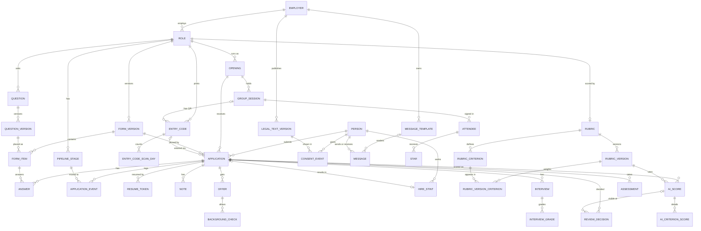

# Tidepool: Data model

Companion to [PLAN.md](PLAN.md). Postgres, managed with Drizzle and drizzle-kit migrations. Written Tue Oct 13, 2026, rewritten the same day after the owner's feedback: one Phase 1 release (target Fri Oct 23, backstop Fri Oct 30), Phase 2 live Fri Nov 6, Phase 3 live Fri Nov 20. Updated Fri Oct 16, 2026, when Phase 2 shipped three weeks early: the P2 sections below describe what was built, including what goes beyond the original spec.

## Principles

- **UUID keys.** Every table's primary key is `id uuid`, a UUIDv7 generated by the app (time-ordered, so indexes stay compact). Ids appear in staff URLs; they are never used as an applicant secret. The one exception is `applied_change`, keyed by each change's permanent text name.
- **UTC storage, Central reporting.** Every timestamp is `timestamptz` stored in UTC. Reports bucket by day and count days in `America/Chicago`. Things that are calendar dates (start date, offer date) are `date`. Every conversion goes through one app helper, or `(ts at time zone 'America/Chicago')` in SQL, and the service and database run with `TZ=UTC` so nothing depends on host settings. Daylight saving time ends Sun Nov 1, 2026, nine days after launch; one unit test of the Central-time helper covers that day (quiet hours, the reminder due time, the scan-count date and the weekday count), and the stage dialog posts an instant with the browser's offset, never a wall-clock string.
- **Append-only logs.** `application_event`, `consent_event`, `review_decision` and `audit_log` are never updated or deleted by the app. One generic trigger function rejects UPDATE and DELETE on all of them. Corrections are new rows. The one exception is the Phase 3 purge job, which the trigger exempts through a session setting; it nulls contact and free-text columns, stamps `redacted_at` and deletes rows past their retention period.
- **Soft delete.** Mutable business rows carry `deleted_at`. Configuration rows carry `archived_at`. Applicant data is only ever removed by the purge job. `redacted_at` and the list of columns it strips arrive in the Phase 3 purge migration, not now; the Phase 2 tables that list `redacted_at` (`attendee`, `interview`, `assessment`) have the column from their own migration.
- **Published config is immutable.** Question versions, form versions and their items, legal text versions and rubric versions can't change once published (the second generic trigger). An edit creates a new version. The same trigger keeps a completed `ai_score` fixed except `is_current`. These two generic triggers (append-only, immutable once published) are the only triggers in the schema.
- **Report keys never change once used.** A stage's `key`, `role_id` and `milestone`, a picklist option's `list_key`, scope, `key` and `fcra_adverse`, and a question's `key` and `role_id` are locked once anything references them. The stage, picklist and question editors enforce it (archive and add a replacement, never remap), with one Vitest each. Names and labels stay editable, with edits audited.
- **Contact and free-text columns.** Columns marked "Contact" or "PII text" below are listed once in TypeScript; that list drives the CSV `includes_contact` flag, log redaction (the app logger redacts those columns before writing to Railway logs; there is no Sentry) and, in Phase 3, the purge. Contact details live on `person`. Copies legitimately live in the message and consent logs (kept 4 years as proof of consent), in `suppression` and `landing_conflict`, and from P2 in `attendee`. The purge nulls contact and free-text columns; choice answers, numbers, events, scores and outcomes stay, so multi-season analysis survives.
- **Plain text, English only.** Applicant-facing text is plain `text`. `application.language` and `person.preferred_language` exist (default `en`); a second language would be a later migration (parallel columns or a translation table), and the question version model already supports a Spanish version of a form.
- **Phases.** Phase tags: **P1** (in the launch migration), **P2**, **P3**. Migrations stay in git and run on pre-deploy; the only rule is that a migration keeps existing rows valid. Facts that can't be reconstructed later are captured from launch, which is why some P1 tables (hires, offers, checks) have their screens in Phase 1 even though their reports come in Phase 3. `group_session` is in the P1 migration because `entry_code` and `application` reference it.
- **Database users.** The app connects as Railway's default user. A second, read-only user (`tidepool_readonly`) exists for the owner's own queries; it can read every table except `integration_secret` (migration 0008 grants it the Phase 2 tables explicitly as well). Migrations run on pre-deploy.
- **Deletes never cascade.** Foreign keys default to `ON DELETE RESTRICT`. The one exception is `suppression.message_id` (`ON DELETE SET NULL`), because a suppression outlives the message that caused it and is never purged. The P3 purge deletes child rows before their parents.

### Conventions used in the tables

- **Standard columns** are listed by name only: `id uuid not null` (PK), `created_at timestamptz not null default now()`, `updated_at timestamptz not null` (mutable tables), `deleted_at` / `archived_at timestamptz null` where listed, and `redacted_at timestamptz null` where listed (added by the Phase 3 purge migration, shown here so the strip list is known in advance).
- **Column checks, not domains:** `phone_us` (text, check `~ '^\+1[2-9][0-9]{2}[2-9][0-9]{6}$'`, so only valid US E.164 numbers can be stored) is a column CHECK constraint declared with Drizzle's `check()`, so drizzle-kit tracks it. The two generic triggers are hand-written SQL in custom drizzle-kit migrations.
- **Plain single-column foreign keys** everywhere. The transition function checks that a target stage belongs to the application's role and is not archived; the form publish checks that every item's question belongs to the form's role; the save function checks that an answer's question version is in the application's pinned form. Partial unique indexes enforce the real business rules (one application per person per opening, one published form per role, one open opening per role, one active hire row per application).
- **"Null" column:** `no` means NOT NULL.
- **Enums** are Postgres enum types, listed in [Enumerations](#enumerations). Adding a value later is additive; renaming or removing one is not allowed.

## Entity diagram

Core entities and relationships. Logs and settings (`audit_log`, `suppression`, `landing_conflict`, `picklist_option`, `app_user`, and the P2 and P3 support tables) are omitted for readability.

## Tables

### Configuration

#### employer (P1)

The legal employer and the brand applicants see. Carries sender identity. Seeded with Kahuna only; Midwest Access becomes a second row later.

| Column | Type | Null | Notes |
|---|---|---|---|
| key | text | no | Stable slug, e.g. `kahuna` |
| legal_name | text | no | Exactly as on the IRS EIN letter (the carrier registration must match) |
| display_name | text | no | Shown on pages and in message signatures |
| website_url | text | yes | |
| hiring_host | text | no | `tidepool.kahunawindowcleaning.com`. One host for cookies, CSP and QR codes; no `jobs.` alias |
| logo_url | text | yes | |
| email_from_name | text | no | e.g. "Kahuna Window Cleaning Hiring" |
| email_from_address | text | yes | On the domain Resend already verifies for REEF or Typhoon |
| reply_to_address | text | yes | hiring@, any address all hiring staff read |
| sms_quo_phone_number_id | text | yes | Quo phone number id (`PN...`) of the hiring number, used as `from` on every text. Left null by the seed. `pnpm quo:setup`, the last step of every deploy's pre-deploy command once `QUO_API_KEY` is in Railway, resolves it from `sms_from_e164` (matched by digits) through Quo's phone-numbers endpoint; if the number is not in the workspace it stores nothing, alerts and shows the warning in Settings > Texting. Once stored it is never looked up again (`pnpm quo:connect` runs the same step by hand). The send function refuses to text while it is null |
| sms_enabled | boolean | no | Default false. The switch in Settings > Texting, turned on once the real-phone test passes |
| sms_from_e164 | phone_us | yes | `+17632922259`. Shown to applicants and used to resolve the Quo id |
| daily_send_cap | integer | no | Default 200. Outbound messages per Central day across both channels; editable in Settings > Texting |
| help_contact | text | yes | The hiring number and hiring email, used on pages, in templates and in the HELP reply |
| timezone | text | no | Default `America/Chicago` |
| booking_link_url | text | yes | P2. The one-on-one booking link that invites carry as `{booking_link}` and the applicant's status page shows while an invite is out. The service accepts only an `https://` address. Edited by Admins at the top of Settings > Message templates (audited as `employer.booking_link_update`); invites cannot be sent while it is null |
| scoring_daily_cap | integer | no | P2. Default 100, check > 0. AI scoring calls per Central day across all roles, counted as `ai_score` rows completed that day in any status (each was a model call; Try it and retried transport errors do not count); past it, scoring jobs wait for the next Central midnight (counted as deferred in the cron summary) with one alert email per day. Edited by Admins in Settings > AI scoring, 1 to 1000 (audited as `employer.scoring_cap_update`) |

Standard: id, created_at, updated_at, archived_at. Unique: `key`. Tidepool is the app name, used in the browser title, sign-in page, admin header and alert-email sender; it never appears on applicant pages, in templates or in legal text, which say Kahuna Window Cleaning. Edited in Settings > Texting (texting fields), by `quo:setup` (the Quo phone number id only) and by the seed (the rest). Settings > Texting also shows, read-only, whether the hiring number is connected (the last 4 characters of the Quo id), whether the webhook is connected (a signing secret exists; never the secret) and the newest `quo:setup` result with its date.

#### role (P1)

Permanent job definition: pipeline, questions, rubric.

| Column | Type | Null | Notes |
|---|---|---|---|
| employer_id | uuid | no | FK employer |
| key | text | no | e.g. `snow_removal_tech` |
| internal_name | text | no | Staff-facing |
| title | text | no | Applicant-facing |
| summary | text | yes | Landing page copy |
| uses_group_interview | boolean | no | Informational; snow false |
| sort_order | integer | no | |

Standard: id, created_at, updated_at, archived_at. Unique: `(employer_id, key)`. New applications pin the role's one published `form_version` (no pointer column, so role and form don't reference each other). The two launch roles come from `db:seed`; from Phase 2 (shipped Oct 16) Settings > Roles and stages > New role creates one from a template role in one transaction (`config/roles.ts`, audited as `role.create`): its live stages, its live role-scoped picklist options (window brings the ladder test and its fail reason) and, unless unticked, its questions as new lineages in a version 1 draft (from the live form, else the draft; same keys, wording, choices, validation, staff guidance, starting-word check, never-send flag, section, order, required flag and attention values; audited as `form.draft_create`). No rubric and no opening are created; the role's page adds a draft opening (`opening.create`), which Settings > Openings then fills in and opens.

#### opening (P1)

One role in one season. The cohort for funnels and retention, and the parent of applications, codes, sessions and hires.

| Column | Type | Null | Notes |
|---|---|---|---|
| role_id | uuid | no | FK role |
| key | text | no | e.g. `snow-2026-27` |
| name | text | no | "Snow Removal 2026-27" |
| status | opening_status | no | draft, open, closed |
| opens_on / closes_on | date | yes | |
| season_start_on / season_end_on | date | yes | Required before retention is reported for this opening (service) |
| target_headcount | integer | yes | |
| pay_text | text | yes | Pay rate or range shown on the landing page |
| benefits_text | text | yes | |

Standard: id, created_at, updated_at. Unique: `(role_id, key)`. Partial unique: `(role_id) where status = 'open'` (one open opening per role, so a role QR always resolves). Edited in Settings > Openings (Phase 1); the service refuses to set status to open while `pay_text` or `opens_on` is missing; season dates are required only before retention is reported (see above).

#### pipeline_stage (P1)

Configurable stages per role, each mapped to a fixed milestone.

| Column | Type | Null | Notes |
|---|---|---|---|
| role_id | uuid | no | FK role |
| key | text | no | Stable slug |
| name | text | no | Staff-facing; renaming is safe |
| public_label | text | no | What the applicant status page shows: Received, Under review, Interview, Offer, Background check, Hired. A closed application shows one fixed line ("This application is closed. Thank you for applying.") whatever the stage |
| milestone | milestone | yes | Null for custom stages like "Phone screen" |
| sort_order | integer | no | |
| is_system | boolean | no | Started and Submitted: the app moves applications into them; can't be archived |
| show_on_board | boolean | no | Started is false (shown as a drop-off count) |

Standard: id, created_at, updated_at, archived_at. Unique: `(role_id, key)`. Index: `(role_id, sort_order)`. Stages are archived, never deleted. Editor rule (the Phase 2 stage editor in Settings > Roles and stages, `config/stages.ts`, with Vitests): `key`, `role_id` and `milestone` can't change once any `application_event` references the stage; to remap, archive the stage and add a replacement, so past funnels and stage times never change. Milestones must not decrease as sort order increases (seed validation, then the stage editor). Several stages may share a milestone. Also enforced by the editor: Started and Submitted (the system stages) stay first and are never archived, moved or remapped, and no other stage may take their milestones; a role keeps one live Hired stage, since Hire now and the hire form need it; a stage holding open applications can't be archived (the refusal gives the count). Stage writes are audited as `pipeline_stage.add`, `.update`, `.move`, `.archive` and `.unarchive`.

#### question (P1)

Question lineage: the stable identity of a question across rewordings. Reports group answers by lineage.

| Column | Type | Null | Notes |
|---|---|---|---|
| role_id | uuid | no | FK role |
| key | text | no | e.g. `job1_months` |
| ai_never_send | boolean | no | Default false. Never sent to the AI scorer, whatever a rubric asks for (P2). Admin-editable, audited. Seeded true for questions that invite protected-trait disclosures |

Standard: id, created_at, updated_at, archived_at. Unique: `(role_id, key)`. Editor rule: `key` and `role_id` never change (the question editor offers no such edit, with a Vitest). Which answers the scorer reads is chosen by the rubric's criteria (P2), so a new rubric version can re-score older applications; this flag is the deny list on top.

#### question_version (P1)

Exact wording, type and options of one version of a question.

| Column | Type | Null | Notes |
|---|---|---|---|
| question_id | uuid | no | FK question |
| version | integer | no | 1, 2, 3 |
| type | question_type | no | |
| prompt | text | no | |
| help | text | yes | |
| options | jsonb | yes | `[{"key": "...", "label": "..."}]`. Keys are stable and never reused for a different meaning in a lineage |
| validation | jsonb | yes | e.g. `{"min": 0, "max": 600, "integer": true}`, `{"maxLength": 2000}` |
| meaning_changed | boolean | no | True when this version asks something materially different from the previous one; reports stop pooling across it |
| change_note | text | yes | |
| staff_guidance | text | yes | Staff-only "What to look for" notes (added Oct 16). Shown folded under the answer on the profile and in the editor's staff views; never shown to applicants (the applicant form loader and the editor's preview never read it) and never sent to AI. Changing it on a published question makes a new version in the same lineage, `meaning_changed` false unless the editor ticks it |
| starts_with_check | text | yes | One word the answer must start with; short_text and long_text only (added Oct 16). The answer passes when, after trimming whitespace and stripping leading quote or punctuation characters, it starts with the word, ignoring case, followed by a non-letter or the end: "Blue.", "blue," and "BLUE" pass; "Bluebird" and "My answer: Blue" fail. The profile shows "Followed the instruction" or "Did not follow the instruction" (nothing when unanswered); exports carry pass, fail or blank. A signal for staff, never an automatic reject. Versioned like `staff_guidance` |
| published_at | timestamptz | yes | Set by the form publish service (one transaction) when first included in a published form |
| created_by | uuid | yes | FK app_user (null for seed) |

Standard: id, created_at. Unique: `(question_id, version)`. Checks: options present if and only if type is single_choice or multi_choice; `starts_with_check is null or type in ('short_text', 'long_text')`. Trigger: no UPDATE or DELETE once `published_at` is set; the two Oct 16 columns are set when a version is created, so the 0001 trigger covers them unchanged.

#### form_version (P1)

An immutable snapshot of a role's application form.

| Column | Type | Null | Notes |
|---|---|---|---|
| role_id | uuid | no | FK role |
| version | integer | no | |
| status | config_status | no | draft, published, retired |
| sections | jsonb | no | `[{"key": "basics", "title": "...", "intro": "..."}]` |
| ai_disclosure_version_id | uuid | yes | FK legal_text_version (kind `ai_disclosure`). Snow form v1 points at `ai_disclosure` v1, and the question editor's draft copies the pointer forward. Since Phase 2 it no longer drives the landing page: the landing page shows the newest published `ai_disclosure`, so a new version reaches applicants without a form publish, and an application saw the version published at or before its `started_at` (`scoring/disclosure.ts`, `aiDisclosureForApplication`; null for staff-created and imported applications). To keep that exact, the landing form posts back the version its page showed and a page showing an older one is asked to reload. The planned rule that the scoring service refuses an application whose pinned form has null here was not built |
| change_reason | text | yes | Required to publish: a written, job-related reason |
| published_at | timestamptz | yes | |
| published_by | uuid | yes | FK app_user |
| created_by | uuid | yes | FK app_user |

Standard: id, created_at. Unique: `(role_id, version)`. Partial unique: `(role_id) where status = 'published'`, the one live form per role that new applications pin; publishing v2 retires v1 in the same transaction. Publish (service, one transaction, with Vitests): sets `published_at` on every question version in its items that lacks one, rejects the publish if any item's question belongs to another role or two items share a lineage, and retires the previous version. Applications already started keep their pinned version to the end; the profile and list show the version, and the editor says so. Trigger: once published, only `status` may change (published to retired).

**`db:seed`.** One script, run once against an empty database (and locally), that creates the employer, the first Admin user, both roles, both pipelines, the picklists, legal text v1, the templates, snow form v1 as published version rows and window form v1 as a draft, both openings (snow open, window draft), plus the two launch entry codes. Re-running it is a no-op by key. Everything after that changes through screens: the question editor (Phase 1) for questions and forms, Settings (Phase 1) for openings, users, texting, entry codes and picklists, and the stage editor and New role screen (Phase 2). Ad hoc SQL against production is not allowed. A content change the owner asks the builder to ship as data (the five snow questions of Oct 16) is a one-time change run by `pnpm db:changes` through the same services the screens use (see `applied_change`); the seed itself stays as it was, so a fresh database gets snow v1 from the seed and v2 from the change.

#### form_item (P1)

Which question versions a form version contains, where, and whether required. Kept as rows (not a JSON blob) so answers can reference it with a foreign key.

| Column | Type | Null | Notes |
|---|---|---|---|
| form_version_id | uuid | no | FK form_version |
| question_version_id | uuid | no | FK question_version |
| section_key | text | no | Matches a key in `form_version.sections` |
| sort_order | integer | no | |
| required | boolean | no | Checked on submit only |
| attention_values | text[] | yes | Answer values that show a warning chip on the profile and list (e.g. `{"false"}` on "18 or older?"). Never acted on automatically |

PK: `(form_version_id, question_version_id)`. One item per lineage per form is checked at publish. Immutable with its form version (same trigger).

#### legal_text_version (P1)

Versioned consent text, privacy policy, SMS terms, landing notice and AI disclosure. A consent record points at the exact version the applicant saw; an application saw the AI disclosure published at or before it started (see `form_version.ai_disclosure_version_id`). Admins publish a new AI disclosure, with a required change note, in Settings > AI scoring (`legal_text.publish`).

| Column | Type | Null | Notes |
|---|---|---|---|
| employer_id | uuid | no | FK employer |
| kind | legal_text_kind | no | |
| version | integer | no | |
| body | text | no | Markdown |
| change_note | text | yes | |
| published_at | timestamptz | yes | Current = latest published per `(employer_id, kind)` |
| published_by | uuid | yes | |

Standard: id, created_at. Unique: `(employer_id, kind, version)`. Trigger: immutable once published.

#### message_template (P1)

A named message with its purpose, channel and text. Not versioned: `message.body` stores the text as sent, which is the proof; template edits are audited. Legal text stays versioned because consent points at it instead of storing it.

| Column | Type | Null | Notes |
|---|---|---|---|
| employer_id | uuid | no | FK employer |
| role_id | uuid | yes | Null = all roles of the employer |
| purpose | message_purpose | no | |
| channel | channel | no | sms, email |
| name | text | no | Staff-facing |
| subject | text | yes | Email only |
| body | text | no | Allowed variables: `{first_name}`, `{link}`, `{role_title}`, `{employer_name}`, `{help_contact}`; P2 adds `{session_date}` (the application's group session, Central time), `{booking_link}` and `{interview_time}` (the one-on-one reminder only, filled from the interview). Times read like "Tue, Nov 3 at 2:30 PM". `{link}` is rendered only in the message delivered; the stored `message.body` keeps a placeholder (see `resume_token`) |

Standard: id, created_at, updated_at, archived_at. Unique (nulls not distinct): `(employer_id, role_id, purpose, channel) where archived_at is null`. Seeded in Phase 1; the Phase 2 templates (one-on-one invite, one-on-one reminder, status update and decline, each as a text and an email) come from the `2026-10-16-phase2-templates` change; `group_invite` has none. Settings > Message templates (`messaging/templates.ts`) lets Admins edit the Phase 2 templates' name, subject and body, audited with the old and new wording as `message_template.update`; Hiring Managers read it, Viewers get no access, and the Phase 1 templates are shown read-only. Save is refused unless a text starts with the brand ("Kahuna Window Cleaning:"), ends with "Reply STOP to opt out.", uses GSM-7 characters only and only known placeholders, and each purpose carries its required placeholder: the invite `{booking_link}`, the reminder `{interview_time}`, the status update `{link}` (`{link}` is never allowed in a subject). Long texts, `{role_title}` in a text and similar are warnings.

#### picklist_option (P1)

All small staff-facing picklists in one table: disqualify, withdraw, not-selected and leave reasons, star reasons, crews, assessment types. They share one shape, and none needs extra columns, so separate tables would not earn their keep.

| Column | Type | Null | Notes |
|---|---|---|---|
| list_key | picklist_key | no | |
| employer_id | uuid | yes | Null = all employers |
| role_id | uuid | yes | Null = all roles of the employer |
| key | text | no | Stable slug; reports group by it |
| label | text | no | |
| requires_note | boolean | no | e.g. "Other" |
| fcra_adverse | boolean | no | Default false. True for background-based disqualify reasons; triggers the FCRA guard |
| default_separation | separation_type | yes | Leave reasons only; pre-fills voluntary or involuntary |
| sort_order | integer | no | |

Standard: id, created_at, updated_at, archived_at. Unique (nulls not distinct): `(list_key, employer_id, role_id, key)`. Options for a role = rows matching the role, or the employer with null role, or null employer, not archived. Editor rule (Settings > Picklists, Phase 1, with a Vitest): `list_key`, `employer_id`, `role_id`, `key` and `fcra_adverse` can't change once any row references the option (an application, event or hire stint, and from P2 a star's reason, an assessment's type or a review decision's reason); archive it and add a new one instead. Labels stay editable (audited). This screen is how crews are entered.

### People and applications

#### person (P1)

The human, independent of any opening, with their contact details. The AI scorer never reads the contact columns (the input snapshot is built from answers only, with a test), and Viewers, when that role is built, get a projection without them.

| Column | Type | Null | Notes |
|---|---|---|---|
| first_name / last_name | text | yes | Contact. Required unless `redacted_at` is set (check) |
| mobile_e164 | phone_us | yes | Contact. Required by the landing form, not the table, so imports and staff-created people fit |
| email | text | yes | Contact. As typed (the form offers a typo suggestion, no confirm step; staff fix an email from the profile) |
| email_normalized | text | yes | Lowercased and trimmed |
| shared_mobile | boolean | no | Default false. Staff set it when two people really share one phone; such a number matches by email only |
| merged_into_person_id | uuid | yes | FK person. Set by a merge, always pointing at a root |
| do_not_contact | boolean | no | Default false. Blocks every send |
| preferred_language | text | no | Default `en` |

Standard: id, created_at, updated_at, deleted_at, redacted_at. Partial unique: `(mobile_e164) where mobile_e164 is not null and not shared_mobile`. Indexes: `email_normalized`, `(merged_into_person_id)`. Checks: `redacted_at is not null or (first_name is not null and last_name is not null)`; `merged_into_person_id <> id`. The public landing form never updates these columns. Staff edits are audited with values recorded as `"[changed]"`.

**Landing matching.** The landing service follows `merged_into_person_id` to the root, then:
- Mobile and email both match the same person, or neither matches anyone: proceed. If that person already has an application on this opening, the link is resent to the details on file and the applicant sees a neutral "check your messages" screen; otherwise a new application (and, if needed, a new person) is created.
- The mobile is flagged shared: match by email only; no email match creates a new person with `shared_mobile` set.
- Any other mismatch (the mobile matches one person but the email differs or matches another, or only the email matches): no application is created for the typist. If the mobile's person has an application on this opening, its link goes to the details on file. The applicant sees the same neutral screen with the hiring number, and a `landing_conflict` row is written; it shows as a banner on the matched person's profile with two buttons, "Update email on file" and "Mark phone as shared".
- Person creation uses `insert ... on conflict do nothing` and re-selects, so two simultaneous first requests never return an error. A retried landing POST with the landing cookie continues the same application; a retry without it (the first response never arrived) resends the link, which is acceptable. Every branch has a Vitest case.

**Returning people.** The profile header lists every prior application and hire stint for the person (opening, outcome, leave reason, ratings, rehire eligible); the list and board show a "Returning" badge; a new application for a person whose latest stint has `rehire_eligible = false` shows a red banner. This is why past hire outcomes are worth importing in Phase 3.

**Merging people (later tool, built the first time a returning worker shows up with a new phone and email).** One Admin-only service function in one transaction: lock both people; move their `application`, `note`, `message`, `hire_stint` and `attendee` rows to the survivor; if both have an application on one opening, keep the one at the later milestone, soft-delete the other and write `person_merged` on both; the survivor gets `do_not_contact` if either had it; staff choose which contact details the survivor keeps and the merged row's are nulled; chains are collapsed so `merged_into_person_id` always points at a root. `consent_event` and `suppression` stay keyed by address, so the send check is unaffected, and reports read people through a view `person_canonical(person_id, canonical_id)`. Until then staff edit the contact details on file.

#### application (P1)

One person applying to one opening.

| Column | Type | Null | Notes |
|---|---|---|---|
| person_id | uuid | no | FK person |
| opening_id | uuid | no | FK opening |
| role_id | uuid | no | FK role. Ordinary column for queries; the service sets it from the opening |
| form_version_id | uuid | no | FK form_version. Pinned at creation; the service only pins the role's published form (Vitest) |
| origin | application_origin | no | landing, staff_created, imported |
| status | application_status | no | open, hired, closed |
| closed_outcome | closed_outcome | yes | Set if and only if status = closed |
| closed_reason_option_id | uuid | yes | FK picklist_option; required when closed |
| current_stage_id | uuid | no | FK pipeline_stage. Cache of the latest event; the transition function checks the stage belongs to `role_id` and is not archived |
| stage_entered_at | timestamptz | no | occurred_at of the event that moved it there |
| on_hold | boolean | no | Default false |
| event_seq | integer | no | Default 0. `seq` of the latest event. The UI (list, dialog and kanban drag) sends it back with a move; a mismatch means someone else changed the application first |
| answers_locked | boolean | no | True after submit. Answers are never reopened; staff record corrections as notes, so the answer rows are what the applicant submitted |
| started_at | timestamptz | no | Cache: `occurred_at` of the `created` event |
| submitted_at | timestamptz | yes | Cache: `occurred_at` of the `submitted` event. Only the transition function writes it |
| last_activity_at | timestamptz | no | Last applicant save or staff action |
| language | text | no | Default `en` |
| entry_code_id | uuid | yes | FK entry_code; null for staff-created |
| entry_channel | entry_channel | no | Copied from the code, or `staff_entered` |
| scanned_session_id | uuid | yes | FK group_session. From the code scanned |
| attributed_session_id | uuid | yes | FK group_session. The scanned session, or one matched later from the sign-in sheet; the service checks it belongs to the same opening |
| attribution_method | attribution_method | no | Default `none` |
| source | source | yes | Asked on the landing form (optional). The end-of-form prompt appears only if it is blank. Staff can edit (audited) |
| source_detail | text | yes | Referrer name or "other" text. PII text |
| source_set_by | actor_type | yes | |
| indeed_applied_on | date | yes | Staff-entered when known |
| exclude_from_analysis | boolean | no | Default false; set true at the moment source becomes `current_employee` (landing form or later), editable |
| group_interview_arrival | group_interview_arrival | yes | on_time, late, did_not_attend; null = not recorded (added Oct 16). Set by Hiring Managers and Admins on the profile or, right after a session, on the session page; read-only for Viewers. Every change, clearing included, writes an `application.arrival_change` audit row. The list has an Arrival filter. A predictor in its own right (see Question predictiveness) |

Standard: id, created_at, updated_at, deleted_at.
Keys and indexes:
- Partial unique `(person_id, opening_id) where deleted_at is null`.
- Index `(opening_id, status, current_stage_id)` for the list and board; `(submitted_at)`; `(attributed_session_id)`; `(last_activity_at) where submitted_at is null` for reminders and drop-off.
- Checks: `(status = 'closed') = (closed_outcome is not null)`; `closed_outcome is null or closed_reason_option_id is not null`.
- Test applications: an Admin-only "Delete test application" button on the profile soft-deletes the row and writes an audit row; deleted rows are out of every count and report. The dry run uses the real snow opening, and its applications are deleted this way before the Indeed link is pasted.

#### answer (P1)

One answer to one question version. Values are typed; choices store option keys, not labels.

| Column | Type | Null | Notes |
|---|---|---|---|
| application_id | uuid | no | FK application |
| question_version_id | uuid | no | FK question_version. The save function checks it is an item of the application's pinned form; lineage joins through `question_version.question_id` |
| value_text | text | yes | short_text, long_text. PII text |
| value_number | numeric | yes | number |
| value_date | date | yes | date |
| value_bool | boolean | yes | yes_no |
| value_options | text[] | yes | single_choice (one key), multi_choice |
| revision | integer | no | Default 0. Each save sends the revision it last saw; the server updates only when it matches |
| updated_at | timestamptz | no | Server time of the last save |

Standard: id, created_at. Unique: `(application_id, question_version_id)`. Index: `(question_version_id)`. Check: `num_nonnulls(value_text, value_number, value_date, value_bool, value_options) <= 1`. The save function refuses any write when the application's `answers_locked` is true (Vitest). Which column a type uses is validated in the service layer by zod.

**Autosave and submit.** Each field saves on change; the client retries three times with backoff and shows "Saved" or "Not saved, check your connection". Each save sends the `revision` it last saw and the server updates only when it matches (one column, one WHERE clause), so a stale device never overwrites a newer answer; a mismatch returns the current value. Submit carries any unsaved values; the server applies them, validates, writes the `submitted` event and locks the answers in one transaction that starts with `select ... from application where id = $1 for update`, so a late autosave can't slip in after validation. A second submit gets 409. No offline queue. There is no snapshot table: answers are never reopened after submit, so the answer rows are what the applicant submitted.

#### application_event (P1)

Append-only log of everything that moves an application: stage changes, status changes, holds, submissions. The single source for time and funnel reports. Stage and status history are one table, because every status change happens at a stage and reports need both in order.

| Column | Type | Null | Notes |
|---|---|---|---|
| application_id | uuid | no | FK application |
| seq | integer | no | 1, 2, 3 per application; defines order |
| kind | application_event_kind | no | |
| from_stage_id / to_stage_id | uuid | yes | FK pipeline_stage. The transition function checks the stage belongs to the application's role. `to_stage_id` set on created, submitted, stage_changed and reopened |
| from_status / to_status | application_status | yes | Also set by `hire_rescinded` |
| closed_outcome | closed_outcome | yes | On `closed` |
| reason_option_id | uuid | yes | FK picklist_option |
| note | text | yes | PII text |
| voids_event_id | uuid | yes | FK application_event; on `event_voided`, marks an earlier event as a mistake |
| actor_type | actor_type | no | staff, applicant, system |
| actor_user_id | uuid | yes | FK app_user; required when actor_type = staff |
| occurred_at | timestamptz | no | When it happened. Staff may backdate |
| recorded_at | timestamptz | no | When it was entered. Defaults to now(); the service never passes it, so it is always the database's entry time |
| batch_id | uuid | yes | Groups a bulk move |
| metadata | jsonb | yes | e.g. `{"background_check_ids": [...]}`, `{"not_report_based": true}` (the FCRA statement), merge source. PII text |

Standard: id. Unique: `(application_id, seq)`. Indexes: `(application_id, occurred_at)`, `(to_stage_id, occurred_at)`, `(kind, occurred_at)`.
Checks: `occurred_at <= recorded_at + interval '5 minutes'`; `actor_type <> 'staff' or actor_user_id is not null`; `kind <> 'closed' or (closed_outcome is not null and reason_option_id is not null)`; `kind <> 'event_voided' or voids_event_id is not null`. Trigger: append-only.

**Transitions, replay and voiding.** One pure function replays an application's non-voided events into its cached state (`current_stage_id`, `stage_entered_at`, `status`, `closed_outcome`, `closed_reason_option_id`, `on_hold`, `started_at`, `submitted_at`, `event_seq`). The transition function and the report tests both use it, so they can't disagree.
- The transition function is the only writer of events and of the cached columns. It starts with `select ... from application where id = $1 for update`, compares the `event_seq` the UI sent, checks the target stage belongs to the application's role and is not archived, computes the next `seq` under that lock, writes the event and re-derives the cache in one transaction. A mismatch returns "changed by <user> at <time>, reload"; the kanban reloads that card and never re-applies the drag. Bulk moves check each row and list the rows they skipped. A Vitest covers two concurrent moves of one application.
- A stage change on a closed application is rejected unless it is an explicit reopen. Applicant submit goes through the same function: rejected on a closed application, and it changes the stage only while the current milestone is before `submitted`.
- Only the latest non-voided state-changing event can be voided. `created`, `submitted`, `event_voided` and `person_merged` can never be voided. Voiding re-derives the cache in the same transaction.
- Moving into an `offered` stage creates the `offer` row, and moving into a `background_check` stage creates the `background_check` row, in the same transaction. Voiding that move soft-deletes the offer or cancels the check.
- Voiding a move into a `hired` stage, or a normal move out of one, voids the stint it created with `void_kind = entered_in_error`. `hire_rescinded` is for real rescissions: it sets `to_status` (open, or closed with outcome and reason) and voids the stint with `void_kind = rescinded`.

#### note (P1)

| Column | Type | Null | Notes |
|---|---|---|---|
| person_id | uuid | no | |
| application_id | uuid | yes | |
| body | text | yes | PII text (null only after redaction) |
| is_restricted | boolean | no | Accommodation or health information. Admin and Hiring Manager only; never exported; never sent to AI |
| author_user_id | uuid | no | |

Standard: id, created_at, deleted_at. Index: `(application_id, created_at)`, `(person_id)`. Notes are append-only: no edit button. A note can be soft-deleted by its author or an Admin (audit row) and a corrected note added; `deleted_at` keeps the old text.

#### resume_token (P1)

Reusable link tokens, stored only as hashes. A token is minted inside the single send function at the moment of the provider call, stored only as a SHA-256 hash, delivered after `#` in the link, and exchanged once for an HttpOnly cookie. The stored `message.body` carries `{link:<resume_token_id>}`, shown as "[application link]" in the UI and CSV, so staff can't open an application as the applicant. A retry mints a new token and revokes nothing; tokens expire 30 days after last use. Staff can revoke all of an application's tokens from the profile, which also sends a fresh link.

Links look like `https://tidepool.kahunawindowcleaning.com/r#<token>`. Browsers never send the part after `#`, so the token stays out of server logs and Railway's HTTP logs. The page posts it once, receives an HttpOnly, Secure, SameSite=Lax cookie and replaces the URL. The landing page moves into the application with a full page load, so the bot-check script doesn't follow the applicant, and a per-route CSP allows `challenges.cloudflare.com` only on the landing and lost-link pages.

| Column | Type | Null | Notes |
|---|---|---|---|
| application_id | uuid | no | |
| token_hash | bytea | no | SHA-256 of a random token of at least 128 bits |
| issued_via | token_issue | no | landing_cookie, message, staff_reissue |
| message_id | uuid | yes | FK message that carried it |
| expires_at | timestamptz | no | Sliding: last use plus 30 days |
| last_used_at | timestamptz | yes | |
| revoked_at | timestamptz | yes | |
| revoked_by | uuid | yes | |

Standard: id, created_at. Unique: `token_hash`. Index: `(application_id)`. Test: after a send, the plaintext is absent from `message` and `audit_log`.

### Entry codes and sessions

#### entry_code (P1)

Every printed or shared link. The QR encodes `https://tidepool.kahunawindowcleaning.com/q/<code>`.

| Column | Type | Null | Notes |
|---|---|---|---|
| code | text | no | 6 to 8 characters, Crockford base32, uppercase. Unique |
| role_id | uuid | no | FK role |
| opening_id | uuid | yes | FK opening. Null = whichever opening of the role is open at scan time |
| group_session_id | uuid | yes | FK group_session; the service checks it belongs to `opening_id` |
| channel | entry_channel | no | |
| label | text | no | e.g. "Snow flyer, Golden Valley shop" |
| closed_at | timestamptz | yes | Closed codes fall back to the role page |
| created_by | uuid | yes | |

Standard: id, created_at, updated_at. Unique: `code`. Index: `(group_session_id)`. Check: `group_session_id is null or opening_id is not null`. The two launch codes come from `db:seed`; Settings > Entry codes (Phase 1) creates a code with a label and channel, closes it, downloads the QR as SVG or PNG and shows daily scan counts.

#### entry_code_scan_day (P1)

Anonymous daily scan counter. No IP, device or cookie is stored.

| Column | Type | Null | Notes |
|---|---|---|---|
| entry_code_id | uuid | no | |
| day | date | no | Central date |
| scans | integer | no | Incremented by upsert |

PK: `(entry_code_id, day)`.

#### group_session (P1; snow runs sessions this fall, so the session screen and per-session QR ship in Phase 1; attendees and stars in Phase 2)

A group interview session. Created in P1 because entry codes and applications reference it.

| Column | Type | Null | Notes |
|---|---|---|---|
| opening_id | uuid | no | |
| starts_at | timestamptz | no | |
| location_name | text | no | |
| location_address | text | yes | |
| invited_count | integer | yes | Entered from Indeed |
| attended_count | integer | yes | Headcount typed from the sheet. Once a session has live `attendee` rows, the screens count those instead ("attended": rows when any exist, else this) |
| status | group_session_status | no | |
| notes | text | yes | PII text |
| created_by | uuid | no | |

Standard: id, created_at, updated_at, deleted_at. Index: `(opening_id, starts_at)`.

### Consent and messaging

#### consent_event (P1)

Append-only history of text consent: opt-ins, unchecked boxes, opt-outs, START replies.

| Column | Type | Null | Notes |
|---|---|---|---|
| person_id | uuid | no | |
| application_id | uuid | yes | |
| employer_id | uuid | yes | FK employer. From the role (web form) or from the number that was texted (keyword events), so consent stays per employer when Midwest Access is added |
| channel | channel | no | `sms` in practice |
| address | text | no | E.164. Contact |
| action | consent_action | no | |
| method | consent_method | no | |
| legal_text_version_id | uuid | yes | The version actually shown, carried in a hidden form field and validated as a published `sms_consent` version, not whatever is current when the form posts. Required when method = web_form |
| checkbox_value | boolean | yes | web_form only |
| language | text | yes | Language of the text shown |
| ip | inet | yes | Contact. From one helper that reads `CF-Connecting-IP` when the host is proxied through Cloudflare, else the header Railway's edge sets |
| user_agent | text | yes | Contact |
| entry_code_id | uuid | yes | |
| message_id | uuid | yes | The inbound message for keyword or free-text events |
| recorded_by | uuid | yes | Staff, for staff_recorded |
| occurred_at | timestamptz | no | |

Standard: id, created_at. Index: `(address, employer_id, occurred_at)`, `(person_id)`. Check: `method <> 'web_form' or legal_text_version_id is not null`. Trigger: append-only. Rows are deleted whole when their retention period ends (P3, before the messages they reference), not stripped, so the table needs no redaction column.

#### suppression (P1)

The source of truth for "do not send to this address", checked at send time. Belongs to the address, not an application.

| Column | Type | Null | Notes |
|---|---|---|---|
| channel | channel | no | |
| address | text | no | E.164 or normalized email. Contact |
| reason | suppression_reason | no | |
| message_id | uuid | yes | The inbound text or bounce that caused it. `ON DELETE SET NULL` |
| created_by | uuid | yes | |
| lifted_at | timestamptz | yes | |
| lift_reason | text | yes | A START or UNSTOP from that number. A staff action with a recorded reason may lift only `free_text_request`, `staff_marked` and email suppressions, never `stop_keyword` or `carrier_blocked` (Quo keeps blocking those). Never a web opt-in |
| lifted_by | uuid | yes | |

Standard: id, created_at. Partial unique: `(channel, address) where lifted_at is null`. Suppression is global across employers on purpose, as the conservative choice, and its rows are never purged. The landing form is public and unverified, so a web opt-in after a STOP records a `consent_event` but leaves the suppression in place, and the page tells the applicant to text START (Quo keeps blocking that number until START or UNSTOP anyway).

#### message (P1)

Every text and email, in and out. Doubles as the outbound queue that the cron script works through.

| Column | Type | Null | Notes |
|---|---|---|---|
| direction | message_direction | no | |
| channel | channel | no | |
| person_id | uuid | yes | Null for unmatched inbound |
| application_id | uuid | yes | |
| template_id | uuid | yes | FK message_template. Null for inbound and for hand-typed staff replies |
| purpose | message_purpose | yes | |
| to_address / from_address | text | yes | Contact. Both present unless `redacted_at` is set (check), so the P3 purge can strip them and keep the row for time-to-contact reports |
| subject | text | yes | |
| body | text | yes | As sent or received, except that application links are stored as `{link:<resume_token_id>}`. PII text |
| status | message_status | no | |
| provider | message_provider | no | quo, resend, sink |
| provider_message_id | text | yes | Unique |
| error_code | text | yes | Contact (provider errors can echo addresses) |
| segments | smallint | yes | SMS |
| dedupe_key | text | yes | Unique, e.g. `reminder_24h:<application_id>` |
| send_after | timestamptz | yes | Also holds texts waiting for 9am |
| attempts | smallint | no | Default 0 |
| locked_at | timestamptz | yes | |
| sent_at / delivered_at / failed_at | timestamptz | yes | |
| triggered_by_type | actor_type | no | |
| triggered_by_user_id | uuid | yes | |
| handled_at / handled_by | timestamptz / uuid | yes | Inbound triage. Every inbound text is emailed to hiring@ and shown on the profile; an "Unhandled texts (N)" badge at the top of the list view stays until each is marked handled |

Standard: id, created_at, updated_at. Unique: `provider_message_id`, `dedupe_key`. Indexes: `(send_after) where status = 'queued'`; `(application_id, created_at)`; `(person_id, created_at)`; `(created_at) where direction = 'inbound' and handled_at is null`. There is no per-callback table (low value, and raw payloads carry PII). A delivery callback applies only when its status ranks higher than the stored one, because callbacks arrive out of order. Inbound texts insert with `on conflict (provider_message_id) do nothing`, and opt-out handling runs only when a row was actually inserted. Webhook redeliveries (Quo and Resend both resend the same event id) are harmless for the same reasons: inbound inserts dedupe on `provider_message_id`, and status updates only move forward.

**The cron service** runs the same codebase every 5 minutes: it claims due `queued` rows with `FOR UPDATE SKIP LOCKED` and sends them, retrying failures up to 3 times; it runs the reminder query (`submitted_at` is null, status open, `started_at` at least 24 hours ago, now between 9:00 and 20:00 Central, person not do-not-contact) and for each match inserts one message (text if the send rules allow, otherwise email) with `dedupe_key = reminder_24h:<application_id>` and `on conflict do nothing`; it writes a heartbeat row; at 3am Central it runs `pg_dump` to the R2 bucket; at 7am Central it sends the daily digest. Resume links are sent inside the request so the applicant gets them at once; cron retries failures. Every run is wrapped in try/catch and errors go through `notifyAdmin`. `GET /health` returns 200 only when the database answers and the heartbeat is under 15 minutes old. A Vitest runs two cron passes at the same moment on one queued row and expects one send. From Phase 2 each pass also queues one-on-one reminders (right after the 24-hour reminders and before sending, so one due now goes out in the same pass, deduped per interview) and runs due `job` rows (after the backup, claiming no new job after two minutes); the heartbeat stays the last step.

**One-on-one reminders (P2, `messaging/interview-reminders.ts`).** Each scheduled, undeleted interview of an open application gets one `one_on_one_reminder`, due at 5pm Central the day before, or right away when the interview is 1 to 20 real hours ahead, and none under an hour ahead. It goes as a text when the person has a current opt-in and texting is on, otherwise by email; when quiet hours would hold the text until less than an hour before, it goes by email instead (or not at all without a usable email). The dedupe key `interview:<interview id>:<scheduled_at ISO>` allows one reminder per booked time, so a rescheduled interview gets a new one (an email fallback adds `:email`). A queued reminder whose interview moved, was canceled, recorded or deleted, whose application closed or was deleted, or whose time passed is canceled with the reason in `error_code` (`interview_rescheduled`, `interview_canceled`, `interview_done`, `interview_started`), which the profile shows; moving an interview back to a time it was booked for before re-queues that time's canceled reminder, since a key is never reused. The reminder goes for every interview kind, phone screens included.

**Staff sends (P2, `messaging/staff-sends.ts`).** Staff send templates, never free text, from three places: "Send a message" on the profile (the one-on-one invite, a status update or the decline), the Move dialog's "Also send the one-on-one invite" on a move into an `interview_invited` stage from an earlier one, and the Close dialog's "Send the decline message" on a disqualified or not-selected close. The decline goes only to an application closed as disqualified or not selected, so it never skips the Close dialog and its FCRA gate: on the profile it is refused for anyone still open (or who withdrew), with the reason, and the Close dialog's decline is queued inside the close, after the application is closed. The channel is chosen for them: a text with a current opt-in when texting is on and the number isn't suppressed, otherwise email, and the decline the other way round (email first, a text only without a usable email). The preview shows this person's values, and a send that would miss a value (no booking link, no help contact) or has no channel is refused with the reason. Sends are queued through `queueMessage` (the cron sends them; the send rules apply then) and audited as `application.message_send` with the purpose, channel, message id, where it came from and the event id. Dedupe keys: `staff_send:<purpose>:<request id>` (one per dialog opening), `invite:<event id>` and `decline:<event id>`. Voiding that move or close (Undo last change) cancels its invite or decline, and the `:email` fallback, while still queued, in the same transaction (`error_code` `change_undone`); the undo dialog says so first. The Move and Close dialogs' messages travel on the transition input (`withMessages`) and are queued inside the transition by `messaging/after-transition.ts`, so a move or close whose message cannot go is rolled back, and board drags, row and bulk moves send nothing. The applicant's status page shows a "Book your interview" button with `employer.booking_link_url` while an invite is out: the application is open in an `interview_invited` stage, an invite was queued after it entered that stage, and no interview is booked, held or missed yet.

**Alerts.** One `notifyAdmin(kind, subject, body)` helper emails the `ALERT_EMAIL` address (the owner's, not hiring@) through Resend, at most once per `kind` per hour (dedupe on `message.dedupe_key = alert:<kind>:<hour>`), carrying ids and never names or numbers. Called on a failed send after retries, a webhook signature failure, a job exception, an uncaught server error (Next.js `onRequestError`), an empty Quo balance and the daily cap. The 7am digest lists applications started and submitted, texts sent, delivered, undelivered and failed, emails bounced, unhandled inbound texts, errors in the last 24 hours and the newest backup's age; in the first week of texting it is how carrier filtering would show up (an undelivered share of 20 percent or more over 10 or more texts, or every undelivered text on one carrier).

**Send rules.** Every outbound text and email goes through one send function, which checks at send time, not queue time:
1. The person isn't `do_not_contact` and the address has no live suppression.
2. For a text: `sms_enabled` is on for the employer, and the latest `consent_event` for that address and employer is `opt_in` or `opt_in_keyword`. Otherwise the message falls back to email when there is one, or is marked `suppressed`. Consent belongs to the number, so it doesn't carry over to a number staff edit in or a merge brings; the profile then shows "texts off: no opt-in for this number". One exception: a HELP reply goes to the number that texted HELP even without an opt-in, unless it is suppressed. The real-phone test runs in production with `sms_enabled` on, against the real snow opening on staff phones, before anyone else has the link; those test applications are then deleted.
3. Quiet hours: a text the applicant didn't just ask for (anything except the landing and lost-link sends and a HELP reply) waits in `send_after` until 9am Central if it falls outside 9am to 8pm. Staff see "will send at 9:00am".
4. The first text to an address since its latest opt-in uses the full-disclosure wording (brand, frequency, rates, HELP and STOP), whatever the template.
5. Links are minted at send (see `resume_token`).
6. Status `sending` and `attempts + 1` are committed before the provider call. Email passes `message.id:attempt` as Resend's idempotency key (check the current header name in Resend's docs). A text stuck in `sending` with no `provider_message_id` becomes `unknown` and is shown to staff, never resent automatically.
7. Texts go through Quo's API (`POST /v1/messages`, one recipient per call, `from` = the employer's `sms_quo_phone_number_id`, with a test asserting no other `from` is ever sent) behind one provider module. Tidepool uses its own API key, created by the owner and labeled Tidepool, so it can be revoked without touching Typhoon. Tidepool creates exactly one webhook through Quo's newer webhook API (`POST /webhooks` with the `Quo-Api-Version: 2026-03-30` header; `message.received`, `message.delivered`, `message.failed`, `message.undelivered`), labeled Tidepool, pointing at `<PUBLIC_BASE_URL>/api/webhooks/quo` and scoped to the hiring number's id, and never updates or deletes any webhook. `pnpm quo:setup` does it on deploy: while no signing secret exists it lists the workspace's webhooks first; if one already points at Tidepool's address (found under any field name, since Quo's list shape is unverified) or is labeled Tidepool, it creates nothing (Quo shows a secret only at creation, so the owner either pastes that webhook's secret into Railway as `QUO_WEBHOOK_SECRET` or deletes that one webhook in Quo so the next deploy recreates it); otherwise it creates the webhook and stores the secret from the response in `integration_secret` in the same run, under an advisory lock so overlapping deploys create one. A webhook for any other address (Typhoon's) is ignored, even one that covers the hiring number. If Quo's create response does not echo the scope as the hiring number alone, the run still stores the secret but reports the scope as unconfirmed or wider and alerts the owner to check the webhook's numbers in Quo. If a secret was stored by something else while the webhook was being created, the stored one is kept and the run alerts the owner to delete the new webhook. The route reads `QUO_WEBHOOK_SECRET` first, then the stored secret (cached in memory for 5 minutes), and with neither answers 503 without reading the event and logs it once. If an existing webhook covers all numbers, the owner decides whether Typhoon narrows it; Tidepool drops any event for another number before storing anything. Each delivery's signature is verified against the raw body, a timestamp more than 5 minutes off is rejected, redeliveries are harmless (see the `message` table notes), and after the signature check the handler always returns 200 (unknown ids are logged, never errors), so Quo never disables it. An outbound event with no matching row and a body is a reply a staff member typed in the Quo app: it is stored as an outbound message row with `triggered_by_type = staff` and `provider = quo`, which also feeds time to first contact. A `failed` or `undelivered` text is shown on the profile; staff send a fresh message if needed, nothing is retried automatically. If the webhook test fails, or the digest shows texts delivered with no delivery events for a day, a reconciliation pass (every 5 minutes, list each recently texted number's messages on the hiring number since the last pass, upsert by provider id, handle STOP found this way like a webhook) is a known two-hour job, built only if that trigger fires.
8. Quo exposes no opt-out list, so the ATS's `suppression` table is the record. Quo's single-word keywords (STOP, STOPALL, UNSUBSCRIBE, CANCEL, END, QUIT), plus REVOKE and OPT OUT, arriving as `message.received` create a suppression and a `consent_event` at once; START and UNSTOP record `opt_in_keyword` and lift it. Everything else inbound waits for a person (see the Collapsed table on classifiers). A Quo opt-out covers every Kahuna Quo number, including the customer line and any number Typhoon texts from, so a person may have opted out by texting STOP to another Kahuna number, which the ATS never sees. A send that Quo rejects, or reports failed or undelivered, with an error that points to an opt-out records a `carrier_blocked` suppression and a `consent_event` automatically, falls back to email in the same pass, and shows "texts blocked at Quo: this number opted out from a Kahuna number" on the profile. No staff step. Only the person can lift a Quo opt-out, by texting START or UNSTOP. The profile header, the move into Hired and the hire form warn when the person's number has a live `stop_keyword` or `carrier_blocked` suppression: "This person has opted out of texts from all Kahuna numbers. Ask them to text START to 763-292-2259 before dispatch texts will reach them."
9. Daily cap and balance: the send function counts outbound rows to applicants sent today (Central) across both channels (alerts and the digest to staff carry no purpose, are exempt and are not counted); at `daily_send_cap` it stops, queues the rest for tomorrow, shows "waiting: daily cap" to staff and alerts once. An insufficient-balance response from Quo stops texting for the rest of the pass, alerts with its own kind, and falls the affected texts back to email; a Vitest exercises that path with a mocked provider response. Per-address limit, computed from `message` rows: no more than 3 link sends to one number or email in an hour (also stops mail-bombing through the lost-link page). Turnstile protects the landing and lost-link pages. No per-IP limit, so proxying through Cloudflare changes nothing.

Tests cover declined, opted out, re-opted in, number edited by staff and merged cases, quiet hours with one DST case, the first-text wording, STOP, START and HELP inbound handling, webhook redelivery, the dedupe key, the cap and the empty-balance path.

#### landing_conflict (P1)

A landing attempt whose mobile and email point at different people (see Landing matching under `person`). Shown as a banner on the matched person's profile until staff resolve it; no separate screen or filter.

| Column | Type | Null | Notes |
|---|---|---|---|
| opening_id | uuid | no | |
| entry_code_id | uuid | yes | |
| typed_first_name / typed_last_name | text | yes | Contact |
| typed_mobile_e164 | phone_us | yes | Contact |
| typed_email | text | yes | Contact |
| matched_person_ids | uuid[] | no | |
| resolved_at / resolved_by | timestamptz / uuid | yes | |
| resolution | text | yes | "updated email on file" or "marked phone shared", the two buttons on the banner |

Standard: id, created_at. Index: `(opening_id) where resolved_at is null`.

### Offers, checks and hires

#### offer (P1; created by the move into an offered stage, edited on the profile panel)

| Column | Type | Null | Notes |
|---|---|---|---|
| application_id | uuid | no | |
| offered_on | date | no | The Central date of the stage move's `occurred_at`, set when the move into an `offered` stage creates this row. Read-only afterward; a correction voids the move and re-enters it, so time to offer and the profile always agree |
| offered_by | uuid | no | |
| is_conditional | boolean | no | Default true |
| pay_amount | numeric(8,2) | yes | |
| pay_unit | pay_unit | yes | |
| planned_start_on | date | yes | Asked in the stage dialog; optional |
| response | offer_response | no | Default pending |
| responded_on | date | yes | |
| note | text | yes | PII text |

Standard: id, created_at, updated_at, deleted_at. Index: `(application_id, offered_on)`. Several offers per application are allowed; the latest is current. A live offer is one with `deleted_at` null and response pending or accepted. Setting response to rescinded while a check is open falls under the FCRA guard (see invariants).

#### background_check (P1; created by the move into a background_check stage, edited on the profile panel)

Status and dates only. Never report contents, SSN or date of birth. Admin and Hiring Manager only. Created when an application moves into a `background_check` stage (type and requested date asked in the dialog); the profile panel sets its status and pre-adverse notice date.

| Column | Type | Null | Notes |
|---|---|---|---|
| application_id | uuid | no | FK application |
| offer_id | uuid | no | FK offer: no check without an offer. The service checks the offer belongs to the same application and is live |
| check_type | background_check_type | no | One row per check |
| vendor | text | yes | |
| vendor_reference | text | yes | PII text |
| status | background_check_status | no | |
| requested_on / completed_on | date | yes | |
| pre_adverse_notice_on | date | yes | Write-once except for Admins; any change is audited |
| final_adverse_on | date | yes | |
| note | text | yes | Status notes only. PII text |

Standard: id, created_at, updated_at. Index: `(application_id)`. Check: `final_adverse_on is null or pre_adverse_notice_on is not null`. A check is open while its status is requested, in_progress, needs_review or pre_adverse_sent. The FCRA wait counts 5 weekdays after the pre-adverse notice date, no holiday table; staff may always wait longer.

#### hire_stint (P1; hire form at launch, Hires page Phase 3)

One row per person per role per season. Created automatically when an application reaches Hired, and the hire form opens at once; external and historical hires have no application.

| Column | Type | Null | Notes |
|---|---|---|---|
| person_id | uuid | no | FK person |
| application_id | uuid | yes | FK application |
| origin | hire_origin | no | ats, external, historical_import |
| employer_id | uuid | no | Defaults from the role; can be overridden |
| role_id | uuid | no | FK role |
| opening_id | uuid | yes | FK opening. Required for ATS stints; the service checks it matches the application's |
| is_temporary | boolean | no | Default false. "Temporary hire: planned short engagement", asked on the hire form. Editable while `outcome = active`; after that only an Admin can change it, with a written reason, audited, because flipping it after an exit is the obvious way to erase a loss. The record shows when it was set |
| planned_end_on | date | yes | Optional, temporary hires only. When set, the Hires page shows whether the stint ended as planned or early |
| crew_option_id | uuid | yes | picklist `crew`; changes audited, value at exit kept |
| offer_accepted_on | date | yes | |
| planned_start_on | date | yes | |
| start_on | date | yes | First day actually worked. Null for an on-call tech who hasn't worked yet |
| last_worked_on | date | yes | Last day actually worked |
| end_on | date | yes | Date the stint ended: the separation date, or the season end for completed_season. Never a made-up "last day worked" |
| outcome | hire_outcome | no | Default active. `completed_season` is labeled "Completed season or term" in the UI, so a temporary hire ending as planned is not a separation |
| separation_type | separation_type | yes | |
| leave_reason_option_id | uuid | yes | picklist `leave_reason`. Still recorded for a temporary hire who leaves early |
| leave_note | text | yes | PII text |
| rehire_eligible | boolean | yes | Required by the service when outcome is set to completed_season or separated, so keepers get a "good" signal, not only leavers |
| rating_30 / rating_90 | smallint | yes | 1 to 5. On the hire form, so they're entered when due |
| rating_30_by / rating_90_by | uuid | yes | |
| season_end_rating | season_end_rating | yes | Mainly snow; required by the service for snow stints when outcome is set to completed_season |
| storms_worked | smallint | yes | Snow |
| voided_at | timestamptz | yes | Set with `void_kind` by the transition function |
| void_kind | hire_void_kind | yes | entered_in_error (a mistaken move to Hired was undone) or rescinded (a `hire_rescinded` event) |
| void_reason | text | yes | |

Standard: id, created_at, updated_at. Partial uniques: `(application_id) where voided_at is null and outcome = 'active'`; `(person_id, opening_id) where voided_at is null and outcome = 'active' and opening_id is not null` (one active hire row per application and per person per opening; a temporary hire in May rehired full-time in June is a second stint on the same application, created from the Hires page). Indexes: `(role_id, start_on)`, `(person_id)`, `(opening_id)`.
Checks: outcome in (separated, never_started) requires separation_type, leave_reason_option_id and end_on; outcome = completed_season requires end_on; `end_on >= start_on` and `last_worked_on` between `start_on` and `end_on` when those are set; ratings between 1 and 5; `origin <> 'ats' or (application_id is not null and opening_id is not null)`; `(voided_at is null) = (void_kind is null)`.

### Access and audit

#### app_user (P1)

Better Auth's user model, configured to use this table, with extra columns. Better Auth also owns `auth_session`, `auth_account` and `auth_verification` (P1), generated by its CLI and not described here.

| Column | Type | Null | Notes |
|---|---|---|---|
| email | text | no | Lowercase. Unique. Contact |
| name | text | yes | |
| status | user_status | no | active, disabled. `google_sub` null means added but not yet signed in |
| role | user_role | no | admin, hiring_manager, viewer. Set by the Admin who adds the row; Settings > Users offers Admin and Hiring Manager until someone needs a Viewer. Added through Better Auth's additional fields; grants and revokes go to `audit_log` |
| google_sub | text | yes | Google account id, bound on first sign-in. Unique |
| invited_by | uuid | yes | |
| last_sign_in_at | timestamptz | yes | Shown in Settings > Users so stale accounts are visible |

Standard: id, created_at, updated_at, plus the columns Better Auth requires. The allowlist is simply `app_user` rows an Admin created in Settings > Users; there is no separate table. The first Admin is seeded by email, and a CLI command `user:add-admin <email>` exists so the owner can never be locked out.

Access rules:
- Sign-in is Google sign-in against the allowlist. It succeeds only when Google reports `email_verified = true` and the lowercased email matches an `app_user` row with status active; any other email is refused with "Ask an admin to add you" and no row is created. No Workspace-domain check and no pending state. Personal Gmail is fine.
- The Google account id is bound on first sign-in; a later sign-in with the same email but a different `google_sub` is refused.
- Every server action and route handler is written through one `requireRole` wrapper that reloads `status` and `role` from the database and asserts the permission (one unit test of the wrapper). Middleware only redirects; Next.js server actions are directly reachable POST endpoints.
- Sessions last 7 days and don't roll forward, Better Auth's cookie cache stays off, and disabling a user or changing their role deletes their `auth_session` rows. Personal Gmail accounts sit outside any central offboarding, so disabling the user here is the offboarding step.
- If Midwest Access later needs per-company access, a new `user_employer` table is added where no rows means all employers.

#### audit_log (P1)

Edits, exports, permission changes, config publishes, merges, legal holds and retention strips. Stage changes are not copied here: `application_event` is already append-only with actor and entry time, and the audit viewer shows both. Each export is one row: action `export.run`, `entity_type = export`, a new uuid as `entity_id`, and `changes = {filters, files: [{name, rows, sha256}], includes_contact}`; the files themselves are not stored.

| Column | Type | Null | Notes |
|---|---|---|---|
| occurred_at | timestamptz | no | |
| actor_type | actor_type | no | |
| actor_user_id | uuid | yes | |
| action | text | no | e.g. `person.update`, `application.source_change`, `user.role_grant`, `config.publish`, `legal_hold.place`, `retention.strip` |
| entity_type | text | no | |
| entity_id | uuid | no | |
| person_id / application_id | uuid | yes | For profile views |
| changes | jsonb | yes | `{field: {from, to}}`. PII fields are recorded as `"[changed]"`, never values |
| request_id | text | yes | |
| ip | inet | yes | Contact |

Standard: id. Indexes: `(entity_type, entity_id, occurred_at)`, `(application_id, occurred_at)`, `(actor_user_id, occurred_at)`. Trigger: append-only. Page views are not logged. Each `quo:setup` run writes one row (actor system, action `integration.quo_setup`, entity the employer, `changes = {phone: {status, idLast4, message}, webhook: {status, idLast4, message}}`, messages redacted and never a secret); Settings > Texting shows the newest.

#### applied_change (P1, added Oct 16)

One row per one-time content change that `pnpm db:changes` has applied.

| Column | Type | Null | Notes |
|---|---|---|---|
| id | text | no | PK. The change's permanent name, date first: `2026-10-16-snow-behavioral-questions` |
| description | text | no | What the change did, in plain words |
| applied_at | timestamptz | no | Default now() |

**`pnpm db:changes`** (`src/db/changes`). `index.ts` lists the changes oldest first; each is `{ id, description, run(tx, ctx) }`. For each change the runner opens a transaction, takes a Postgres advisory lock, skips the change if its id is in `applied_change`, otherwise runs it and inserts its `applied_change` row in the same transaction, then logs what it did. A failure rolls the change back with its row and exits non-zero, which stops a deploy. The actor on every audit row is the earliest-created active Admin in `app_user`; with none, the runner refuses. Changes go through the service layer (the question editor's services for forms), so versioning, publishing and audit rules apply as they do on screen; nothing writes versioned tables by hand. Because the id is recorded, a change never runs twice, and something it added that staff later remove is never added back. It is safe on every deploy; the production pre-deploy step (`preDeployCommand` in `railway.json`, which overrides the Railway service settings) is `pnpm db:predeploy`, which runs `pnpm db:migrate && pnpm db:seed && pnpm db:changes`. The first change starts a draft of the snow form from the live version (refusing if a draft is already open, rather than mixing in someone's unpublished edits), adds the "How you work" section and its five questions, and publishes it; applications already started keep the version they pinned. The list today, in order: `2026-10-16-snow-behavioral-questions`; `2026-10-16-phase2-templates` (the eight Phase 2 templates from `content/legal/messages.md`, inserted only where no live employer-wide template exists for that purpose and channel, through the template service); `2026-10-16-snow-starter-rubric` (the snow starter rubric, published as version 1 through the rubric editor's services with scoring set to visible, plus its Try it samples; it reads the questions the first change publishes, so it stays after it, and when snow already has a rubric it logs that and does nothing). A new change goes at the end.

#### integration_secret (P1, added Oct 16)

Secrets an integration hands Tidepool once, stored so nobody has to copy them by hand. Today one row: `quo_webhook_secret`, the Quo webhook's signing secret, which Quo returns only in the response that creates the webhook.

| Column | Type | Null | Notes |
|---|---|---|---|
| key | text | no | PK. The secret's permanent name, e.g. `quo_webhook_secret` |
| value | text | no | The secret itself. Never shown, logged, exported or audited |
| created_at | timestamptz | no | Default now() |
| note | text | yes | Where the value came from, in plain words (which webhook, which address, when); never part of the secret |

Who can read it: only the server, through `src/server/services/integration-secrets.ts`. The read-only database user `tidepool_readonly` is excluded: its default privileges would otherwise hand it every new table, so migration 0006 revokes all privileges on `integration_secret` from it (and from PUBLIC), and `scripts/readonly-role.sql` revokes them again on every run, whichever of the role and the table came first. The Quo webhook route reads the value to verify signatures; Settings > Texting reads only whether a row exists and its `created_at`, never the value. It is never sent to the browser, never in a CSV export or the data dictionary, never in an `audit_log` payload and never in a log line (`quo:setup` redacts the API key and the secret from everything it prints and returns). Like every table it is in the nightly `pg_dump`, which is private to the owner's R2 bucket. `quo:setup` inserts the row with `on conflict do nothing` and never overwrites it; to replace a secret, delete the row (and the old webhook in Quo) or set `QUO_WEBHOOK_SECRET` in Railway, which always wins. No application data, so no retention policy.

### Phase 2 tables

#### attendee (P2)

A name from a group interview sign-in sheet or door check-in.

| Column | Type | Null | Notes |
|---|---|---|---|
| group_session_id | uuid | no | |
| name_as_written | text | yes | Contact. Null only after redaction (check) |
| mobile_e164 | phone_us | yes | Contact |
| source | attendee_source | no | paper_sheet, door_checkin, staff_added |
| person_id / application_id | uuid | yes | Set when matched |
| match_method | attribution_method | no | Default none |
| matched_by / matched_at | uuid / timestamptz | yes | |

Standard: id, created_at, updated_at, deleted_at, redacted_at. Index: `(group_session_id)`, `(mobile_e164)`. Partial unique: `(group_session_id, application_id) where application_id is not null`. Check: `redacted_at is not null or name_as_written is not null`. Matching links automatically only on an exact mobile match; name matches are suggestions a person confirms.

**Who came and matching (P2, `services/sessions`).** Staff type the sign-up sheet into the session page's "Who came" card (source `paper_sheet`, or `staff_added` for someone not on the sheet); rows can be edited and soft-deleted, and the service keeps one live row per mobile per session. An exact mobile (normalized like the landing form) links a row to the person's live application on the session's opening (`match_method = phone_match`, `matched_by` null as a system match). Matching runs when a row is added or edited, at a kiosk check-in, when a new application is created on the landing form (in a savepoint that only logs a failure, so it never stops anyone applying), on every load of the session page and the floor view, and from "Match now". A number marked shared, or an application on another opening, never auto-links, and an application gets at most one row per session. Name matches are suggestions only: the same last name with the same first name or first initial, ignoring case, accents, punctuation, "Last, First" order, middle names and Jr./Sr.; staff confirm them (`staff_confirmed`) or dismiss them, and can link anyone on the opening by hand. Unmatch, removing a row and an edit that changes a phone-matched mobile drop the link. There is no table of refused pairs: the `attendee.unmatch` and `attendee.suggestion_dismiss` audit rows are read back, so a pair staff turned down is never auto-linked or suggested again. A link also sets the application's `attributed_session_id` (method `phone_match` or `staff_confirmed`) when it has none, and a `door_checkin` link sets a blank `group_interview_arrival` (`on_time` if checked in no later than 5 minutes after `starts_at`, else `late`); sheet and staff rows never set arrival. Both are audited (`application.session_attribution`, `application.arrival_change`, with the attendee and session ids), and undoing the link reverts them only while the latest such audit row came from that attendee, so a later staff change is kept. `group_session.opening_id` can't change while any attendee row is matched. Audit actions: `attendee.add`, `.update`, `.remove` (name and mobile recorded as `"[changed]"`), `attendee.match`, `attendee.unmatch`, `attendee.suggestion_dismiss`. Viewers see names, marks and arrival on the profile's Group interview card, but no mobile, no session link and no buttons.

**The door check-in kiosk.** `/check-in/<group_session id>` (the `(kiosk)` route group) is a page on a tablet a staff member signs in on and hands to people arriving at the session; each check-in is an `attendee` row with source `door_checkin`. It needs the same sign-in as the admin pages (a request without a session goes to sign-in and comes back) and only Admins and Hiring Managers may open it; the layout and every kiosk page check that themselves. People at the door see it, so it says Kahuna Window Cleaning, never Tidepool, has no admin navigation, so nobody there can reach the rest of the app, and is never indexed. It is open only for a scheduled or held session on the session's Central date; otherwise, and for an unknown id, it shows a plain message. It asks for a name and mobile (autofill off), never shows other attendees, records no consent, and shows "Thanks, <first name>." for 5 seconds before resetting. The same mobile twice updates the existing row and keeps its first check-in time. Check-ins write no audit row, like the landing form; the row records its source and time.

**The floor view.** `/admin/sessions/<id>/floor` is the phone screen staff use during the session: each name has Star and Concern buttons with per-attendee counts, reasons from the role's `star_reason` picklist, a find-a-name filter and Refresh.

#### star (P2)

| Column | Type | Null | Notes |
|---|---|---|---|
| attendee_id | uuid | no | |
| user_id | uuid | no | |
| mark | star_mark | no | star, concern |
| reason_option_id | uuid | yes | picklist `star_reason` |
| note | text | yes | Max 140 characters (check). PII text |

Standard: id, created_at, deleted_at. Partial unique: `(attendee_id, user_id, mark) where deleted_at is null`. A star's reason is optional; a concern needs a reason or a note, and a reason whose option has `requires_note` needs a note. Giving a mark you already gave is a no-op, and tapping your own mark takes it back (soft delete); only your own marks can be removed. Audited as `star.add` and `star.remove` (the note as `"[changed]"`). The profile's Group interview card lists every mark with its giver and time.

#### rubric (P2)

| Column | Type | Null | Notes |
|---|---|---|---|
| role_id | uuid | no | Unique |
| scoring_mode | scoring_mode | no | off, hidden, visible. Default off. Snow: visible since Oct 16, 2026, at the owner's request, set by the `2026-10-16-snow-starter-rubric` change that publishes the snow starter rubric (see Seed data). Window: off until the owner's window rubric is published. Hidden and visible need a published version (service). Off stops model calls at once: a score job for a role with scoring off waits unclaimed until it is turned back on |

Standard: id, created_at, updated_at. The live version is the one published `rubric_version` (partial unique there), so there is no pointer column. Rubrics are written in the P2 rubric editor (Admin only): Settings > AI scoring lists every role with its mode, published version, Re-score all, version history and, in hidden mode, a table of the 25 most recent current scores beside the latest screening decision; each role's page (`/admin/settings/scoring/<role id>`) holds the draft editor, the publish dialog and Try it. One rubric per role, created with scoring off (`rubric.create`); mode changes are audited as `rubric.mode_change`.

#### rubric_criterion (P2)

Stable criterion identity across rubric versions, so criterion scores can be compared over seasons.

| Column | Type | Null | Notes |
|---|---|---|---|
| rubric_id | uuid | no | |
| key | text | no | |

Standard: id, created_at, archived_at. Unique: `(rubric_id, key)`.

#### rubric_version (P2)

| Column | Type | Null | Notes |
|---|---|---|---|
| rubric_id | uuid | no | |
| version | integer | no | |
| status | config_status | no | |
| instructions | text | no | Includes "ignore spelling, grammar, length and language" and the ban on protected traits and criminal history |
| allowed_flags | jsonb | no | `[{key, label}]`: the fixed, job-related flag list |
| change_reason | text | yes | Required to publish: a written reason, not a passing test run |
| published_at / published_by | timestamptz / uuid | yes | |

Standard: id, created_at. Unique: `(rubric_id, version)`. Partial unique: `(rubric_id) where status = 'published'`; publishing a new version retires the old one in the same transaction. Trigger: immutable once published. The overall-score formula is recorded in `ai_score.prompt_version`; a version that changes only weights can recompute `overall_score` from the stored `ai_criterion_score` rows without a model call.

Editing (`scoring/rubrics.ts`): a role has at most one draft, started as a copy of the published version (`rubric.draft_create`) and saved whole (`rubric.draft_update`): instructions, flags as `{key, label}` (keys made from the label when blank, then fixed), and criteria in order with name, weight (above 0, at most 999.99, whole hundredths), the three guidance texts, the lineages read and `meaning_changed`. At most 20 criteria and 20 flags; guidance at most 2000 characters each. A draft can be discarded (`rubric.draft_discard`). Publishing needs a written change reason and never a Try it run, checks the questions again (so a lineage marked never-send after the save blocks it), retires the old version in the same transaction, and is audited as `config.publish` with entity `rubric_version`. Publishing needs no extra step to re-score: the next jobs pass queues a score against the new version for every submitted application of a role in hidden or visible mode.

#### rubric_version_criterion (P2)

| Column | Type | Null | Notes |
|---|---|---|---|
| rubric_version_id | uuid | no | |
| criterion_id | uuid | no | |
| name | text | no | |
| guidance_strong / guidance_acceptable / guidance_weak | text | no | |
| weight | numeric(5,2) | no | Check > 0 |
| question_ids | uuid[] | no | Question lineages this criterion reads: only live lineages of the rubric's role. The service rejects any lineage with `ai_never_send` at save and again at publish, and scoring refuses a snapshot that would include one |
| meaning_changed | boolean | no | Default false. True when this criterion's guidance asks for something materially different from the previous version; reports stop pooling across it. The editor keeps it only on a criterion that is in the published version |
| sort_order | integer | no | |

PK: `(rubric_version_id, criterion_id)`. Immutable with its version.

#### rubric_test_case (P2)

Optional sample answers. Cases in one group say the same thing in different forms (standard, broken English, very short). A "Try it" button in the rubric editor scores them against the draft (or the published version when no draft is open) with the same scorer and engine as the scoring job, at most three calls at a time, and shows the results side by side with each group's spread (highest minus lowest; over 10 points is flagged); nothing is stored, nothing counts toward the daily cap, and nothing blocks publishing. A case that leaves a criterion unanswered is not sent. The owner's Phase 2 acceptance check is that the variants score within a few points of each other. Samples are added, edited and archived on the rubric page (`rubric_test_case.create`, `.update`, `.archive`) and may only answer this role's questions that can be sent to the AI.

| Column | Type | Null | Notes |
|---|---|---|---|
| rubric_id | uuid | no | |
| group_key | text | no | A key made from the typed group name ("Solid answers" becomes `solid_answers`) |
| variant | text | no | e.g. standard, broken_english, short |
| answers | jsonb | no | `{question_key: value}` |

Standard: id, created_at, archived_at.

#### ai_score (P2)

| Column | Type | Null | Notes |
|---|---|---|---|
| application_id | uuid | no | |
| rubric_version_id | uuid | no | |
| model_id | text | no | The model that answered (`SCORING_MODEL`, default `claude-opus-5-5`, or the fallback model the API used) |
| prompt_version | text | no | Includes the overall-score formula version: `prompt-1/overall-1/effort-medium` for the live scorer, `fake-1/overall-1` for the stand-in |
| status | ai_score_status | no | |
| input_snapshot | jsonb | no | Exactly what was sent: an anonymous id plus answers to the lineages the rubric's criteria read, never an `ai_never_send` one. PII text. A test scans it for the person's name, phone and email |
| raw_output | jsonb | yes | PII text |
| overall_score | smallint | yes | Check 1 to 100; set if and only if status = succeeded (check). Computed by the app, not asked of the model: `round(1 + 99 * (weighted mean of criterion scores - 1) / 4)` with the rubric version's weights. Replaces the brief's Advance / Review / Decline. A failed or invalid result shows "not scored", never a low number |
| rationale | text | yes | PII text |
| flags | text[] | yes | Keys from `allowed_flags` only (service rejects others) |
| keyword_hits | text[] | yes | Protected-trait keyword scan of the rationales (the list leaves out "black" and "white", which snow answers use for black ice and white-outs); a hit shows as a chip to Admins only and sends an alert, at most one an hour |
| is_current | boolean | no | The newest completed score of the application, whatever its status, so a failed re-score replaces an older number with a "not scored" line until it is re-scored |
| hidden_from_reviewers | boolean | no | Set when the score was made in hidden mode; such a score stays hidden after the role switches to visible |
| scored_after_decision | boolean | no | Set when a review decision exists or the application is closed or hired when the score lands, e.g. a re-score after the human decided |
| requested_by_type / requested_by_user_id | actor_type / uuid | no / yes | |
| input_tokens / output_tokens | integer | yes | |
| error | text | yes | |
| completed_at | timestamptz | yes | |

Standard: id, created_at. Partial unique: `(application_id) where is_current`. Index: `(rubric_version_id)`. Only `is_current` ever changes after completion (trigger: the immutability function's `ai_score` rule, keyed on `completed_at`; the Phase 3 purge is exempt through the same session setting as the append-only rule, so it can strip the PII text columns). The model returns only per-criterion scores (1 to 5), a short rationale per criterion and an overall rationale, and flags from the allowed list, through the SDK's structured output with a strict schema. The profile shows the number with the per-criterion scores, the rationale and the rubric version beside it. Re-scoring runs sequentially through the `job` table.

**Scoring (P2, `services/scoring`).** One score job per application and rubric version (see `job`). The input snapshot reads only the lineages the version's criteria name, under a fresh random id, with emails, US phone numbers and the person's names (whole words, any case) redacted, and never an `ai_never_send` lineage; an application with no answer for some criterion is not sent and gets no row (the profile says it has no answers to the questions the rubric reads). The live scorer (`scoring/anthropic.ts`) makes one Messages API call with the fairness rules and the rubric as cached system text, the anonymous answers as the user message, a strict JSON schema allowing only the rubric's criterion keys, integer grades 1 to 5 and its flags, effort medium and server-side fallbacks on; no temperature, tools or prefill. A refusal is stored as failed (`error = refusal`); a reply that breaks the rubric is `invalid_output`; timeouts, 408, 409, 429 and 5xx are retried by the job runner, and any other 4xx or a missing `ANTHROPIC_API_KEY` pauses scoring for the pass with an hourly alert. A score row and its criterion rows are written in one transaction that makes the new score current; scoring never writes an event, a message or a stage change. Everyone who can open the profile sees a visible score; only Admins see the keyword chips and re-score, from the profile (`ai_score.rescore_request`) or for a whole role in Settings (`ai_score.rescore_role`). The list and the board show an "AI score N" badge and can sort by it (unscored last) while the role is visible.

#### ai_criterion_score (P2)

| Column | Type | Null | Notes |
|---|---|---|---|
| ai_score_id | uuid | no | FK ai_score |
| criterion_id | uuid | no | FK rubric_criterion; the service checks it is in the score's rubric version |
| score | smallint | no | 1 to 5 (check) |
| rationale | text | yes | PII text |

PK: `(ai_score_id, criterion_id)`. A table rather than JSON because the predictiveness report groups by criterion across seasons.

#### review_decision (P2)

The human decision, separate from stage moves, so AI-vs-human agreement never has to be inferred.

| Column | Type | Null | Notes |
|---|---|---|---|
| application_id | uuid | no | |
| decision | review_decision_value | no | advance, hold, decline |
| reason_option_id | uuid | yes | Required for decline; must come from the `disqualify_reason` list (service) |
| note | text | yes | PII text |
| ai_score_id | uuid | yes | The current score at decision time, if any |
| ai_score_visible | boolean | no | Whether the reviewer could see it |
| application_event_id | uuid | yes | The event this decision was recorded with |
| decided_by | uuid | no | |
| decided_at | timestamptz | no | |

Standard: id, created_at. Index: `(application_id, decided_at)`. Check: `decision <> 'decline' or reason_option_id is not null`. Trigger: append-only; the latest row is current.

Rule: the decision compared with the AI is the **screening** decision. For any application with a current `ai_score` that has not yet reached `interview_invited`, each of these writes a decision in the same transaction: a staff disqualification (decline, with the same reason), a move or a reopen to a stage at or after `interview_invited` (advance), or a Hold (hold). A later screening action supersedes a Hold. Once the application has reached `interview_invited`, nothing more is written, so a later ladder-test failure is not recorded as the reviewer overruling the score. Moving into the Reviewed stage alone writes nothing. `not_selected` and `withdrew` closures write no decision. `ai_score_id` and `ai_score_visible` come from the current score (visible means the role is in visible mode, the score was not made hidden and it is a number), and the decision copies the event's note and time. Built in `scoring/after-transition.ts`, which `transition()` calls inside every event, so list and bulk moves, board drags, Hire now, holds and closes all write it the same way; voided events don't count when deciding whether `interview_invited` was reached. Without this rule, quick declines from the Submitted column would drop out of the agreement report, and whether the score was visible could not be reconstructed later.

#### interview (P2)

| Column | Type | Null | Notes |
|---|---|---|---|
| application_id | uuid | no | |
| kind | interview_kind | no | |
| status | interview_status | no | |
| scheduled_at | timestamptz | yes | |
| booked_via | text | yes | booking_link, phone, in_person (`INTERVIEW_BOOKED_VIA`, checked in the service) |
| interviewer_user_id | uuid | yes | |
| held_at | timestamptz | yes | |
| overall_grade | interview_grade_value | yes | |
| recommendation | interview_recommendation | yes | |
| notes | text | yes | PII text. No medical observations. At most 4000 characters (service) |
| notion_url | text | yes | An `https://` link on notion.so or notion.site (or a subdomain), with no user name, password or port (service) |

Standard: id, created_at, updated_at, deleted_at, redacted_at. Index: `(application_id)`, `(scheduled_at)`.

Recorded on the profile's Interviews card (`services/interviews`), by Admins and Hiring Managers; Viewers read. The date and time are entered as Central wall-clock values and turned into `scheduled_at` through the Central-time helper. Staff schedule (refused on a closed application), reschedule or cancel an interview only while it is `scheduled`, then record it `held` (with `held_at`, grades, an overall grade, a recommendation, notes and the Notion link) or `no_show`; a held interview or a no-show is final, so another try is a new interview. Audited as `interview.schedule`, `.reschedule`, `.cancel` and `.result` (notes and the link as `"[changed]"`). Nothing here moves or closes an application, and closing or hiring one leaves its interviews as they are: the card points out an interview still scheduled on a closed application, and after a no-show it points at Close with the "No-show to one-on-one" reason. Each scheduled interview of an open application gets the one-on-one reminder (see `job` and the cron).

#### interview_grade (P2)

| Column | Type | Null | Notes |
|---|---|---|---|
| interview_id | uuid | no | |
| category_key | text | no | One of the scorecard categories, which are configuration in code (`interviews/categories.ts`: reliability, work_ethic, communication, coachability, safety, customer_presence), not an enum. A grade under a key later dropped stays on its interview and still shows |
| grade | interview_grade_value | no | |

PK: `(interview_id, category_key)`.

#### assessment (P2)

The ladder test and any future per-role test. Types come from the `assessment_type` picklist, so new tests need no schema change.

| Column | Type | Null | Notes |
|---|---|---|---|
| application_id | uuid | no | |
| assessment_type_option_id | uuid | no | picklist `assessment_type` |
| result | assessment_result | no | pass, fail, did_not_attempt |
| administered_by | uuid | no | |
| administered_on | date | no | |
| note | text | yes | Restricted. Never medical observations. PII text |
| voided_at | timestamptz | yes | |

Standard: id, created_at, redacted_at. Partial unique: `(application_id, assessment_type_option_id) where voided_at is null`. Recorded on the profile's Interviews card, one card per test the role uses (only window has the ladder test), with `administered_on` a Central date that can't be in the future and `administered_by` the signed-in user. A mistake is voided (it stays, crossed out) and the test recorded again; audited as `assessment.record` and `assessment.void`. Viewers never receive the note. A fail closes nobody; the card points at Close with the "Did not pass the ladder test" reason.

#### job (P2)

Scheduled work beyond sending, starting with P2 scoring (including re-scoring, which runs sequentially through this table) and later the P3 purge. In P1 the cron service sends due `message` rows and inserts reminders directly, so no job table is needed yet.

The one kind so far is `score_application`, payload `{application_id, rubric_version_id, requested_by_user_id?}` (validated with zod; a payload that fails at run time goes dead at once). Dedupe keys: `score:<application id>:<rubric version id>` for the automatic job, which a submit queues and the cron's sweep queues for every submitted application of a hidden or visible role with no score and no such job for the published version (so publishing a version re-scores on the next pass), and `rescore:<application id>:<rubric version id>:<request id>` for an Admin's re-score. The cron's jobs step (`jobs/run.ts`) runs the sweep, then claims one due job at a time with `FOR UPDATE SKIP LOCKED`, marking it running with `locked_at`, `locked_by` and `attempts + 1`, and claims nothing new after its two-minute budget. A failure retries after min(2^attempts, 60) minutes; at `max_attempts` the job is dead and alerted, at most one email an hour however many die (`job_dead`). A job left running for 15 minutes goes back to retry, or dead on its last attempt. A job for a role with scoring off, of an unknown kind or with a malformed application id is never claimed. At the employer's `scoring_daily_cap` jobs move to the next Central midnight with one alert per employer per day (`scoring_daily_cap:<employer id>:<Central date>`). A missing API key or another refusal that a retry won't fix pauses scoring for the rest of the pass with one alert an hour (`scoring_unavailable`) and puts the job back without spending an attempt (a refused one an hour later, so a refusal that only its request gets cannot hold up the queue). Any other failed scoring call also ends scoring for the pass, so an outage costs one attempt a pass. When an application's newest score job is dead, the profile says scoring failed and an Admin can re-score. A keyword hit alerts at most once an hour (`keyword_hits`).

| Column | Type | Null | Notes |
|---|---|---|---|
| kind | text | no | Validated in code, so new kinds need no migration |
| payload | jsonb | no | Ids only, never PII |
| run_at | timestamptz | no | |
| status | job_status | no | Default queued |
| attempts | smallint | no | Default 0 |
| max_attempts | smallint | no | Default 5 |
| locked_at / locked_by | timestamptz / text | yes | |
| last_error | text | yes | Contact (provider errors can echo addresses) |
| dedupe_key | text | yes | Unique |
| finished_at | timestamptz | yes | |

Standard: id, created_at. Index: `(run_at) where status in ('queued', 'retry')`.

### Phase 3 tables

#### retention_policy (P3)

Ships with the purge job and its settings screen (Admin only, audited), the last Phase 3 item (target Wed Nov 25); it does not gate the Nov 20 reports release, since nothing reaches the one-year floor before late October 2027, and with the default periods nothing is purgeable before late 2028. Until then nothing is purged.

| Column | Type | Null | Notes |
|---|---|---|---|
| record_type | retention_record_type | no | Unique |
| retain_days | integer | no | Check `retain_days >= 365` |
| anchor | text | no | What the clock starts from (documented per record type) |
| updated_by | uuid | yes | Changes go to the audit log |

Standard: id, updated_at.

#### legal_hold (P3)

Ships with the purge job, which skips held records. Until then a hold is a note plus an `audit_log` entry, which is safe because nothing purges before Phase 3.

| Column | Type | Null | Notes |
|---|---|---|---|
| person_id / application_id / opening_id | uuid | yes | Exactly one is set |
| reason | text | no | |
| placed_by | uuid | no | |
| placed_at | timestamptz | no | |
| released_by / released_at | uuid / timestamptz | yes | |

Standard: id. Check: `num_nonnulls(person_id, application_id, opening_id) = 1`. Partial indexes on each target `where released_at is null`.

Deletion requests and Minnesota personnel-record requests (7 working days) are a note plus an audit entry and a calendar reminder; the single-person record export (first Phase 3 week) answers them. No table.

### Collapsed or not built, and why

| Considered | Decision |
|---|---|
| Separate stage-history and status-history tables | One `application_event`; reports need both in one order |
| Separate table per reason list, and a crew table | One `picklist_option`; same shape, no extra columns |
| Form section table | `form_version.sections` JSON; sections are labels only and never referenced |
| Translation tables, language-keyed text | Plain text columns, English only; a second language is a later migration |
| Allowlist table | `app_user` rows an Admin created |
| Composite foreign keys | Plain FKs; the transition function, form publish and save function check the cross-role rules |
| Lock-once-used triggers, PII column registry, CASCADE schema test, superuser CI check | Editor rules with Vitests, one TypeScript column list, RESTRICT by default, Railway's default user |
| `application_submission` (answer snapshots) | Answers are never reopened after submit, so the answer rows are the submission |
| `note_revision` | Notes are append-only; soft-delete and re-add |
| `message_template_version` | `message.body` stores the text as sent; template edits are audited |
| `rate_limit_bucket` | Turnstile, a per-address limit computed from `message`, and the daily cap on `employer` |
| `data_request` | A note, an audit entry and a calendar reminder |
| Seed loader with content hashing and `config:apply` | `db:seed` once on an empty database, then screens |
| "Snow dry run" opening | The dry run uses the real snow opening; test applications are deleted by an Admin button |
| Staff test-number allowlist | The real-phone test runs with `sms_enabled` on before anyone else has the link |
| Offline autosave queue | Per-field save with retries and a revision check |
| Message Batches for re-scoring | Sequential through `job` |
| Rubric publish gate with a stored test run | "Try it" in the editor; publish needs a written reason |
| Quo retry endpoint, federal-holiday table | Staff send a fresh message; the FCRA wait counts weekdays |
| Role assignment history table | `app_user.role`; grants and revokes are already in `audit_log` |
| Separate `person_contact` table | Folded into `person`; Viewer and AI limits come from projections driven by the contact column list either way |
| Separate `export_log` | `audit_log` rows with action `export.run` |
| Job table in P1 | The cron script sends due `message` rows and inserts reminders directly; `job` arrives with P2 scoring |
| Active-version pointers on role, template and rubric | "One published version" partial uniques; no circular foreign keys, no duplicate of `status` |
| Database grant split for append-only logs, non-superuser app role | One generic trigger; the app connects as Railway's default user and the service layer has no update path for logs |
| Milestone snapshot on each event | Not needed while a used stage can't be remapped (editor rule with a Vitest, see pipeline_stage) |
| Keyword classifier for opt-out texts | Not built. A person reads every inbound text, with an "Unhandled texts" badge on the list; a classifier that misses "pls dont text me" gives false comfort |
| Per-callback message status table | Latest status on `message` |
| Rubric test results table | Not stored; "Try it" shows results on screen |
| Table of attendee matches staff turned down | The `attendee.unmatch` and `attendee.suggestion_dismiss` audit rows, read back as the block list (no migration) |
| Interview scorecard category table | A code constant (`interviews/categories.ts`); grades keep their key |
| Current-score pointer on application | `ai_score.is_current` with a partial unique index |
| Rubric pointer on opening | The role's one published rubric version |
| Storm call-out log | Not built. Season-end rating plus storms worked, rebuildable from payroll |
| Self-identification table | Not built unless you decide to collect it; if so, a separate P2 table hidden from reviewers and the AI |
| Staff notification table | Not needed; inbound texts go by email to hiring@, system alerts to the owner's address |
| Typhoon or payroll handoff | Later, additive, if the owner says yes: `hire_handoff` (hire_stint_id, target such as typhoon or payroll, external_id, pushed_at, pushed_by, status, error; unique (hire_stint_id, target)) and `api_key` (hashed key, scope such as hires:read, created_by, revoked_at). Only hired people's details flow out, never unhired applicants' answers. Everything Typhoon would need (name, mobile, email, role, crew, start date, the texts-blocked flag, the call_windows, response_time and equipment answers) is reachable from the stint today |

## Enumerations

| Enum | Values | Notes |
|---|---|---|
| milestone | started, submitted, reviewed, interview_invited, interviewed, offered, background_check, hired | Fixed and ordered; reports compare by this order. "Retained" is computed, not a milestone |
| application_status | open, hired, closed | |
| closed_outcome | disqualified, withdrew, not_selected | |
| application_origin | landing, staff_created, imported | |
| application_event_kind | created, submitted, stage_changed, closed, reopened, hold_set, hold_cleared, contacted, hire_rescinded, event_voided, person_merged | |
| actor_type | staff, applicant, system | Deliberately has no AI value |
| channel | sms, email | |
| message_direction | outbound, inbound | |
| message_status | queued, sending, sent, delivered, failed, undelivered, suppressed, canceled, received, unknown | unknown = a text whose provider call may or may not have gone out; shown to staff, never resent automatically |
| message_provider | quo, resend, sink | sink = local development, never sends |
| message_purpose | resume_link, link_recovery, reminder_24h, submit_confirmation, help_reply, group_invite, one_on_one_invite, one_on_one_reminder, status_update, decline | P2 values created in P1 |
| token_issue | landing_cookie, message, staff_reissue | |
| consent_action | opt_in, declined, opt_out, opt_in_keyword | declined = box left unchecked |
| consent_method | web_form, keyword, free_text_reply, staff_recorded | |
| suppression_reason | stop_keyword, free_text_request, staff_marked, carrier_blocked, email_hard_bounce, email_complaint | |
| entry_channel | role_qr, session_qr, indeed_message, job_posting, flyer, website, staff_entered, other | |
| source | indeed, referral, current_employee, former_employee, social_media, sign_or_walk_in, other | |
| attribution_method | none, scanned_session, phone_match, staff_confirmed | |
| group_interview_arrival | on_time, late, did_not_attend | Added Oct 16. Null on `application` means not recorded |
| question_type | short_text, long_text, single_choice, multi_choice, yes_no, date, number | number added to the brief's six |
| config_status | draft, published, retired | |
| opening_status | draft, open, closed | |
| group_session_status | scheduled, held, canceled | |
| legal_text_kind | sms_consent, privacy_policy, sms_terms, landing_notice, ai_disclosure | ai_disclosure v1 is shown from launch and pointed at by `form_version` |
| picklist_key | disqualify_reason, withdraw_reason, not_selected_reason, leave_reason, star_reason, crew, assessment_type | |
| user_status | active, disabled | Not yet signed in = `google_sub` null |
| user_role | admin, hiring_manager, viewer | viewer kept in the enum; not offered in Settings until someone needs it |
| offer_response | pending, accepted, declined, rescinded, expired | |
| pay_unit | hourly, daily, salary | |
| background_check_type | criminal, driving_record, drug_screen, other | |
| background_check_status | requested, in_progress, clear, needs_review, pre_adverse_sent, final_adverse_sent, canceled | |
| hire_origin | ats, external, historical_import | external and historical are excluded from funnel and predictiveness |
| hire_outcome | active, completed_season, separated, never_started | completed_season is labeled "Completed season or term" in the UI; no separate value for temporary hires |
| hire_void_kind | entered_in_error, rescinded | |
| separation_type | voluntary, involuntary | |
| season_end_rating | reliable, mixed, unreliable, never_worked | |
| job_status (P2) | queued, running, retry, succeeded, dead | |
| retention_record_type (P3) | applicant_contact_not_hired, hire_contact, consent_and_messages, background_check_status, audit_log | |
| attendee_source (P2) | paper_sheet, door_checkin, staff_added | |
| star_mark (P2) | star, concern | |
| scoring_mode (P2) | off, hidden, visible | |
| ai_score_status (P2) | queued, succeeded, failed, invalid_output | The 1 to 100 `overall_score` replaces the brief's Advance / Review / Decline; there is no label enum |
| review_decision_value (P2) | advance, hold, decline | |
| interview_kind (P2) | one_on_one, phone_screen | |
| interview_status (P2) | scheduled, held, no_show, canceled | |
| interview_grade_value (P2) | a_plus, a, a_minus, b_plus, b, b_minus, c_plus, c, c_minus, d, f | Not `interview_grade`: the `interview_grade` table's row type already takes that name in Postgres, the same reason the decision enum is `review_decision_value` |
| interview_recommendation (P2) | hire, maybe, no_hire | |
| assessment_result (P2) | pass, fail, did_not_attempt | |

## How each report is computed

Common rules: applications with `exclude_from_analysis`, `origin = imported` or `deleted_at` set are left out unless a filter adds them. Events referenced by an `event_voided` event are ignored, and so are hire stints with `voided_at` set (the Hires page lists rescinded ones separately). "Reached milestone M" means some non-voided event moved the application to a stage whose milestone is at or after M in the fixed order, so a skipped milestone counts as reached when a later one was. Person-level questions ("returned next season") read people through `person_canonical`. Days are Central calendar dates subtracted. Every figure shows its n. In the funnel, retention and AI reports, rates are hidden when a group has fewer than 5 people, and a warning shows under 10; predictiveness has its own thresholds below. Temporary stints (`is_temporary`) are excluded from retention, the funnel's retained step, predictiveness and the AI-vs-human-vs-retention report, and shown as their own count wherever they are excluded.

**Drop-off (Started vs Submitted).** `application` grouped by opening, entry code or day: started = rows created, submitted = `submitted_at` set. Applications not submitted but active in the last 7 days show as "in progress", not dropped. The same counts head the Phase 1 list view. By source uses the landing-form answer, with blanks shown as "not given"; entry channel is captured for everyone and is the complete drop-off dimension. Scans to starts uses `entry_code_scan_day`; scans count repeat scans by the same person, so that ratio is labeled approximate. Duplicate attempts resend a link and create no row.

**Time to hire.** Start = `submitted_at` (the first submitted event). Time to offer ends at the `occurred_at` of the first non-voided event reaching `offered`; `offer.offered_on` is that event's Central date by construction, so the report and the profile agree. An application that skips Offered uses its first later-milestone event. Time to disqualify covers only applications whose current outcome is disqualified, using the last non-voided `closed` event, so someone disqualified, reopened and later hired isn't counted in both. Average and median (`percentile_cont(0.5)`), filtered by role or opening, submitted date range, source and entry channel. Open applications aren't averaged in; the report shows "N still open, oldest X days" so slow cases aren't hidden. Median is the headline when n is under 10.

**Time in each stage.** From `application_event`, ordered by `seq`, each stage-or-status-changing event opens an interval for its stage that ends at the next event's `occurred_at` (a `closed` event ends it; `reopened` starts a new one). Resubmission events carry no stage, so they don't restart the clock. Intervals are summed per application and stage across repeat visits. An interval still open runs to now, is flagged, and is shown separately from the median by default. Group by stage within a role, or by milestone across roles and renames. Hold time is included unless the "exclude hold" toggle subtracts `hold_set` to `hold_cleared` periods. The Started stage measures time to finish the application. The report also shows the share of moves entered more than 2 days after they happened (`recorded_at - occurred_at`), to expose batch entry.

**Funnel conversion.** Per application, the highest milestone reached; steps are started, submitted, reviewed, interviewed, offered, hired, retained 90 days (interview_invited and background_check are optional steps). Each step's rate uses the previous step as denominator. A milestone with no active stage in that role's pipeline shows N/A and is bridged. Three steps have their own rules:
- Reviewed means a staff decision was made after submit: a milestone at or after `reviewed`, or a staff `closed` event (any outcome except withdrew, and not the `opening_closed` reason) while the application sat at a submitted-milestone stage, or (P2) a `review_decision`. "Closed at Submitted" shows as its own count beside the step, so the rate doesn't depend on whether staff moved a card before disqualifying it.
- Hired counts applications with a non-voided ATS hire stint, not the stage event, so a rescinded or mistaken hire drops out of both hired and retained. Temporary hires still count here.
- Retained 90 comes from the retention calculation, excludes pending and temporary hires from numerator and denominator, and shows never-worked and temporary hires as separate counts beside the step.

Group by role, opening, source, entry channel and `attributed_session_id` (null shows as "no session").

**Group interview attendance vs applications.** Per `group_session`: invited (`invited_count`), attended (the count of live `attendee` rows when the session has any, else `attended_count`, the same rule as the screens), started and submitted (applications with that `attributed_session_id`, which the service keeps within the session's opening), and from P2 "attended, never applied" (attendees with no match) and "applied, not on sheet" (applications with no attendee row). Applicants who scanned a generic role QR at a session only count once matched by phone or by staff. Conversion is submitted divided by attended.

**Retention by role, source and hire cohort.** From non-voided `hire_stint` rows joined to `opening` and, where present, `application.source`. An opening's `season_end_on` is required before its retention is reported, so a window end is never computed over a null. Each stint is classified in this order:
0. `is_temporary`: its own bucket, shown as "temporary: N" (with "ended as planned" and "left early" counts when `planned_end_on` is set) and left out of both retained and lost at every window and at season end. Their leaving is the plan, not a signal.
1. `never_started`: lost at day 0.
2. Never worked: `season_end_rating = never_worked`, or `start_on` still null after `season_end_on`. Its own bucket, shown with its count and left out of both retained and lost. With deliberate snow over-hiring, this count is one of the test run's main lessons.
3. `start_on` null before season end: pending.
4. For N in 30, 60, 90: window end = the earlier of `start_on + N` and `season_end_on`. Pending if the window end is after today and the stint hasn't ended; retained if outcome is active or completed_season, or `end_on` is on or after the window end; lost otherwise.

Season-end retention = `completed_season`; an active stint past `season_end_on` is flagged as missing data. "Returned next season" = the same canonical person has a later stint in the same role (temporary stints excluded from the denominator). Cohort is the opening by default, or start month. External and historical hires appear with source "no application". Leave reasons are tallied by voluntary and involuntary. For snow the headline is the `season_end_rating` distribution, storms worked and the never-worked count; N-day figures stay available. The Hires page has a Temporary filter and shows the hired-with-a-live-text-opt-out warning.

**Question predictiveness.** Per role, never pooled across roles (the brief's rule), pooled across all openings of the role by default with an opening filter. Population: non-voided ATS hire stints with a decided outcome, temporary stints excluded by default (a toggle includes them). The outcome is "keeper", a per-role report setting. Window default: `completed_season` and `rehire_eligible = true`. Snow default: `season_end_rating = reliable`, with never worked shown separately and excluded. Other choices: retained to the earlier of 90 days or season end; completed season; `rating_90` of 4 or 5; returned next season. Hires missing the rating a setting needs form a "not rated" group shown separately, and the report shows "missing rating: N". For each choice, yes/no and number question lineage, the population is the hires whose pinned form contains that lineage (through `form_item`), and hires who skipped it form a "no answer" group (for the job-history items, skipping is itself a signal). Versions pool only within a run with no `meaning_changed = true` between them. Choice answers group by option key; numbers use fixed buckets (months: 0 to 5, 6 to 11, 12 to 23, 24 plus). Output is a count table of keepers and others per answer; counts always show; a keeper rate shows only when the answer group (the denominator) has at least 10 hires, with a warning under 20; "no variation" when every hire gave the same answer (typical for knockouts). The math behind "a year or two": at 40 to 50 hires a year split across two roles, an evenly split yes/no question reaches 10 per group in season one and clears the 20 warning in season two; lopsided splits take longer. From P2, each AI criterion and the overall score show the median for keepers vs others under the same thresholds, pooled only within a run of rubric versions with no criterion `meaning_changed`. Two staff-recorded signals are predictors in the same count tables, per role and never pooled across roles, because the owner expects them to predict retention better than any answer: group interview arrival, compared as on time versus late or did not attend (not recorded is its own group), and text reply speed, split at the role's median of the people's median reply minutes (people with no replies are their own group). A per-person page, filterable by outcome and defaulting to keepers, lists each person's choice answers, arrival, reply speed, current score, star or concern, interview grades, ladder result and leave reason. A fixed banner says outcomes exist only for people who were hired and that nothing here changes weights. No p-values or rankings. Heights and too-physical leave reasons are flagged as possible disability proxies and never used to tune screening.

**AI score vs human decision vs retention (P2 data).** `review_decision` (the latest one written up to and including the event that first reached `interview_invited`, matched by `application_event_id` and event `seq`, not by time, so backdated moves can't misorder it) joined to the `ai_score` it references, then to non-voided, non-temporary `hire_stint`. Score bands are a report setting, never shown to reviewers: default 70 to 100, 40 to 69, 1 to 39. A matrix of band by decision (advance, hold, decline), plus the median and quartiles of the score per decision, split by `ai_score_visible` and filtered by rubric version and model, so the bands can change later without losing anything. Because a screening decision is written automatically for every scored application that is disqualified, held or advanced before `interview_invited`, scored applications without one are either still awaiting review or closed as `not_selected` or `withdrew`; each is shown as a separate count. Scores flagged `scored_after_decision` are excluded. Agreement = top band with advance, bottom band with decline. A warning shows when the bottom band's decline rate is above 95% with n of at least 20, or when a single score cutoff separates every advance from every decline with n of at least 20 (possible rubber-stamping). The retention column only exists for people a human advanced and hired, and the report says so.

**Time to first human contact.** From `submitted_at` to the earliest of an outbound `message` with `triggered_by_type = staff` or a `contacted` event. Median by opening and week. Applications still uncontacted show their current age.

**Text reply speed (added Oct 16).** Per person, across their messages: for each inbound text, the minutes from our most recent outbound message to that person (text or email) that was actually sent before it (`sent_at`; queued, suppressed and failed messages never reached them, and a text the carrier later reports failed or undelivered keeps its `sent_at` but is left out by its status and `failed_at`) to the text's arrival. Inbound keyword texts (STOP, START, HELP and the other opt-out words the inbound service recognises) are ignored, and so is the automatic HELP reply sent back for one (purpose `help_reply`), so it does not reset the clock; an inbound text with no earlier outbound message is ignored too; a second text after the same outbound message is measured from that message too. The figure is the median of those minutes with its count: the profile shows "Median 12 min across 3 replies" or "No replies yet", with a note that email replies go to the hiring inbox and are not counted; the wide export carries `median_text_reply_minutes` and `text_reply_count`. One service function (`messaging/reply-speed.ts`) computes it, with tests.

**CSV export set.** Admin only, one `audit_log` row (`export.run`) per run, UTF-8. Any cell whose first non-space character is `=`, `+`, `-`, `@`, a tab or a carriage return gets an apostrophe prefix, in every column including names, `source_detail` and headers; files are then written by an RFC 4180 library that quotes every field and doubles embedded quotes. Phone numbers export in national format, (612) 555-0123, so they need no apostrophe. Tests cover each leading character, embedded quotes, commas and newlines. Files:
- Per-opening wide export: one row per application with contact fields, status, closed outcome, closed reason key and label, hold, origin, `exclude_from_analysis`, stage, first-reached date per milestone, source, entry channel, sessions, `group_interview_arrival`, `median_text_reply_minutes` and `text_reply_count`, and one column per question lineage per form version (`<key> (v<N>)`), since the question editor ships at launch and a v2 can exist in week one. Each lineage with a starting-word check gets a `<key> check` column (pass, fail or blank) after its last version.
- Long files: answers (with `check_result`: pass, fail or blank); stage events; notes (restricted excluded); message log (links shown as "[application link]"); consent events; offers; background checks (status and dates only); hires (with `is_temporary` and `planned_end_on`); entry codes with daily scan counts; sessions.
- Dictionary files, so the long files can be read outside the app: roles, openings with season dates, stages with milestones, question versions with prompt text, option keys and labels, the starting-word check and the staff notes, picklist options with keys and labels.
- P2 adds scores (the 1 to 100 number), criterion scores, decisions, attendees, stars, interviews and assessments, and the attendee count in the sessions file. Not built yet: they follow the Phase 2 release (PLAN.md, Phase 2, Deferred), and the interviews and assessments files will leave out `assessment.note`, which is restricted like restricted notes.
- The read-only database user covers any question the files don't.

## Key invariants and how they are enforced

| Invariant | Enforced by |
|---|---|
| One application per person per opening | DB: partial unique index |
| One person per unshared mobile number | DB: partial unique on `person.mobile_e164 where not shared_mobile` |
| The public form never changes contact details on file | Service: landing matching rules, with a Vitest case per branch |
| Phone numbers are valid US numbers in E.164 | DB: `phone_us` check. Service: libphonenumber-js before insert |
| Published versions never change (questions, forms, form items, legal text, rubrics) | DB: one generic trigger |
| One published form per role, and applications only pin a published form | DB: partial unique on `form_version`. Service: the landing service pins the published form (Vitest) |
| Keys and milestones that reports group by never change once used | Service: the stage, picklist and question editors archive and replace, never remap (one Vitest each) |
| Logs are append-only | DB: one generic trigger (demonstrated to the owner before go-live: an UPDATE on `application_event` is rejected) |
| No delete cascades | DB: FKs default to `ON DELETE RESTRICT` (one listed exception) |
| An answer belongs to a question in the application's pinned form | Service: the save function checks the question version is an item of the pinned form (Vitest) |
| Answers can't change after submit | Service: the save function refuses writes when `answers_locked`; submit locks the application `FOR UPDATE` (Vitest). Answers are never reopened |
| A stale device never overwrites newer answers | DB: `answer.revision`. Service: compare-and-set saves (Vitest) |
| A stage, session or hire belongs to the application's role and opening | Service: the transition function, landing service and hire form check it (Vitests) |
| A closed application has an outcome and a reason | DB: checks on `application` and `application_event` |
| The reason comes from the matching list (disqualify reason for disqualified, and so on) | Service |
| Cached stage, status, hold and dates match the event log | Service: one transition function under a row lock, with the UI's expected `event_seq`; one replay function shared with the tests. Vitest: two concurrent moves of one application |
| Voiding follows fixed rules | Service: only the latest state-changing event; never created, submitted, event_voided or person_merged; hire stints voided with it |
| Event times are not in the future and not before the previous event | DB: check against `recorded_at`, which defaults to the insert time. Service: ordering against the previous event; the dialog posts an instant, never a wall-clock string |
| Milestones never go backward along a pipeline's stage order | Service: seed validation, then the P2 stage editor |
| The AI never moves, closes or rejects an application | DB: `actor_type` has no AI value. Service: the scoring module writes only `ai_score` rows |
| Nothing sent to the AI identifies the person or comes from a never-send question | Service: input built only from the rubric's question lineages minus `ai_never_send`, stored in `input_snapshot`; a test scans it for names, phones and emails |
| Staff notes on what to look for never reach applicants or the AI | Service: the applicant form loader and the editor's preview never read `staff_guidance` (Vitest); the P2 input snapshot is built from answers only |
| A one-time content change runs once | DB: `applied_change` primary key, inserted in the change's own transaction under an advisory lock (Vitest: a second run is a no-op) |
| The overall score is computed, 1 to 100, and a failed result is "not scored" | DB: check 1 to 100, set exactly when the score succeeded. Service: formula recorded in `prompt_version` |
| A completed AI score never changes except `is_current` | DB: the immutability trigger's `ai_score` rule (the Phase 3 purge exempt) |
| One current AI score per application; every scored disqualification, Hold or move to `interview_invited` or later, made before `interview_invited`, has a review decision | DB: partial unique index. Service: decision written in the same transaction (P2), from every staff path (Vitest) |
| A rubric never reads a never-send question | Service: the rubric editor refuses the lineage at save and at publish, and the scoring snapshot refuses it too (Vitests) |
| AI scoring stays under the daily cap and stops when scoring is off | Service: the job runner moves jobs to the next Central midnight at `scoring_daily_cap` (Vitest across Nov 1) and never claims a job for a role with scoring off |
| A move or close and the template it asks to send commit together | Service: the message is queued inside the transition, which rolls back when it cannot go (Vitest) |
| An attendee links to an application automatically only on an exact mobile on the same opening | DB: one row per application per session (partial unique). Service: shared numbers and other openings only suggest; staff confirm name matches (Vitests) |
| No background check without a live offer | DB: non-null FK. Service: the offer belongs to the application, is not deleted and its response is pending or accepted (Vitest) |
| Background-based disqualification waits 5 weekdays after that check's pre-adverse notice | Service: the dialog names the check or checks relied on (stored in event metadata), each needing `pre_adverse_notice_on` at least 5 weekdays before `occurred_at`; the date is write-once except for Admins (Vitest). DB: final adverse date requires a pre-adverse date |
| While a check is open, no rejection skips the FCRA steps | Service: closing as disqualified or not selected, or rescinding an offer, needs a background-based reason under the rule above or a recorded statement that the decision doesn't rely on the report (event metadata plus `audit_log`). The open check shows at the top of the dialog (Vitest) |
| Nothing is sent to a suppressed address or a do-not-contact person | Service: the single send function checks at send time, not queue time (Vitest) |
| A text goes only to a number with a current opt-in | Service: send rule 2, with tests for declined, opted out, re-opted in, number edited and merged |
| Only START or UNSTOP lifts a keyword or Quo-blocked text opt-out; a recorded staff action lifts only a staff-recorded, free-text or email suppression | Service: a web opt-in never lifts a suppression; a staff lift of `stop_keyword` or `carrier_blocked` is refused; a Quo opt-out rejection records `carrier_blocked` automatically |
| The first text after an opt-in carries the full disclosure | Service: send rule 4, with a test |
| Texts the applicant didn't just request wait for 9am to 8pm Central | Service: send rule 3, with one DST case |
| A message is sent at most once | DB: unique `dedupe_key` on `message`. Service: claim committed before the provider call; Resend idempotency key; unknown texts never resent automatically. Vitest: two cron passes on one row send once |
| Sends stop at the daily cap and on an empty Quo balance, with one alert | Service: send rule 9 (Vitest with a mocked balance error) |
| Texts only ever go out from the hiring number | Service: the provider module hardcodes `from` (Vitest) |
| Integration secrets never leave the server | Service: only `integration-secrets.ts` reads `integration_secret.value`; `quo:setup` returns and prints redacted messages, Settings shows existence only. Database: the read-only user holds no privilege on the table (migration 0006 and `scripts/readonly-role.sql`). Vitest: after a webhook is created the secret is absent from the console output, the returned result, the audit row and the Settings data; running the real script and migration against a scratch role leaves it unable to read `integration_secret` |
| Quo setup never blocks a deploy or touches another app's webhook | Service: `quo:setup` always exits 0 and alerts instead; it never updates or deletes a webhook and creates one only for Tidepool's own address (Vitests with a fake Quo, including Typhoon's webhook in the list) |
| Resume links are never stored or logged readable | DB: only `token_hash` exists, unique. Service: tokens minted at send, message bodies keep a placeholder, links carry the token after `#`. Test: after a send, the plaintext is absent from `message` and `audit_log` |
| Only active, allowlisted users with a role reach admin | Service: every server action and route handler goes through `requireRole`, which reloads status and role (one unit test). Sessions end on disable or role change; sign-in bound to `google_sub` and `email_verified` |
| Viewers (when built) never see contact details, message bodies, consent records, background checks or restricted notes | Service: a projection built from the contact and free-text column list, with tests. Names are visible to Viewers |
| One active hire row per application, and per person per opening | DB: partial uniques. Service: created in the transition that reaches Hired |
| A temporary flag can't be flipped after an exit without an Admin, a reason and an audit row | Service: hire form rule (Vitest) |
| Exports are Admin-only, logged and formula-escaped | Service. DB: `audit_log` is append-only. Vitest: each leading character, embedded quotes, commas and newlines |
| One open opening per role | DB: partial unique |
| Retention periods are at least one year; legal holds block stripping (P3) | DB: check on `retain_days`. Service: the purge query excludes held records |

## Seed data for Phase 1

Values marked **OWNER INPUT** come from a seed config file you approve. `db:seed` runs once against an empty database and fails loudly if a required value is missing; an opening can't be set to open while its pay text or dates are missing.

### Employer

| Field | Value |
|---|---|
| key | `kahuna` |
| legal_name | OWNER INPUT (exactly as on the IRS EIN letter, which you confirmed matches the Quo registration) |
| display_name | Kahuna Window Cleaning |
| website_url | OWNER INPUT |
| hiring_host | `tidepool.kahunawindowcleaning.com` |
| email_from_name | Kahuna Window Cleaning Hiring |
| email_from_address | OWNER INPUT (on the domain Resend already verifies for REEF or Typhoon) |
| reply_to_address | OWNER INPUT (hiring@, any address all hiring staff read) |
| sms_from_e164 | `+17632922259` |
| sms_quo_phone_number_id | Left null by the seed; filled by `quo:setup` in the first pre-deploy step after the API key is in Railway (alerts if +17632922259 is not in the workspace). No text can go out while it is null |
| sms_enabled | true from the seed, but no text can go out until `quo:setup` fills the phone id; the real-phone test runs right after, and Settings > Texting turns it off if the test fails, or whenever you want |
| daily_send_cap | 200 |
| help_contact | `763-292-2259` and OWNER INPUT (hiring email) |
| timezone | America/Chicago |

Midwest Access is not seeded. First Admin user: OWNER INPUT (your Google email; personal Gmail is fine). The rest of the staff list is entered in Settings > Users.

### Roles and openings

| Role key | Internal name | Applicant title | uses_group_interview |
|---|---|---|---|
| `snow_removal_tech` | Snow Removal Technician (on-call) | Snow Removal Technician (on-call) | false |
| `window_cleaning_tech` | Window Cleaning Technician (full-time seasonal) | Window Cleaning Technician (full-time seasonal) | true |

| Opening key | Name | Status | Inputs |
|---|---|---|---|
| `snow-2026-27` | Snow Removal 2026-27 | seeded open, with the pay text you approve Oct 14, and it stays open through the real-phone test, the dry run and go-live (test applications are deleted by the Admin button; nothing opens or closes on launch night) | opens_on = launch date. Pay and benefits OWNER INPUT (Oct 14). Season dates and headcount OWNER INPUT (Oct 16) |
| `window-2027` | Window Cleaning 2027 | draft | All dates, pay and headcount OWNER INPUT before the window opening opens |

Launch entry codes, created by `db:seed` with fixed values before any printing: the snow role code (`role_qr`, null opening, so it resolves to whichever snow opening is open) and the snow Indeed-message link (`indeed_message`), which you paste into Indeed's message template and auto-reply on launch day. Snow flyers get their own `flyer` code from Settings > Entry codes if you decide to print them, after the QR gate.

### Default pipelines

Window cleaning:

| Order | Key | Name | Milestone | System | On board |
|---|---|---|---|---|---|
| 10 | started | Started | started | yes | no (count) |
| 20 | submitted | Submitted | submitted | yes | yes |
| 30 | reviewed | Reviewed | reviewed | no | yes |
| 40 | one_on_one_invited | One-on-one invited | interview_invited | no | yes |
| 50 | one_on_one_scheduled | One-on-one scheduled | interview_invited | no | yes |
| 60 | one_on_one_done | One-on-one done | interviewed | no | yes |
| 70 | conditional_offer | Conditional offer | offered | no | yes |
| 80 | background_check | Background check | background_check | no | yes |
| 90 | hired | Hired | hired | no | yes |

Snow removal: the same without `one_on_one_scheduled`, and stage 80 is named "Background or driving check". Staff can move from any stage straight to Hired or to any later stage (the "Hire now" button on the profile does this from the group interview the same day); skipped milestones are handled by the reports. If snow skips one-on-ones entirely, the two stages stay seeded and unused and are archived in the Phase 2 stage editor; an unused stage costs nothing. Public labels: Started and Submitted show "Received"; Reviewed "Under review"; the one-on-one stages "Interview"; Conditional offer "Offer"; the check stage "Background check"; Hired "Hired".

Disqualified, Withdrew and Not selected are closed outcomes, not stages (change from the brief).

### Source field (system field, both roles)

"How did you hear about us?" optional single choice on the landing form, staff-editable: Indeed; Someone referred me (with name); I work for Kahuna now; I worked for Kahuna before; Social media; Saw a sign or walked in; Other (with text). If it was left blank, the same question appears once at the end of the application.
**Changes:** moved out of the versioned questions so it stays a stable report dimension, and onto the landing form so people who start and never finish still have a source (otherwise every drop-off would read "unknown", and that can't be backfilled). "Current or returning employee" is split into current and former, because current employees picking up snow shifts are excluded from analysis by default (set the moment they pick it) and returning workers are not.

### Snow removal question set (form version 1)

Snow scoring was off at launch. Snow form v1 points at `ai_disclosure` v1, shown on the landing page from launch, so snow could be scored later without a migration; since Oct 16 the snow starter rubric change publishes a snow rubric and turns snow scoring to visible (see below). Seeded `ai_never_send` lineages: `age_18_plus`, `essential_functions`, `job1_employer`.

| # | Section | Key | Type | Prompt | Options (key: label) | Req | Attention | Change from the brief |
|---|---|---|---|---|---|---|---|---|
| 1 | basics | age_18_plus | yes_no | Are you 18 or older? | | yes | No | **New.** Child labor rules limit minors on power equipment and driving. Never ask date of birth |
| 2 | basics | drivers_license | yes_no | Do you have a valid driver's license? | | yes | | Kept. Never ask the license number |
| 3 | basics | short_notice_travel | yes_no | Can you get to job sites around the Twin Cities on short notice, including overnight? | | yes | No | Reworded from "transportation": asks about getting there, not owning a car |
| 4 | basics | start_date | date | What is the earliest date you could start? | | yes | | **New** |
| 5 | basics | essential_functions | yes_no | This job means shoveling and running snow equipment outdoors in cold weather, often overnight or before sunrise, for several hours at a time. Can you do this work, with or without reasonable accommodation? | | yes | No | **New**, ADA-safe wording |
| 6 | availability | call_windows | multi_choice | When could you take a snow call? Pick all that apply. | overnight: Overnight (midnight to 5am); early_morning: Early morning (5am to 8am); daytime: Daytime; evening: Evening; weekends: Weekends | yes | | Structured version of "on-call overnight/early morning availability" |
| 7 | availability | response_time | single_choice | If we call you during a storm, how quickly could you be on your way? | under_30: Within 30 minutes; 30_to_60: 30 to 60 minutes; 1_to_2h: 1 to 2 hours; over_2h: More than 2 hours | yes | over_2h | Choice instead of free text |
| 8 | availability | other_job | single_choice | Do you have another job, and when do you usually work it? | none: No other job; weekday_days: Yes, weekday daytime; evenings_nights: Yes, evenings or nights; varies: Yes, it varies | yes | | Choice instead of free-text "other job schedule"; maps to the part-time conflict leave reason |
| 9 | experience | equipment | multi_choice | Which of these have you used for snow removal? Pick all that apply. | shovel: Shovel; snowblower: Snowblower; plow_truck: Plow truck; skid_steer: Skid steer; tractor: Tractor; none: None yet | yes | | Kept |
| 10 | experience | job1_employer | short_text | Your most recent job: who was the employer? | | no | | **New.** Structured job history (skip if no prior job) |
| 11 | experience | job1_months | number | How many months did you work there (or have you so far)? | | no | | **New.** Number type; validation 0 to 600, integer |
| 12 | experience | job1_end | single_choice | How did that job end? | still_there: I still work there; seasonal_end: Seasonal or temporary job ended; laid_off: Laid off; left_for_job: Left for another job; left_other: Left for another reason; let_go: Was let go; other: Other | no | | **New.** Replaces free-text "why you left" |

### Snow removal form version 2 (Oct 16, 2026, from `pnpm db:changes`)

The owner's five behavioral questions, added after the existing sections in a new section `how_you_work`, "How you work", intro "A few sentences is plenty. Spelling and grammar don't matter." All are required long_text, `ai_never_send` false, version 1 of new lineages. Change reason: "Owner added five behavioral questions on reliability, integrity, work ethic, following directions and problem solving (Oct 16, 2026)." Four are behavioral ("tell us about a time") on purpose; the fifth is hypothetical because entry-level applicants may have no real example, so it is the weakest signal.

| # | Key | Prompt | Staff guidance (what to look for) | Check |
|---|---|---|---|---|
| 13 | missed_commitment | Tell us about the last time you couldn't make it to a shift or commitment you'd agreed to. What happened, and when and how did you let people know? | Strong: specific story, gave early notice, owns it. Red flag: "That's never happened" (unlikely to be true) or blaming someone else. | |
| 14 | unnoticed_mistake | Describe a mistake you made at work that nobody else noticed. What did you do about it? | Strong: fixed or reported it even though it cost them something. Red flag: can't name one, or switches to "I would..." instead of a real example. Score only how they handled the work mistake. Ignore anything about health, family or legal matters. | |
| 15 | hardest_physical_job | What's the hardest physical job you've done? What made it hard, and how long did you stick with it? | Strong: concrete details, finished the job, stayed a while. Red flag: vague, quit fast, complains about the boss or coworkers. | |
| 16 | best_boss_blue | In 2 to 3 sentences, tell us about the best boss you've ever had. Start your answer with the word 'Blue.' | Pass or fail only: did they start with the word Blue? The content barely matters. Treat a fail as a signal, not an automatic reject. | `blue` |
| 17 | forgot_equipment | You're working a job alone, halfway done, and realize you forgot equipment you need to finish. The shop is 40 minutes away and your manager isn't answering. What do you do? | Strong: tells the customer, finishes what they can, keeps trying the manager or texts, offers options. Red flag: leaves without telling anyone, or just goes home. Hypothetical question, so a weaker signal than the other four. | |

The instruction in #16 stays plain text, not bold, so it tests whether the applicant actually read it.

### Snow starter rubric (Oct 16, 2026, from `pnpm db:changes`)

The owner asked for snow to be scored, visibly, from Oct 16. The change `2026-10-16-snow-starter-rubric` publishes snow rubric version 1 through the rubric editor's services, with the change reason "Starter rubric from the owner's notes on the snow questions (Oct 16, 2026). The owner asked for snow to be scored.", and sets snow's scoring mode to visible. Its guidance comes from the staff notes on the five behavioral questions; the Blue question is not scored (its pass or fail is already a badge on the profile). The instructions tell the AI the job, to reward specific real examples, to judge only what the person did (spelling and grammar don't matter), to grade Integrity only on the work mistake (ignoring health, family or legal matters), and that Problem solving is the weakest signal.

| Criterion (key) | Reads | Weight |
|---|---|---|
| Reliability (`reliability`) | `missed_commitment` | 30 |
| Integrity (`integrity`) | `unnoticed_mistake` | 25 |
| Work ethic (`work_ethic`) | `hardest_physical_job` | 30 |
| Problem solving (`problem_solving`) | `forgot_equipment` | 15 |

Flags: `no_call_no_show`, `blames_others`, `hid_mistake`, `left_job_unfinished`, `unsafe_shortcut`. Try it samples: two groups, `solid_answers` and `red_flag_answers`, each written standard, broken English and short, with no names or digits. The owner reviews the wording, weights, flags and samples in Settings > AI scoring and publishes changes with a reason. The window rubric is the owner's work; window scoring stays off until it is published.

### Window cleaning starter set (seeded as a draft form version; published in the question editor before the window opening opens)

| # | Section | Key | Type | Prompt | Options (key: label) | Req | Never to AI | Attention | Change from the brief |
|---|---|---|---|---|---|---|---|---|---|
| 1 | basics | age_18_plus | yes_no | Are you 18 or older? |  | yes | yes | No | **New** (ladders and driving) |
| 2 | basics | drivers_license | yes_no | Do you have a valid driver's license? |  | yes | no | No | Kept |
| 3 | basics | shop_commute | yes_no | Can you get to our Golden Valley shop by the start of each workday? |  | yes | no | No | Reworded from "reliable transportation", which reads as car ownership |
| 4 | basics | start_date | date | What is the earliest date you could start? |  | yes | no |  | Kept (split from the availability item) |
| 5 | basics | full_season | yes_no | Can you work full-time from your start date through the end of the season? |  | yes | no | No | Kept (split). The season end date from the opening is shown in the help text |
| 6 | basics | hours_fit | single_choice | Busy weeks here can run 55 hours, and slow weeks are much lighter. Which fits you best? | varies_ok: Weeks that go up and down work for me; need_steady_40: I need close to 40 hours every week; not_sure: Not sure | yes | no |  | **New.** Measurable companion to the slow-stretch question; maps to the hours leave reason |
| 7 | basics | other_job | yes_no | Do you have another job you plan to keep during our season? |  | yes | no |  | **New.** Maps to the part-time conflict leave reason |
| 8 | basics | ladder_height | single_choice | What is the highest you have worked on a ladder? | never: I haven't worked on a ladder; one_story: One story or less; two_story: Two stories; three_plus: Three stories or higher | yes | no |  | **New.** Asks experience, not fear or health; relates to the heights leave reason |
| 9 | basics | essential_functions | yes_no | This job means climbing and working on ladders, carrying ladders and equipment, and working outdoors most of the day. Can you do this work, with or without reasonable accommodation? |  | yes | yes | No | **New**, ADA-safe. Add figures (ladder height, weight) only if they match the written job description |
| 10 | work_history | job1_employer | short_text | Most recent job: who was the employer? |  | no | yes |  | **Changed.** "Last two jobs, how long, why you left" becomes structured fields |
| 11 | work_history | job1_months | number | How many months did you work there (or have you so far)? |  | no | no |  | **New** number type, 0 to 600 |
| 12 | work_history | job1_end | single_choice | How did that job end? | Same options as snow #12 | no | no |  | Replaces free-text "why you left", which invites health, family and legal disclosures |
| 13 | work_history | job2_employer | short_text | The job before that: who was the employer? |  | no | yes |  | As above |
| 14 | work_history | job2_months | number | How many months did you work there? |  | no | no |  | As above |
| 15 | work_history | job2_end | single_choice | How did that job end? | Same options as snow #12 | no | no |  | As above |
| 16 | about_you | hardest_physical | long_text | Tell us about the hardest physical job you've done. What made it hard, and how did you handle it? |  | yes | no |  | Kept |
| 17 | about_you | why_this_job | long_text | Why does this job interest you? |  | yes | no |  | **Reworded** from "Why this job, and why now?": "why now" invites answers about family, money, health or release from custody. Timing is covered by start date |
| 18 | about_you | slow_stretch | long_text | When work slows down for a week or two, how would you handle it? |  | yes | yes |  | Kept for human reading; never sent to the AI, because it invites answers about kids, public assistance, another job or health. The 55-hour context moved to hours_fit, which with other_job carries the measurable part |
| 19 | about_you | stranger | long_text | Tell us about a time you had to talk to a stranger and help them or convince them of something. |  | yes | no |  | Kept |
| 20 | about_you | supervisor_view | long_text | What would your last supervisor say is your biggest strength, and the thing you most need to work on? |  | yes | no |  | Kept |
| 21 | about_you | pushed_through | long_text | Tell us about a time you were uncomfortable or nervous doing something and pushed through anyway. |  | yes | no |  | Kept |
| 22 | about_you | two_years | long_text | Where do you want to be in two years? |  | no | yes |  | **Kept for human reading only**, now optional. Not sent to the AI: it penalizes retirees (age) and invites family disclosures |

Section intro for `about_you`: "Short answers are fine. Spelling and grammar don't matter." Section intro for `work_history`: "Skip this section if you haven't had a job yet."
"How did you hear about us?" is removed from this set; it is the system source field above.
"Never to AI" seeds `question.ai_never_send`. Which of the other answers the scorer reads is chosen by the rubric's criteria in Phase 2, after your rubric draft exists.

**Do-not-ask list** (shown in the question editor, applies to every role): criminal history (until after a conditional offer); date of birth or age (except "18 or older?"); SSN; driver's license number; home address; photo; prior pay or pay history; marital or familial status; status with regard to public assistance; health or disability (except the essential-functions question); race, color, creed, religion, national origin, sex, sexual orientation, gender identity; membership or activity in a local human rights commission.

### Reason picklists

Disqualify reasons (`disqualify_reason`, all roles unless noted):

| Key | Label | Requires note | fcra_adverse |
|---|---|---|---|
| missing_requirement | Missing a job requirement | yes | no |
| availability_conflict | Availability doesn't fit | no | no |
| failed_ladder_test | Did not pass the ladder test (window only) | no | no |
| interview_concerns | Interview concerns | yes | no |
| background_or_driving_record | Background or driving record | no | yes |
| other | Other | yes | no |

Withdraw reasons (`withdraw_reason`): took_another_job (Took another job); pay (Pay); schedule_or_hours (Schedule or hours); no_show_one_on_one (No-show to one-on-one); stopped_responding (Stopped responding); declined_offer (Declined the offer); other (Other, note required).
**Change:** "No-show to group interview" from the gap analysis is dropped; applicants enter the ATS after the group interview, so nobody in it can no-show one.

Not-selected reasons (`not_selected_reason`): roles_filled (Roles filled); opening_closed (Opening closed before review); other (Other, note required).

Leave reasons (`leave_reason`), with default separation type:

| Key | Label | Default |
|---|---|---|
| part_time_conflict | Conflict with another job | voluntary |
| heights | Uncomfortable with heights | voluntary |
| too_physical | Work was too physical | voluntary |
| wanted_more_hours | Wanted more or steadier hours | voluntary |
| took_another_job | Took another job | voluntary |
| relocated | Moved away | voluntary |
| performance | Performance | involuntary |
| attendance | Attendance | involuntary |
| no_call_no_show | No call, no show | (staff choose) |
| other | Other (note required) | (staff choose) |

**Changes:** "Seasonal hours" becomes "Wanted more or steadier hours", because finishing the season is now the `completed_season` outcome, not a leave reason. "Afraid of heights" becomes "Uncomfortable with heights" (describes the behavior, not a condition). Heights and too-physical reasons are flagged in the predictiveness report as possible disability proxies and are not used to tune screening.

Star reasons (`star_reason`, used from P2): on_time (Arrived on time); engaged (Engaged or asked good questions); relevant_experience (Relevant experience); followed_up (Talked to staff afterward); other (Other).
Assessment types (`assessment_type`, window role): ladder_test (Ladder test).
Crews (`crew`): OWNER INPUT, entered in Settings > Picklists before the first hire (by Nov 6).

### Legal text and templates

`sms_consent` v1 (decided: this application only), the label beside the unchecked box directly under the mobile field:
> Text me my application link and updates about this application (optional). I agree that Kahuna Window Cleaning may text me at the number above about my job application: my application link, reminders, interview scheduling, status updates and decisions. Msg frequency varies. Msg & data rates may apply. Reply HELP for help, STOP to opt out. Consent is not a condition of applying. See our SMS Terms and Privacy Policy.

Decided: consent covers this application only; returning applicants opt in again on the next season's form. Texts about future openings would need a new `sms_consent` version, a `future_opening` message purpose and a registration check, added together.

`landing_notice` v1: "Any background check happens only after a conditional job offer."
`ai_disclosure` v1 (shown on every landing page from launch, under the notice): "We may use software, including AI tools, to help organize and summarize applications. A person makes every hiring decision."
`privacy_policy` and `sms_terms` v1: drafted Oct 14 for your approval. The privacy policy states that mobile numbers and opt-in data are not shared with third parties for marketing, names the hiring number and the office number, and says that backups are kept 35 days and how long provider message logs are kept.
Public opt-in page (`/text-messages`, permanent, live with the production shell): a screenshot of the landing form with the exact `sms_consent` wording and where applicants find the form (Indeed messages, flyers, group interviews). Good practice for any future registration question, because the landing form itself only resolves while an opening is open. It is updated whenever `sms_consent` gets a new version.

Templates (seeded; the Phase 1 ones stay read-only in Settings > Message templates):

| Purpose | Channel | Body |
|---|---|---|
| resume_link | sms | Kahuna Window Cleaning: Hi {first_name}, here's your link to finish your job application: {link} Msg frequency varies. Msg & data rates may apply. Reply HELP for help, STOP to opt out. |
| resume_link | email | Subject: Your Kahuna Window Cleaning application link. Body: thanks for starting, the link works on any device and stays active while used at least once every 30 days, reply or call {help_contact} with questions |
| link_recovery | sms, email | Same as resume_link, opening with "Here's your application link again." |
| reminder_24h | sms | Kahuna Window Cleaning: Hi {first_name}, your application is saved but not sent yet. Finish it here: {link} Reply STOP to opt out. |
| reminder_24h | email | Subject: Your application isn't finished yet. Body: same message with the link |
| submit_confirmation | email | Subject: We got your application. Body: a person on our team reviews every application within 3 business days; we'll contact you about next steps; questions to 763-292-2259 |

Phase 2 templates (Oct 16, 2026, from the `2026-10-16-phase2-templates` change, word for word from `content/legal/messages.md`, which is still a draft for the owner's approval), editable by Admins in Settings > Message templates:

| Purpose | Channel | Body |
|---|---|---|
| one_on_one_invite | sms | Kahuna Window Cleaning: Hi {first_name}, we'd like to interview you. Pick a time here: {booking_link} Reply STOP to opt out. |
| one_on_one_invite | email | Subject: Interview invitation from Kahuna Window Cleaning. Body: we'd like to meet you, pick a time with {booking_link}, about 30 minutes, details in the booking confirmation |
| one_on_one_reminder | sms | Kahuna Window Cleaning: Hi {first_name}, reminder: your interview is {interview_time}. To change it, call or text 763-292-2259. Reply STOP to opt out. |
| one_on_one_reminder | email | Subject: Reminder: your interview with Kahuna Window Cleaning. Body: the same reminder with {interview_time} |
| status_update | sms | Kahuna Window Cleaning: Hi {first_name}, there's an update on your job application. See it here: {link} Reply STOP to opt out. |
| status_update | email | Subject: An update on your Kahuna Window Cleaning application. Body: the same, with {link} and {help_contact} |
| decline | sms | Kahuna Window Cleaning: Hi {first_name}, thank you for applying with us. We won't be moving forward this time. We wish you well. Reply STOP to opt out. |
| decline | email | Subject: Your application with Kahuna Window Cleaning. Body: thank you, not moving forward this time |

The status page shows the submitted date, the stage's `public_label`, "A person on our team reviews every application", the hiring number for questions, and, while a one-on-one invite is out, a "Book your interview" button with the booking link (see Staff sends under `message`).

Any text that is the first to its number since the latest opt-in gets "Msg frequency varies. Msg & data rates may apply. Reply HELP for help, STOP to opt out." in place of its shorter closing (send rule 4).

Keyword replies. Quo sends its own confirmation for STOP and its other single-word opt-outs (Quo's wording, not ours), so the ATS sends nothing extra; only one confirmation is allowed after an opt-out. If the Oct 15 real-phone test shows Quo does not confirm START or answer HELP, the ATS sends this through the normal send function:
- HELP: "Kahuna Window Cleaning hiring: for help call or text 763-292-2259 or email OWNER INPUT (hiring email). Reply STOP to opt out."

### Retention policy defaults

| Record type | Days | Clock starts at |
|---|---|---|
| applicant_contact_not_hired | 730 | Last activity on any of the person's applications |
| hire_contact | 1095 | The hire's end date |
| consent_and_messages | 1460 | Last message to or from that address |
| background_check_status | 1825 | Check completed date |
| audit_log | 1825 | Entry date |

Stripping nulls the contact and free-text columns (from the one TypeScript list) and keeps choice answers, numbers, events, scores and outcomes; `consent_event` rows are deleted whole; suppression rows are kept. Records under a legal hold are skipped. The purge job, its settings screen, legal holds and the `redacted_at` columns ship as the last Phase 3 item (target Nov 25). The purge also deletes the matching texts in Quo by `provider_message_id` if Quo's API allows it (otherwise a documented manual cleanup), and Resend's own log retention is confirmed and stated in the privacy policy.

Backups: Railway's scheduled Postgres backups are on, and the cron service runs `pg_dump` nightly at 3am Central to a private Cloudflare R2 bucket using a normal API token scoped to that bucket, with a 35-day lifecycle rule, so a strip or deletion is complete everywhere within 35 days. R2 encrypts at rest; there is no app-level encryption and no offline key (a lost key would make every backup useless). The pre-launch restore test (Mon Oct 19) restores the newest dump into a scratch Railway Postgres, opens the app against it, and deletes it. The daily digest shows the newest dump's age, and an alert fires if it is older than 36 hours.
